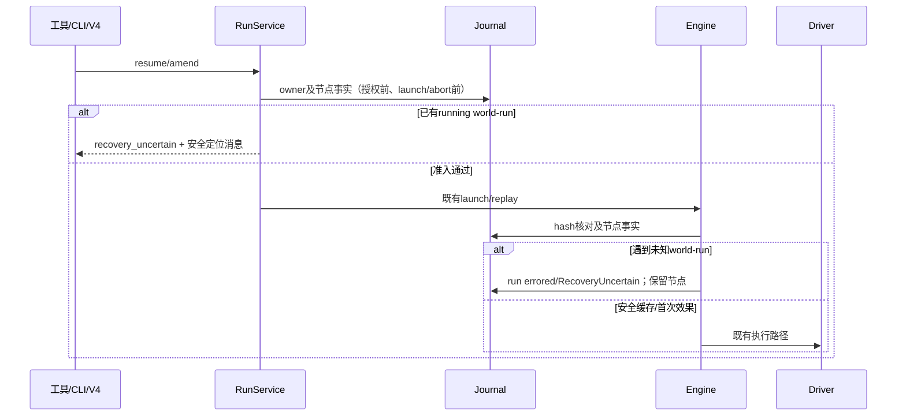

# 未知外部效果的恢复保护

本入口对应已通过独立方案评审的根 spec：
[WF5 未知外部效果的恢复保护](../../../../../docs/specs/workflow-uncertain-recovery.md)。
它演进旧的 running 节点重放合同，不提供全系统 exactly-once。

P2 状态：联合 RED 已确认暖订阅可能保留旧 stopped/resumable/stopReason，真正冷读正确。
阶段 A 已完成原库集成和独立验收；阶段 B 已获授权，Task1–Task5 已在隔离树实现并完成分层验证，Task6 精确原库集成和最终门禁待验收。
A通过不能关闭B，也不代表完整GUI或无人值守验收。

## 父会话的宿主终态观察（阶段 A）

lifecycle 是唯一 run 业务终态写者；DB 成功、terminal 缓存同步后，通过独立
onRunReconciled 回调发布观察，不借 Engine onRunEvent 伪造事件，不写 dwf_event。
复用父会话 DynamicWorkflowRunProgress / run-settled，显式 observationSource 为
host-reconciliation，sequence 严格数值 0（无 journal cursor）；父会话 eventId/raw
sequence 仍由真实 eventStore.append 分配。已有 lastEventSequence 不变，无 run 为 0。

唯一运行时校验放在 shared 既有 zcode-protocol-v4/workflow-runs.ts，公开入口为
@zcode/shared/zcode-protocol-v4。parseWorkflowRunProgressObservation 对无自有 source 键
返回 legacy；有 source 则必须满足根 spec 的窄 host 合同，未知 source/非法组合为 invalid，
不能降级。构造器、runtime、product projection 与 shared reducer 均复用它；非法输入在
append/水位/提醒/telemetry/状态变化前拒绝。runtime 前门记录稳定 reasonCode 与安全 run/session；
product 的既有 event-normalizer / normalizeConversationEvent 入口在变更前安全抛错，
不改超长 product-projection 文件；shared reducer 对 invalid 保持纯 null 返回，不影响 TUI。
gateway 缓存 apply 失败并上抛，由真实 runtime 订阅调用者既有 warn
记录；冷 hydration 以订阅失败返回。generic apply 不保证 gateway.onError，不借 telemetry
旁路诊断，不输出原始 payload。shared 保持纯函数，不引入新 module/反向依赖。

链路固定为 host 回调→既有 sink→真实父 runtime.record→同一 eventStore→真实
subscribeEvents→gateway publisher→shared reducer。shared 所有终态先去旧
resumable/stopReason/supersededBy/error 再补新合法字段，保留节点、结果、usage 和
resumedFrom。source0 不抬 journal 刷新信号；终态头、Resume、错误正文读 run 投影，
workspace 清单/正文没有新事实，不因此重查。若验收发现实际查询依赖终态，按终态事实
单独触发读取，不伪增 cursor。构造期 runtime 未就绪由 cold row 恢复；safe amend
最后 scan→abort 不加 await。host 不携 launchInputId、显式跳过 Engine telemetry，
不重复完成通知或唤醒模型。

受支持旧远端消费新 publisher 的既有 snapshot/delta 可兼容；旧 reducer 直读原始 progress
仍可能保留旧字段，不承诺全旧版本修复。continuous 与 replayable 各自验证。

A 在线 GREEN 按真实 server 的 subscribeReserved→接纳 initialWires→dispatch.commit
顺序激活订阅，再捕获真实 context.notify 后续通知；使用 subscribe 包装时须证明激活
等价并分别接纳初始帧。flushNow 仅是逻辑投影探针，不能代替真实通知。冻结 RED 的
gateway.subscribe 内部已自动 commit，没有漏提交；它仍证明暖重订阅快照错误，未证明
物理 transport 或持续在线通知，不冒称 Desktop IPC/GUI 或跨 Host 验收。

## 未完成的观察可靠性（阶段 B，必做）

两个既有职责按根 spec 精确纳管：workflow-progress-payload（agent-runtime/app）与
workflow-telemetry-facts（conversation/app），requires 均为 shared/zcode-cli。公开既有函数文件
及类型 contract，五件跨精确 src/tests roots 聚合；contract tests 由现有 Vitest 发现并执行。
保持调用路径，不加 wrapper/状态，不豁免架构规则，也不纳管整个 app 或协议目录。

A 沿原 sink 报 runtime unavailable/append rejected，并保留现有单 sink 失败日志；
sink 复用 shared parser，仅 legacy 保持旧错误正文合同；host/invalid 同步和异步失败均只记
安全身份、source 分类与 reasonCode，不记录任意 error.message/String(error)。
callback/record resolve 不证明 projection commit。持久成功、观察失败的自动恢复要求仍未完成，
用户再次拒绝或重启不算无人值守保证。

B合同以根spec的“P2阶段B”为准：

- sink仅在合法host且构造时已注入protocol stored hook时调用新recorder，失败不得fallback。明确非protocol/TUI无hook保留旧recorder与A校验；invalid仍安全拒绝。protocol parent-record factory必须在app构造前注入捕获原owner的闭包，record未就绪/gateway缺席时明确安全失败，禁止条件省略hook或noop成功。
- host-only recordWorkflowHostObservation(input, onStored): Promise<void> 创建一次身份；events.ts内部共用阶段在真实store确认后、durable/usage/fanout任何await前同步安全交接。公开appendEvent(event,traceContext)、旧recorder和SessionEventSink合同不变。methods/index.ts显式绑定新方法。
- hook在调用recorder时传入，不等返回；throw安全隔离且普通fanout继续。reject-but-present按同id精确查证后立即交接、零重append；仅原append已settle且权威absent才同事件串行再试一次。任意自定义store append或必要lookup未settle不能伪称全recorder有界。
- store后的普通sink永久pending不能阻挡record adapter接单、25000ms总deadline和实际commit核实。job的正常observer段上限1000ms，最多一次strict，不轮询。hook/正常subscription同event join；dispose/unsubscribe先撤销owner，迟到结果不按sessionId转交新record。
- direct parent record/eventStore查恰好一条真实身份；同run较新errored、seen、loaded ids或generic applied均不足证明本event已apply。host专用admission证明与strictAttempted/永久失败按gateway同generation per-event保留，不随job finally或recent-tail清除。strictAttempted表示该event/generation曾消耗strict；strict成功后重复已commit快返仍true，永久失败重复沿原元数据，未尝试才false；adapter不复制owner。
- old flight结束后原子取得同session strict slot；strict loader不走child fallback或空降级。全部采用字段/seed读取、candidate逐事件replay与buffer/raw tail完成后，最后同步核owner/generation/deadline再adopt既有publisher；保订阅、epoch和reservation恢复边界。generic失败保护在整个loaded replay与tail都过滤，不能仅复制failed map。
- host等待取消仅结束本observer，不改generic TurnStarted取消/timeout保护，不扩permission allowlist。publisher commit与wire/client apply分层；发帧失败只走既有resync，不重append/业务效果。
- host可带toolCallId；usage无upsert是因事件类型不匹配ToolCall*/Permission*分支，而非字段缺席；registry前置仍可能reject，因此hook必须更早。
- 新record adapter精确模块workflow-host-observation，owner=conversation、layer=adapters、requires=[shared,zcode-cli]；roots仅adapter文件/自身契约目录/自身tests目录，五件与精确policy块见根spec和既有计划。不纳管整个协议目录，不刷新上游snapshot/baseline。

B01–B23见根case catalog；B21真实内存store+前置deferred sink、B22换代后释放、B23三独立hook/usage注入为必测。legacy Engine/TUI、permission、generic waiter、普通hydration/oversize/batch/reservation都要定向回归。当前只是spec/plan；B、真实GUI、跨Host和长期运行仍待验证。

当前阶段证据：Core 定向工具 21 项、CLI node:test 22 项、V4 resumeWorkflowRun 6 项与
私有 SQLite/IPC 强杀 1 项已通过；RunService 冷热准入与读面由 Task3 独立验证。
CLI typecheck 与 lint 退出 0，最终原库集成与整体门禁仍由主任务完成。

RunService 是恢复/修订准入的唯一所有者，Engine 是效果派发的执行所有者。
已有 `running` 的 `world-run` 表示结果未知，不能根据命令文本判断是否安全重跑。
服务返回 `recovery_uncertain` 和可信 `runId/siteId/ordinal`；无 live 的本 owner 旧
stopped/孤儿 run 收敛为 `errored/RecoveryUncertain`，同步 terminal registry 读面，
节点保持 running，completed 兄弟结果不变，也不虚构宿主 `dwf_event`。
Engine 在输入 hash 核对后、任何节点写入和 driver 调用前独立拒绝；脚本 catch
不能解锁后续效果。completed/failed 缓存及 running 纯 read 保持原合同。

Core 的 ResumeWorkflowRun/AmendWorkflow 沿原 `ToolHandlerFailure` 的
`result/errorCode/message` 返回专用失败；本地码分别为 18 和 30。CLI 用事实文本，
V4 沿 `fault.command.workflowRunResumeRejected.recovery_uncertain` 和既有 ACK.message
进入 UI 的 generic/detail。消息只包含可信 run/instance 标识、结果未知与需核实，
不暴露 command/input/result，不自动推荐新 run 或修订重跑。不增加通知 kind 或 locale。

权限谓词、用户停止、新 provider 与 CTRL 授权保持原合同；服务门无条件拒绝未知前驱，
无论原权限分类或确认结果如何都不创建替代 run。首版没有 force、receipt 导入或重放批准入口，
普通继续、取消、换 runId 或用户确认都不证明外部效果已经核实。

定向证据分层：Core 工具、CLI node:test、真实 V4CommandExecutor、真实 RunService/harness，
以及私有 SQLite/IPC 强杀 Engine fixture。强杀场景在第二次效果 append+sync 后、driver
返回前终止子进程，全新进程同库恢复应保持两种效果各一次，恢复 driver 调用为零，
第一节点 completed 原样、第二节点 running 原样、run errored/RecoveryUncertain。
这不等于客户端 E2E、跨 Host、掉电/WAL 硬断电或 24h soak 验收。

### E2E1-P2-B strict 旧 base 恢复边界补充（accepted-planned，尚未实现验收）

同 epoch 的重建 candidate seq 不能作为原日志同一前缀的证明。strict 在 candidate 内提升 `seq=max(candidate.seq,previous.seq+1)`、`revision=max(candidate.revision,previous.revision+1)`，采用后清 log 并设 floor 为新 seq。previous/candidate 两水位、previous+1 与最终值都须是非负安全整数，previous+1 必须严格递增且可表示；失败不 clamp、不归零、不换 epoch，零 live adopt。新增窄同步 ProductProjection.advanceRecoveryBoundary(minimumSeq,minimumRevision) 只改候选水位，验证先于边界写入，保留业务字段及真实可选初始化状态，不写 snapshot 返回引用、不伪造事件/初始化或 applied proof。

先在 candidate 完成数值校验、水位提升与最终 logical size 校验，成功后才在同步段切换 live projection/log/floor 和订阅 reservation。数值或最终 size 失败可使 token 失效，但 live snapshot/log/floor/subscriptions/reservations 原样。两个 profile 的 reconnect/same-sub resync 旧 base 必须 snapshot；新 snapshot base 可 resume，后继事件正常 delta；旧 revision 命令按既有 CAS stale。定向覆盖无初始化时 candidate 水位小于/等于/大于旧值、安全整数边界和最终 size 原子性；普通 rehydrate 的 batch/oversize/初始化 patch 及原 epoch 不变，不新增 schema。

本修订仅扩大一个既有 source 白名单 `packages/bootstrap/src/zcode-protocol-v4/product-projection.ts`，Task3 为该文件、conversation-topic-publisher.ts 与原 publisher 测试三文件。最终 L1 为 22 个绝对 TS 目标，精确 argv 与计数以根实施计划为准。保留 Task5 原旧 base 断言，由原测试作者独立复跑后判断联合缺口；本文不表示实现或 V5 已通过。

### E2E1-P2-B 取消诊断补充（accepted-planned，尚未执行）

B13/B22 追加：gateway result/安全error的strictAttempted保持真实boolean，adapter仅failed outcome在未取得权威历史时允许unknown，成功不得unknown；未知不能猜false。合规gateway abort必须同步reject原返回Promise，Task4闭包直接透传，adapter abort返回后仅一次microtask兜底unknown。验证true/false、历史重复、verify阶段失败、永久pending/malformed错误、已settled未消费、监听顺序、dispose先拒绝后清表、迟到零adopt及一次终结/资源清理。Task2注入端口与Task4真实gateway联合分别存证，不宣称物理GUI/网络通过。invalid仍可用旧recorder作A校验，零append/hook/model。
