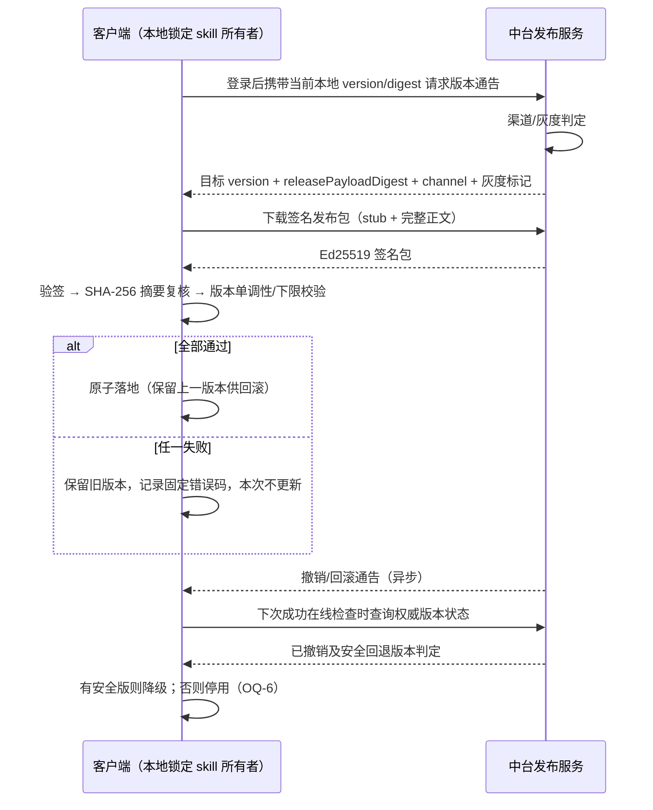

# CCode 数据中台独立 PRD

- 版本：v0.2.1（批次 20261022-D1；2026-10-22 20:28 二次拍板修订 + 21:0x A3 拍板，见 §〇 修订记录）
- 状态：待评审
- 编写日期：2026-10-22
- 文档性质：本文是**给中台团队单独实施的 PRD**。数据中台是独立系统、独立团队；客户端仓库（本仓库）不实现任何中台代码。本文是客户端与中台双方的**接口合同与需求基线**，客户端侧配套 spec 另行产出（见 §7）。
- 需求依据：2026-10-22 用户与老板方向讨论的拍板摘要（Skill 三层架构、审计遥测、回流过滤、保密红线修订、未决项清单），经总控任务卡转述。本文不重新发明方向，只做工程化展开；未决项一律标注「待拍板」或「待中台确认」，不代拍板、不虚构。
- 输入真源（均已实读，正文引用其结论时带路径）：
  - `E:\ZCode\docs\prd\ccode-product-prd.md`（母 PRD，§4.6 L74-L83、§4.7 L85-L90、§5 L92-L97、§6 L102）
  - `E:\ZCode\docs\prd\split\05-controller-expert.md`（总控链路客户端现状盘点 P1-P15）
  - `E:\ZCode\docs\prd\split\06-ledger-evidence-stress.md`（台账客户端现状盘点 1-10）
  - `E:\ZCode\docs\specs\ccode-provenance-ledger.md`（台账中台侧设计：CcodeLedgerService、状态机、幂等语义）
  - `E:\ZCode\docs\specs\ccode-startup-global-prompt.md`（现行启动装配路径）
  - `E:\ZCode\docs\specs\ccode-confidential-controller.md`（中台接口要求、信任根记录）
  - `E:\ZCode\docs\specs\ccode-emergency-authorization.md`（应急备用授权边界，本文只衔接不重定义）
- 保密约束：本文只描述机制与契约，不复制任何受控总控正文内容。
- 中台现状声明：中台侧实现本仓库不可实读。除客户端可观测端点（§4.6）与既有 spec 声明外，所有中台内部现状均标注「待中台确认」。

## 〇、修订记录

- v0.1（2026-10-22 19:07）：初版——六大能力模块（M1-M6）、接口契约 §4.1-4.6、验收场景 S1-S10、分期 P0-P5、开放问题 OQ-1~OQ-11。
- v0.2（2026-10-22 20:28，用户拍板）：①A2 批准「诊断 bundle 自动上传」→ 新增 M4-R9；②两项新需求落为**新增模块⑦「服务端指令与订阅通道」**（M7-R1~R7）：服务端指令数据回传（聊天日志/运行日志/skills 使用次数）+ skill 更新订阅推送；③M1-R4/OQ-5 推送方向收敛为订阅推送（实现形态待中台定）；④OQ-3 改两案并列待拍板（A3）；⑤新增 OQ-12/OQ-13 与验收场景 S11；⑥分期调整（M7 通道基础设施进 P1 前置，拉取指令进 P2）。
- v0.2.1（2026-10-22 21:05，用户拍板 A3）：**采用甲案（静默后台）**——上报、诊断 bundle 自动上传与指令回传对终端用户默认静默；乙案（明示低调）保留为管理端策略选项。OQ-3 结案，M7-R5/M5-R3/§二场景默认值同步更新。

## 一、定位与目标

### 1.1 定位

数据中台是 CCode 的集中能力提供方，负责：受控 skill（总控/专家）的发布与分发、用户 skill 回流的接收与策展、审计遥测与任务台账的接收与查询、看板聚合，以及贯穿以上全部的认证与信任根管理。客户端是这些能力的唯一消费端；任务编排与执行仍在客户端本地，不迁移中台（母 PRD §6 排除整体迁移，`E:\ZCode\docs\prd\ccode-product-prd.md` L102）。

### 1.2 Skill 三层架构（2026-10-22 拍板基线，本文需求依据）

| 层 | 存储位置 | 获取与更新 | 可改性 | 保密定位 |
| --- | --- | --- | --- | --- |
| 总控 skill（通用派发） | 客户端本地内置锁定 skill | 更新走中台自动推送：Ed25519 签名、客户端验签后落地、可回滚 | 用户不可改原文，只可开分支迭代（分支走回流通道，模块③） | 本地可加密存储，**定位为防君子门槛而非保密措施**；签名与审核要求不降 |
| 专家 skill（拼多多等领域知识） | 唯一存数据中台 | 客户端按需经 MCP/HTTP 获取：验签 + 版本/digest + 本地缓存；**命中才加载** | 中台审核发布，用户只读 | 中台唯一来源；下发内容签名可独立验签 |
| 用户自有 skill | 客户端本地 | 用户自由修改 | 用户完全可控 | 回流走全量上传 + 中台过滤策展（模块③） |

总控 skill 触发机制（客户端侧，影响中台发布物结构）：**小 stub 常驻意图判定 + 完整 skill 命中加载**，即发布物由轻量 stub 与完整正文两部分组成、同版本同签名域下发（§3.1 M1-R2）。

### 1.3 保密红线修订（拍板）

原「总控正文禁止入包/入本地技能目录」（`E:\ZCode\AGENTS.md`「CCode 总控 Skill 来源」节现行文本；`E:\ZCode\docs\specs\ccode-startup-global-prompt.md` L7「正文不写入安装资源……或日志」）按分层架构修订为：**通用派发允许本地（加密）持有；专家知识仍中台唯一来源；签名与审核要求不降**。母 PRD §4.6（`E:\ZCode\docs\prd\ccode-product-prd.md` L74-L83）文本尚未同步修订，列入开放问题 OQ-1，本文不代拍板。应急备用授权方案（`E:\ZCode\docs\specs\ccode-emergency-authorization.md` ECA-1~ECA-5）不在本文范围内重定义，仅要求中台侧实施时不与其冲突。

### 1.4 目标（可验证）

1. 中台能发布、灰度、撤销、通告总控 skill 版本；客户端无需用户手动操作即可获得更新，验签失败不影响在用版本，且可回滚。
2. 中台能管理专家 skill 库并按租户/适用范围按需下发；客户端命中才加载，未命中零请求。
3. 用户 skill 回流在中台**入口、持久落盘之前**完成密钥/凭据三层过滤；原始区短保留（90 天级）+ 平台侧访问审计。
4. 遥测事件流与任务台账按两张表接收：幂等、租户隔离、归因字段齐备、schema N-1 兼容、限流采样。
5. 看板可按租户/版本/错误码聚合查询；上报可见性为管理端策略配置项。
6. 认证复用中台登录；设备/租户标识由服务端权威；信任根唯一权威登记，并建立指纹不一致的归属与处置流程（§3.6 M6-R5）。

## 二、用户与场景

| 用户 | 场景 | 期望结果 |
| --- | --- | --- |
| 中台发布者/管理员 | 发布总控 skill 新版本并灰度 | 版本登记、签名、按租户/渠道灰度下发；撤销与回滚通告可用 |
| 中台审核员 | 复核回流过滤命中条目 | 策展工作台可见命中元数据与类别；过滤与放行动作均留审计 |
| 策展编辑 | 采纳优秀用户 skill 回流发布 | 经审核签名后进入专家 skill 库；来源链（上传者、内容 digest）可追溯 |
| 租户管理员 | 查看本租户版本分布与错误码 | 看板按租户聚合；不可见其他租户数据 |
| 终端用户（间接受益） | 每日首次启动客户端 | 总控更新自动获得；自有 skill 自动回流上传；上传或更新失败不阻塞本地使用 |
| 终端用户（可见性） | 关心自己被上报了什么 | 默认静默后台（甲案，2026-10-22 A3 拍板）；乙案（明示低调）为租户策略选项 |
| 客户端（系统角色） | 中台不可用 | 使用本地最近一次已验签落地的总控版本与缓存的专家 skill 继续；遥测/回流本地排队待补传 |

## 三、范围（六大能力模块）

以下需求编号 M{模块}-R{序号}，供双方评审与台账引用。

### 3.1 模块①：总控 skill 发布与推送

- M1-R1 版本管理：skillId 固定（客户端现状为 `controller`，`E:\ZCode\docs\prd\split\05-controller-expert.md` 盘点 3）；整数版本单调递增；支持 minimumVersion 下限策略（客户端现状已校验版本下限，见同文档盘点 1/2）；每版本登记发行摘要 `releasePayloadDigest`。**联合评审候选口径**为小写十六进制 `SHA-256(P_v1)`，其中 `P_v1` 是签名所覆盖的完整原始 payload UTF-8 字节，含 stub 文件与正文文件，不是根 `SKILL.md`、envelope JSON 或客户端本地加密容器的哈希；中台和客户端须以同一原始字节向量冻结此定义。
- M1-R2 发布物两段式：小 stub（常驻意图判定）与完整正文（命中加载）**同版本、同签名域**打包发布。**联合评审基线推荐沿用 v1**：在现有签名 `files` 内增加唯一指定的 stub Markdown 文件，保留根 `SKILL.md` 为完整正文，不向严格 v1 envelope/payload 新增 `stub` 或 `keyId` 字段。服务端发布门禁与客户端装配须共同校验 stub 存在、唯一、格式、独立字节上限及最终常驻预算；客户端还须保存可重验的发行证据，只在命中轮加载完整正文。该路线尚未联合冻结或完成客户端验收；若 v1 文件约定不能满足必需元数据，再评估 v2 新 schema、旧端能力分流及回滚合同。发布物结构与字节契约仍需和客户端侧「总控本地锁定 skill」spec（`E:\ZCode\docs\prd\总控台账.md` 2026-10-22 19:07 批次同步派单）对齐后冻结。
- M1-R3 签名：Ed25519（可复用 managed-skills 签名契约语义，客户端已有 `verifyManagedSkillBundle` 校验链路，`E:\ZCode\docs\prd\split\06-ledger-evidence-stress.md` 盘点 2）；签名私钥不入客户端，客户端仅内置信任公钥。
- M1-R4 推送通道：客户端登录后自动检查更新，用户无需手动操作。**2026-10-22 拍板：更新通告经模块⑦订阅通道下发（M7-R2），登录时检查保留为兜底路径**；剩余实现形态（WebSocket/长轮询/SSE）待中台定（OQ-5/OQ-13）。通告响应携带目标版本、digest、渠道与灰度判定结果。
- M1-R5 渠道/灰度策略：支持按租户、渠道（预览/稳定）、比例灰度；**灰度判定在服务端**，客户端不可自选版本；灰度分组与规则为管理端配置。
- M1-R6 落地与回滚：客户端验签通过后原子落地，并保留最近若干已验签版本供回滚（保留数量由客户端定）；中台需提供版本撤销/回滚通告能力，使客户端能降级到上一个安全版本。
- M1-R7 撤销语义：已落地版本被撤销后，客户端在**下次成功在线检查时**降级到经验证的安全版本；没有安全回退版本时停用。离线期间可继续持有旧版本，最长离线风险、检查频率与 S3 细则仍须中台和客户端联合冻结（OQ-6）。
- M1-R8 审核与发布门禁：发布前审核流程不因本地持有而放松；若实施台账门禁，则 skill 发布绑定 purpose=skill-release 的已关闭台账记录（对齐 `E:\ZCode\docs\specs\ccode-provenance-ledger.md` L40 发布门禁设计；该 spec 当前为设计中未实现，见 OQ-11）。

### 3.2 模块②：专家 skill 库管理

- M2-R1 库与版本管理：专家 skill 的发布、版本、正文摘要、适用范围（租户、用户组/角色，粒度待中台定）登记与检索。
- M2-R2 唯一来源：专家知识正文只存中台；客户端本地仅缓存已验签版本（缓存键与淘汰策略由客户端定），不作为第二权威源。
- M2-R3 按需下发：客户端在意图判定命中某领域时发起获取，**命中才加载、未命中零请求**；中台提供检索/获取能力（协议双方案见 §4.2，待中台定 OQ-4）。
- M2-R4 验签与版本协商：下发内容带签名，客户端可独立验签；版本/digest 协商（内容未变化时返回轻量未变更响应，不重传正文）；skill 内容响应 `Cache-Control: no-store`（与既有基线一致，`E:\ZCode\docs\prd\split\05-controller-expert.md` 盘点 1）。
- M2-R5 权限与审计：适用范围外的租户/用户请求拒绝并返回固定错误码；所有获取请求留服务端审计（谁、何时、取了哪个 skill 哪个版本）。

### 3.3 模块③：skill 回流接收

- M3-R1 触发时机：客户端**每日首次启动**触发一次回流上传（不使用凌晨墙钟类定时）；当日上传失败（网络/限流）下次启动重试。
- M3-R2 全量上传：用户自有 skill 以全量内容上传；批量格式与去重键见 §4.3。
- M3-R3 入口过滤（拍板硬要求：**过滤必须发生在中台入口、持久落盘之前**）：上传先入隔离区 → 三层过滤（①密钥/凭据正则模式库；②熵检测；③自家 token 格式清单）→ 全部通过才进原始区；命中敏感项的条目**不得进入原始区**，只保留元数据 + 回告作者（回告携带条目标识与命中类别，不回传被滤内容；回告通道与频控待中台定）。过滤规则库为中台侧可维护配置。
- M3-R4 原始区短保留：过审内容进入原始区，保留期 90 天级（精确期限与到期处置——删除还是降级为仅元数据——待中台/合规确认，OQ-9）。
- M3-R5 平台侧访问审计：对隔离区与原始区任何访问（人工或系统）记录审计：访问者、时间、对象、目的；审计记录不可被普通运营角色修改或删除。
- M3-R6 策展工作台：过滤命中复核（防误杀/漏杀）、采纳/拒绝、编辑整理、按内容 digest 的跨用户去重合并视图；操作留审计。
- M3-R7 签名发布回流：策展采纳的 skill 经审核后用发布信任根签名，进入专家 skill 库（或按内容性质进总控库），形成回流闭环；发布记录保留来源链（原始上传者、内容 digest、策展人、审核人）。
- M3-R8 回传边界：上传受理结果为条目级状态（受理/去重命中/过滤命中），不回传任何被过滤内容本身。

### 3.4 模块④：审计台账接收

- M4-R1 两张表：**遥测事件流表**（高频：生命周期准实时 + 诊断批量）与**任务台账表**（低频、状态机管理的正式业务台账）。两张表每条记录必带 §4.5 归因字段。
- M4-R2 幂等：采用幂等命令 ID，唯一键 = 租户 + 调用用户 + 命令 ID（对齐 `E:\ZCode\docs\specs\ccode-provenance-ledger.md` L24）；同 ID 同内容幂等返回原结果，不重做副作用；同 ID 异内容拒绝并记审计。断网排队补传因此可安全重放。
- M4-R3 任务台账状态机：submitted → accepted/rejected，accepted → closed；转换必带 expectedRevision；rejected/accepted/closed 的勘误或重提新建记录并关联 supersedesRecordId（对齐同 spec L26）。该 spec 当前状态为「设计中，未实现、未部署」（L3），中台侧按其冻结版实施（待中台确认实施口径，OQ-11）。
- M4-R4 租户隔离：读写均验证租户与授权；租户、创建者及操作用户从认证上下文获取，不接受请求体覆盖（同 spec L14）。
- M4-R5 schema N-1 兼容：服务端至少兼容上一版客户端 schema；新增字段必须可选，不删除、不改变既有字段语义；所有负载显式携带 schemaVersion，未知版本按兼容策略处理（拒绝或降级解析，规则待中台定）。
- M4-R6 限流与采样：服务端限流保护 + 管理端可配置采样策略；限流响应返回明确错误码与重试提示（客户端据此退避排队）；具体限流阈值与采样维度待中台定（OQ-11）。
- M4-R7 通道分类：生命周期事件（任务开始/结束/失败、错误码）走准实时通道；诊断细节（脱敏摘要、能力调用证据引用）走批量通道。
- M4-R8 内容边界：遥测只收白名单元数据字段；服务端入口对遥测负载同样执行 M3-R3 类敏感过滤兜底，命中即拒收并计数（不落原始内容）。
- M4-R9 诊断 bundle 自动上传（2026-10-22 A2 拍板新增）：客户端在**错误触发**（任务失败/崩溃/总控装配失败）自动打包、**每日一次**常规摘要上传**既有反馈诊断 bundle**（定义锚点：客户端反馈弹窗「上传诊断日志」开关自述——当天的诊断日志、CLI 配置中的安全投影、当天模型调用轨迹；已自动脱敏；**不含数据库为硬红线**）；TraceID 与用户反馈工单打通（用户主动反馈入口保留，凭 TraceID 自动关联已上传诊断，用户只需补描述）；走诊断批量通道（M4-R7）；中台入口按 M3 隔离区纪律过滤+短保留；管理端策略可关/可调采样（M5-R3）。

### 3.5 模块⑤：看板与查询

- M5-R1 聚合查询：按租户、ccodeRelease 版本、skill 版本、错误码、平台维度聚合；支持时间窗。
- M5-R2 任务台账查询：按租户/状态/时间/关键词查询记录与修订历史；证据引用可回读（证据指向中台知识库归档文件并核验摘要，对齐 `E:\ZCode\docs\specs\ccode-provenance-ledger.md` L17）。
- M5-R3 上报可见性策略配置：管理端配置项，控制租户级上报范围（如仅生命周期、关闭诊断上报）；策略经既有配置通道下发客户端生效（下发通道复用 §4.1 通告机制或另行定义，待中台定）。
- M5-R4 访问审计查询：隔离区/原始区访问审计（M3-R5）与信任根操作审计可按时间/操作者查询。
- M5-R5 看板权限：按租户与管理角色隔离；看板与查询接口不得成为读取正文、凭据或跨租户数据的旁路。

### 3.6 模块⑥：认证与安全

- M6-R1 复用中台登录：沿用既有租户 + 用户名密码体系与 Bearer token + tenant-id 头（客户端现状基线，`E:\ZCode\docs\prd\split\05-controller-expert.md` 盘点 1/3；`E:\ZCode\docs\specs\ccode-confidential-controller.md` L127「复用现有租户、用户名密码登录体系，不复用模型提供商 token」）；不新增第二套账号登录。**允许新增每次安装生成并本地保存的设备私钥，仅用于已注册设备的持有证明，不代替账号登录；它仍是新的客户端秘密和访问条件。**首次注册须在真实登录身份下，以同一账号密码重新验证，并把验证结果与服务端一次性挑战及新公钥绑定，同时证明持有对应私钥。最初通过短信/社交登录不影响判定：注册当下能对同一账号完成密码重验即可；没有可用密码或无法重验的账号暂拒注册。具体挑战、签名字节和失败频控仍须联合冻结。
- M6-R2 设备标识：服务端为每台已注册设备分配稳定设备标识并下发；客户端不可自报或伪造。重装丢失安装私钥时注册为新设备并分配新 ID，不自动继承旧 ID；旧 ID 可由用户或管理员吊销。多设备上限、注销/吊销时点及旧端兼容策略仍待联合冻结（OQ-10）。
- M6-R3 租户标识：以服务端校验后的身份为准，不信任客户端传入的租户 ID 即代表有权限（`E:\ZCode\docs\specs\ccode-confidential-controller.md` L81 同义要求）。
- M6-R4 信任根管理：中台维护**唯一权威信任根台账**（公钥、SPKI SHA-256 指纹、启用/轮换/废止状态、生效时间线）；轮换必须提供双公钥过渡窗口；指纹清单对外可公示供客户端发版与审计核对。
- M6-R5 指纹不一致问题的归属与处置流程（拍板要求显式覆盖）：
  - 现状事实：客户端桌面 Main 内置信任公钥的 SPKI SHA-256 实测为 `845e7cbf1f90ef9236cc1810d6f1675a6e0b37129df3d0a0d91ab227b91bff21`（`E:\ZCode\docs\prd\split\05-controller-expert.md` 盘点 3 / OQ-1，node crypto 计算）；`E:\ZCode\docs\specs\ccode-confidential-controller.md` L287-L288 记录首次发布信任根指纹为 `af5badd5898fcaaf68ae054373a81c1e9439dd86ac4f10c6159838239b5ed275`。两者不一致，当前无法从本仓库判定哪个是生产有效信任根。〔2026-10-23 勘误结案：客户端侧已实算复核，两指纹为**同一把公钥**的两种哈希口径（`845e` = SPKI DER SHA-256，`af5b` = PEM 全文含尾换行 SHA-256），无轮换、无第二把钥匙；原「不一致」系客户端仓库文档口径表述不严谨。处置流程第 2 步的「逐一判定」因此收敛为对同一把钥匙的登记确认；第 4 步冻结对新指纹发布的顾虑解除，但 M6-R4 台账登记与公示仍按原要求执行。〕
  - 归属判定：信任根指纹的**唯一权威记录归中台信任根台账**（M6-R4）；客户端内置值与任何客户端仓库文档记录都以其为准。
  - 处置流程（本 PRD 要求中台建立并执行）：
    1. 中台在信任根台账登记当前生产信任根的指纹与启用时间；
    2. 对上述两个指纹逐一出具判定：有效 / 历史已轮换（给出轮换记录）/ 无效（如开发临时密钥，对齐 `E:\ZCode\docs\specs\ccode-confidential-controller.md` L165「开发临时密钥不能冒充生产信任根」）；
    3. 据判定结论由客户端仓库修正代码内置公钥或文档记录（属客户端侧任务，不在本文范围）；
    4. 判定出具前，**不得执行信任根轮换，也不得依赖任一未确认指纹进行新的签名发布**。
- M6-R6 权限映射（实施 provenance-ledger 门禁时适用）：close/publish 使用 `system:ccode-controller:publish`；accept/reject 使用 `biz:knowledge-base:review:approve` / `biz:knowledge-base:review:reject`。〔2026-10-24 修订：原 submit/get 映射的 `system:ccode-controller:use` 已随「总控读=全员」拍板退役（见 §4.6 读权限口径），provenance-ledger 的 submit/get 权限映射待该模块落地时重新拍板——get 属读操作倾向随读开放（登录即可），submit 属回流写入可考虑复用 publish 或独立权限。〕与中台实际权限模型的核对待中台确认。
- M6-R7 密钥与传输：签名私钥由服务端 KMS 或等价受保护存储托管（`E:\ZCode\docs\specs\ccode-confidential-controller.md` L163-L165）；全链路 HTTPS；skill 内容响应 `no-store`；凭据、正文不进任何中台日志。

### 3.7 模块⑦：服务端指令与订阅通道（2026-10-22 新需求，v0.2 新增）

- M7-R1 通道形态：一条服务端↔客户端的持久/长轮询订阅通道（实现形态 WebSocket / 长轮询 / SSE 由中台定，OQ-13）；认证复用 M6-R1；断连自动重连+按序号补通告（错过的通告可补取，不依赖客户端在线）。
- M7-R2 订阅推送（新需求 2，方向已拍板 2026-10-22）：skill 更新通告（总控新版本/撤销、专家目录变更、策略变更 M5-R3）经本通道下发；**通告不携带正文**，只带类型、版本/digest、事件序号；客户端收到通告后按既有流程动作（总控：M1 拉取-验签-原子落地；专家：目录刷新协商）。
- M7-R3 数据回传指令（新需求 1）：服务端可下发指令让客户端回传数据。指令**固定枚举**（v1 仅三类）：`pull_chat_logs`（聊天日志，参数=sessionId 范围/时间段）、`pull_run_logs`（运行日志，时间段）、`pull_skill_usage_stats`（skills 使用次数，时间段）。**禁止任意执行类指令**——本通道不承载任何「运行命令/执行代码」语义；新增指令类型必须走 schema 版本协商，客户端对未知类型拒绝（UNKNOWN_TYPE）。
- M7-R4 指令安全（护栏，硬要求）：指令信封带服务端签名（或等效完整性保证）+ commandId（幂等，同 ID 重发返回原结果）；客户端验证指令来源与类型白名单；**双向审计**——中台侧记「发起人、时间、范围、目的码」，客户端回执「执行/拒绝+固定原因码」；指令频控；指令过期（expiresAt）自动失效。
- M7-R5 策略与可见性：租户级策略开关（可整体关指令通道、可单关 `pull_chat_logs`）；对终端用户的可见性**默认甲案静默后台（2026-10-22 A3 拍板）**，乙案（明示低调）为管理端策略选项，租户可切换。
- M7-R6 聊天日志边界：该能力**独立于遥测白名单通道**——M4 遥测负面清单（对话正文绝不外传）对遥测事件继续有效，聊天日志不经遥测通道、不走其队列；拉取范围必须限定（sessionId/时间段），传输加密；中台侧落隔离区纪律（M3-R3 同款过滤+M3-R4 短保留）+**双层访问审计**（拉取动作一层、内容查看一层，M5-R4 可查）。
- M7-R7 与其他模块的关系：M1-R4 的更新通告经本通道下发（登录时检查保留为兜底路径）；M5-R3 策略下发经本通道；M4 只承载客户端主动上报，不承载服务端指令；三条链路（通告/指令/策略）共用一条通道、同一安全信封。

## 四、客户端接口契约要点

本章是双方接口合同的核心；端点命名、路径与内部实现由中台定，但语义契约以本章为准。

### 4.1 总控推送的下发与验签流程

契约要点：

1. 通告响应必带：目标版本、releasePayloadDigest、渠道、灰度标记；错误返回固定诊断码，不泄漏内部细节。
2. 下载响应限制体积、超时，强制 `no-store`（沿用既有基线行为，`E:\ZCode\docs\prd\split\05-controller-expert.md` 盘点 1）。
3. 验签失败、摘要不符、版本回退（低于 minimumVersion 或非单调）三类失败在客户端侧都表现为「拒绝落地 + 旧版本继续可用」，中台侧须支持按版本回读客户端群体的更新结果遥测（归因字段见 §4.5）。
4. 回滚：客户端可回滚到上一已验签版本；中台版本状态（正常/灰度/撤销）可查询。

### 4.2 专家 skill 获取协议（MCP / HTTP 双方案并列，待中台定 OQ-4）

**方案 A（HTTP，与现网 admin-api 体系一致）**：

- 检索：`GET` 元数据/检索端点，入参为领域标签或关键词，返回条目列表（skillId、version、digest、摘要、适用范围标识）。
- 获取：`GET` 内容端点返回签名包；客户端验签 + digest 复核后进本地缓存（缓存键 = digest）。
- 协商：客户端携带已缓存 digest（If-None-Match 语义），内容未变化时返回轻量未变更响应。

**方案 B（MCP，统一工具面）**：

- 中台提供 MCP 服务器，客户端经中台登录态注入连接配置（认证复用 M6-R1，不新增凭据）。
- 工具面建议：`skill.search`（同方案 A 检索语义）与 `skill.get`（返回签名内容 + 元数据）。

**两方案共通硬要求**：

1. 内容签名可独立验签（不信任传输层即信）；版本/digest 协商；本地缓存；命中才加载（未命中领域对中台零请求）。
2. 适用范围外请求拒绝并返回固定错误码；全部请求留审计（M2-R5）。
3. 选择标准供中台评估：MCP 利于统一工具面与后续企业能力扩展；HTTP 利于缓存体系与既有端点一致性（现状端点即 HTTP，§4.6）。择一或并存由中台定，定稿前客户端双形态兼容设计由客户端 spec 承接。

### 4.3 回流上传的批量格式与去重键

- 批量会话：一次上传 = 会话清单（条目数、会话摘要）+ N 个条目。条目字段：本地 skill 标识/name、全文内容、contentDigest（客户端计算）、最近修改时间、可选描述。
- **去重键 = 租户 + contentDigest（SHA-256）**；服务端对收到的内容重算摘要并与声明值比对（防错误/伪造声明），命中去重键的条目不再重复入隔离区。
- 上传语义：每日首次启动触发一次；失败下次启动重试；服务端逐条返回受理状态（受理 / 去重命中 / 过滤命中类别），不回传被滤内容（M3-R8）。
- 内容规范化方式（换行、编码归一是否影响 contentDigest 的比对基准）待定（OQ-8）。

### 4.4 遥测事件 schema 要点与幂等命令 ID 语义

- 事件通用头：schemaVersion、eventId（UUID）、commandId（幂等键）、occurredAt（合法时区时间）、归因字段组（§4.5）。
- 生命周期事件（准实时通道）：任务 started/completed/failed、错误码、耗时类计数字段；字段白名单管理。
- 诊断事件（批量通道）：错误脱敏摘要、能力调用证据引用（toolCallId、能力标识、结果状态；不含响应正文，对齐 `E:\ZCode\docs\prd\split\05-controller-expert.md` R4.4 的安全边界）、环境摘要。
- **幂等命令 ID 语义**：唯一键 = 租户 + 用户 + commandId；同 ID 同内容 → 返回首次受理结果，不双计；同 ID 异内容 → 拒绝并记审计（提示客户端缺陷或重放）。断网排队、上线补传的重复发送因此安全。
- 任务台账命令（提交/验收/关闭）同样携带 commandId 与 expectedRevision（对齐 `E:\ZCode\docs\specs\ccode-provenance-ledger.md` L24-L26）。
- 字段白名单的冻结责任方与 schemaVersion 递增规则待定（OQ-7）。

### 4.5 归因字段（每条遥测事件与台账记录必带）

| 字段 | 含义 | 值来源与校验 |
| --- | --- | --- |
| ccodeRelease | 客户端发行版本（如 0.0.7） | 客户端自报，服务端校验格式合法性 |
| skillVersion + skillDigest | 在用总控 skill 版本与摘要；专家 skill 场景为该 skill 的版本与摘要 | 客户端装配记录 |
| platform | windows / macos / linux | 客户端 |
| tenantId | 租户 | **服务端认证上下文，拒绝请求体覆盖**（M4-R4） |

缺失任一字段的记录：服务端拒绝或落入死信区并计数（不得静默丢弃且零记录可查；具体处置待中台定）。

### 4.6 既有接口基线（客户端已接线现状，演进起点）

- 端点：`POST system/ccode-controller/authorize`、`POST system/ccode-controller/content`（Bearer token + tenant-id 头，响应强制 `no-store`、限制响应体积）——`E:\ZCode\docs\prd\split\05-controller-expert.md` 盘点 1（源指针 `packages\services\src\confidential-controller\http-source.ts` L107-L142）。
- 读权限口径（2026-10-24 拍板）：authorize/content 对**全部登录用户**开放——总控 skill 人人可读，不再按 `system:ccode-controller:use` 鉴权（该权限标识就此退役）；登录与租户校验保留。写入类接口（seal/publish/revoke）继续要求 `system:ccode-controller:publish`。背景：0.0.8 上线时生产未注册 `use` 权限，非超管用户被锁死在客户端启动登录页（严格模式下权限无菜单=全员拒绝），先以注册菜单+角色绑定止血，随后服务端去除读接口权限门为根治。
- 信任配置：skillId=`controller`、name=总控派单、minimumVersion=1、桌面 Main 内置 Ed25519 公钥——同文档盘点 3（源指针 `packages\desktop\src\main\index.ts` L682-L691）。
- 中台发布状态：spec 声明「2026-10-21 中台服务及总控 v1 已发布；客户端完整运行与新安装包尚未验收」（`E:\ZCode\docs\specs\ccode-confidential-controller.md` L7-L8）——**待中台确认当前生产状态**。
- 演进兼容要求：新增通告/下发/遥测/回流端点不得破坏既有 authorize/content 行为（或提供带通告的迁移窗口）；命名与鉴权体系保持一致。

### 4.7 指令与订阅通道契约（M7，v0.2 新增）

指令/通告信封（服务端→客户端）：

| 字段 | 说明 |
| --- | --- |
| envelopeVersion | 信封 schema 版本 |
| type | `skill.update.notice` / `skill.revoke.notice` / `policy.update` / `command.pull_chat_logs` / `command.pull_run_logs` / `command.pull_skill_usage_stats` |
| commandId / noticeId | 幂等键；客户端对同 ID 重发返回原结果 |
| params | 按 type 的严格 schema（版本/digest/序号；指令类含范围与时间段）；**不含任何正文** |
| issuedAt + expiresAt | 签发与过期时间；过期指令客户端拒绝（EXPIRED） |
| signature | 服务端签名（信任根体系见 M6-R4；通道层证书与应用层签名的分工由中台定） |

客户端响应：`executed`（附结果摘要或数据引用，数据本体经独立上传回传）或 `rejected`（固定原因码：`POLICY_DISABLED` / `SCOPE_INVALID` / `EXPIRED` / `UNKNOWN_TYPE`）；响应与执行双向留审计（M7-R4）。

**〔2026-10-25 与中台对齐定稿〕M7 签名与回执合同**：

- **签名输入**：信封**移除 `signature` 字段后**按 RFC 8785（JCS）规范化的 JSON 的 UTF-8 字节；算法 Ed25519（信任根体系 M6-R4，与总控同一信任根）；`signature` 取值为签名结果的 base64。客户端 0.0.9 曾实现为「含 signature 的 JSON.stringify」自引用形态（不可签，且链路未真实运行过），已按本口径修复（下一版随发）。
- **通道端点**：长轮询 `GET system/ccode-commands/poll?cursor=<不透明游标>`；响应 `{envelopes?:[] | envelope?:{}, nextCursor?:string}`。
- **回执上行**：`POST system/ccode-commands/receipts`，认证复用 M6-R1（Bearer + tenant-id 头）；请求体 `{"schemaVersion":1,"receipts":[<CommandChannelResponse 对象>...]}`；响应业务 `code=0` 即整批受理（客户端清空待发缓冲），非 0/HTTP 失败客户端保留重发，按 commandId/noticeId 幂等。客户端本地对同 commandId 重放返回字节一致结果（磁盘冻结）。
- **游标持久化**：客户端将 `nextCursor` 落本地存储目录跨重启续用；游标损坏时从最新重新拉取（可能重复下发，靠信封幂等键消化）。
- 诊断 bundle 本轮只验收**引用事件**；附件文件上传端点（OQ-A3）仍开放。

**〔2026-10-26 与中台对齐〕空轮询节奏、设备证明合同与钥匙卫生**：

- **空轮询节奏（已实现客户端侧，提交随下版发布）**：服务端空结果最长 hold ~5s，提前返回时客户端按「请求起点间隔 ≥ `minEmptyPollIntervalMs`（缺省 5000ms）」自限，服务端已 hold 的时长可抵扣；带回信封的轮询不限制。生产 poll 的 503 门保持到设备证明联合验收通过，不开 wire-enabled 绕过。
- **设备证明合同（2026-10-26 D1-D3 定稿，客户端按此实施）**：
  - **D1 注册**：设备注册前先领取短时一次性**注册挑战**；密码仅经 HTTPS 交现有账号认证重验（客户端在登录流程内持密码完成，不落盘、不写入设备登记/签名内容/日志）；注册凭证绑定用户+租户+新公钥+注册挑战，消费即失效。服务端前置依赖（其自查项）：须先处理「持有高权限 Bearer 可重置密码」路径，否则不得声称仅盗 Bearer 无法注册设备。**注册签名字节合同（2026-10-26 定稿，中台已确认并过 226 字节冻结向量/固定签名/换钥拒绝回归）**：注册时 deviceId 尚未分配，签名输入 = `JCS({schemaVersion:1, challengeId, nonce, purpose:"register", installKeySpkiSha256})` 的 UTF-8 字节，Ed25519（安装密钥）签名，base64；`installKeySpkiSha256 = sha256(安装公钥 SPKI DER 字节)` 的小写 hex（与 trust-roots keyId 同口径）——把待注册公钥与挑战绑定防换钥；**nonce wire 格式** = 服务端发行 24 字节随机值、以 32 字符无填充 base64url 传输，客户端按不透明字符串原样入签。冻结向量（含换钥攻击必拒回归）见 `platformCommandChannelDeviceChallenge.test.ts`（canonical 226 字节 sha256 `72de68c4…`）。客户端 D1/D2 可按此实施；desktop 侧「登录时注册」接线与 poll/receipts 证明头挂接随隔离环境端点就绪进行。
  - **D2 两段式挑战（2026-10-26 修订定稿：签名绑定请求内容）**：客户端先领一次性挑战，再对 poll / receipts 请求签名；挑战绑定用户、租户、deviceId 与**请求用途**；服务端验签并**原子消费**后才读指令或收回执；过期/重试一律重新领挑战。**签名字节合同**：输入 = `JCS({schemaVersion:1, challengeId, deviceId, nonce, purpose, requestSha256})` 的 UTF-8 字节（`purpose ∈ "poll" | "receipts"`），Ed25519（设备安装密钥）签名，base64；`requestSha256` 口径——poll = sha256(游标参数原文 UTF-8，无 cursor 参数时对空串计算)，receipts = sha256(实际发送的原始请求体字节)；服务端从收到的请求重算比对。**deviceId wire 格式** = 小写标准 UUID 文本，服务端严格解码为 16 字节设备 ID。跨端冻结向量（含「替换 cursor」「替换回执正文」两个验签失败向量）见客户端 `packages/services/test/platformCommandChannelDeviceChallenge.test.ts`（poll canonical 265 字节 sha256 `117c10d9…`；receipts canonical 269 字节 sha256 `38ba6dbe…`；测试钥 SPKI `MCow…E0o=`）——复用信封签名的同一 JCS 实现，测试钥仅合同夹具。错误码只保留枚举值不返回内部详情；服务端待办：注册/挑战路由、设备定向 outbox、回执归属；完成前生产 poll 保持 503。
  - **D3 设备治理**：指令按 deviceId **定向投递**；同账号允许多台 ACTIVE 设备，初版上限 10 台，达上限明确报错不自动顶替；重装=新密钥+新 deviceId；旧设备由本人或管理员吊销；**登出不吊销设备**，吊销后新请求立即拒绝；**每台设备独立维护指令游标与回执**（客户端侧落地：游标文件与幂等存储按 deviceId 隔离，两台机器不共享、不重复执行同一条用户级指令）。
  - wire 形状（客户端提案，待中台确认）：领挑战 `POST system/ccode-commands/device/challenge`（Bearer+tenant-id+`x-ccode-device-id`，体 `{"purpose":"poll"|"receipts"}`）；poll/receipts 追加头 `x-ccode-device-id` / `x-ccode-challenge-id` / `x-ccode-device-signature`；固定错误码建议 `CHALLENGE_REQUIRED / CHALLENGE_EXPIRED / DEVICE_UNKNOWN / DEVICE_REVOKED / DEVICE_LIMIT_REACHED`（呼应「错误码不被隐私壳抹平」）。

**〔2026-10-27 实测合同回填（服务端 a5cd0080ca 实读，客户端按此接线）〕**：

- **D1 注册三端点**（前缀 `/admin-api/system/ccode-commands/device/`，请求体字段数严格相等，多余即拒）：①`registration-challenge`：体 `{publicKeySpkiDer(标准 base64，解码恰 44 字节规范化 Ed25519 SPKI DER，无 PEM/无 sha256 上送), idempotencyKey(非空白≤128)}` → `{challengeId, nonce(24 字节随机→32 字符无填充 base64url)}`（挑战 5 分钟过期）；②`reauth`：体 `{challengeId, password(明文，仅此一次经 HTTPS 上送)}` → `{"code":0}`；③`register`：体 `{challengeId, nonce(原样回传), signature(标准 base64)}` → `{deviceId(小写 UUID)}`。**三步必须同一枚 access token**（挑战与 token 行绑定）；幂等=同 idempotencyKey+同公钥返回同一 deviceId；每用户 ACTIVE 上限 10 台→`409 DEVICE_LIMIT_REACHED`；门 `ccode.commands.registration-wire-enabled`（默认关→503 DEVICE_PROOF_UNAVAILABLE）。客户端 idempotencyKey 取安装公钥 spkiSha256（天然幂等重试）。
- **D2 挑战**：`POST system/ccode-commands/device/challenge` 体恰 `{purpose}`；响应 `{challengeId, nonce(32 字节→43 字符无填充 base64url，与 D1 不同长), expiresAt(epoch 毫秒数字，+60s)}`；挑战原子消费于独立事务（验签过即作废）。
- **poll 查询串**：整体匹配 `cursor=(0|[1-9][0-9]*)` 或完全无参（禁前导零/多余参数）→422 INVALID_CURSOR；无参时 requestSha256=空串哈希。
- **receipts**：请求体按**原始字节**验签（1..65536），项内 `commandId`/`noticeId` 二选一（同现即 422）。
- **错误体形态**：`{"error":"<CODE>"}`（非 CommonResult 包装；仅 filter 层 401 是 `{"code":401,...}`）；门 `ccode.commands.device-wire-enabled` 默认关。
- **D3 客户端落地**：游标文件与命令幂等存储按 deviceId 隔离（`cursor-{deviceId}.txt`、store identity 增 deviceId）；无 deviceId 不启动 poll 轮询（避免对关闭门无限退避）。
- **钥匙卫生（拍板）**：跨端 281 字节向量及其测试钥**仅作合同测试夹具**，不作生产密钥来源；生产 verify-key 必须为独立生成保管的正式信任根钥，公钥按 M6-R4 台账登记后再启用；后端 `enqueue` 调用方传私钥的形态仅限隔离测试。

**〔2026-10-27 S11 隔离联调联合判定：PASS（仅隔离环境）〕**：

- 中台回执（客户端 `总控台账.md` 行 126 归档）：指令 `c4aa0af7-f13a-41a2-b922-5408c5fbbcff`（row6）归属设备 `8b62a87d-139b-98c3-a1f7-684d0a315951`，服务端 receipts 表**唯一 1 条 executed 终态回执**（客户端两次原样重发均 HTTP 200、未重复入库）；回执摘要与客户端冻结的 status/commandId/resultRef 计算结果完全一致；最终游标 6 为客户端本地持有，服务端不可独立读取。
- 判定覆盖：四断言（a 坏签名拒收 / b 同 commandId 重放幂等字节一致 / c `POLICY_DISABLED` / d `UNKNOWN_TYPE`，执行零调用）+ 成功回执链路（自动拉取执行 → executed 回执上行 → 原样重发验幂等）。执行证据见客户端台账行 132/133。
- **边界**：本判定仅针对隔离环境（测试租户 ccodes11 + 测试钥）；生产 `registration-wire-enabled` / `device-wire-enabled` 门保持关闭，生产总控与命令通道未启用；生产开门时序与 0.0.10 发布另行拍板。
- 勘误采纳：中台澄清其 master 已因线上使用统计菜单热修更新至 `a3a1164456`（S11 分支确未合入）——此前客户端「master 未动」转述作废。

## 五、非功能要求

1. 传输与存储安全：全链路 HTTPS；skill 内容响应 `no-store`；中台侧内容加密存储、密钥 KMS 托管、签名私钥不入客户端（`E:\ZCode\docs\specs\ccode-confidential-controller.md` L162-L165）。
2. 多租户隔离：数据行级隔离；跨租户访问拒绝为验收必测项（§6 S6/S8）；租户永远取自认证上下文。
3. 可用性与降级契约：中台不可用时客户端使用本地最近已验签总控版本与缓存专家 skill 继续（拍板后新架构语义；与 `E:\ZCode\docs\specs\ccode-startup-global-prompt.md` L7 现行「无离线回退」口径不同，属保密红线修订方向，关联 OQ-1/OQ-6）；遥测与回流排队待补传。中台侧可用性目标、限流与容量指标**待中台确认**（OQ-11）。
4. 审计完整性：隔离区/原始区访问、信任根登记/轮换、策略变更、过滤放行/拒绝均留不可篡改审计（M3-R5、M5-R4、M6-R4）。
5. 合规：遥测字段白名单 + 脱敏；凭据、正文不入日志与看板；原始区 90 天级保留期的合规确认待完成（OQ-9）。
6. 兼容性：schema N-1（M4-R5）；信任根轮换双公钥过渡（M6-R4）；端点演进不破坏旧版客户端（§4.6）。
7. 时序与幂等：所有远端交互有明确超时、重试与固定错误码；幂等命令 ID 保证补传重放安全（M4-R2）；不用超时掩盖同步问题。

## 六、验收场景

以下场景均在隔离测试环境执行（对齐 `E:\ZCode\docs\specs\ccode-provenance-ledger.md` L66 的隔离验收原则），每条给出可回读判定条件，不以「完成/成功」类空话表述。场景 S1-S10，≥6 条要求满足。

1. **S1 推送签名损坏的更新包**（任务卡指定示例）：中台向测试租户推送一个签名损坏的总控更新包。判定：客户端日志回读出固定验签失败错误码；客户端本地在用 version/digest 与推送前一致（旧版本仍可装配运行，新任务正常使用旧版）；服务端更新结果遥测中该次更新记录为验签失败。
2. **S2 灰度隔离**：租户 A 加入灰度名单、租户 B 未加入，中台发布灰度版本 vN。判定：A 客户端通告响应返回 vN 且落地后 version=vN；B 客户端通告响应返回稳定版 vN-1，且 B 侧无 vN 内容字节落地；灰度判定记录在服务端可回读。
3. **S3 版本撤销与回滚**：中台将已推送的 vN 标记撤销并发布通告。判定：离线期间不要求即时失效；客户端下次成功在线检查后不再装配 vN。若存在经验证的安全回退版，降级到该版且任务正常装配；若不存在，停用该 skill 且不得继续装配。服务端 revoked 状态、回退判定和通告/在线检查时间线均可回读；最长离线风险及检查频率按 OQ-6 联合冻结。
4. **S4 专家 skill 按需下发与验签**：测试客户端执行命中某领域的任务。判定：命中时产生一次获取请求并成功验签加载（客户端缓存目录 version/digest 与服务端一致）；构造 digest 不符样本时客户端拒绝加载并记录固定错误码；未命中领域的整个会话期间，服务端请求审计中该客户端的专家 skill 获取请求数为 0；本地缓存有效时再次命中不产生新请求。
5. **S5 回流三层过滤**：上传包含模拟凭据的用户 skill（高熵随机串、形似 API key/token 的内容）。判定：原始区落盘内容对凭据特征全文检索零命中；命中条目在隔离区仅存元数据与命中类别；作者回告记录（条目 ID、类别、时间）可回读；策展工作台的复核人访问动作在访问审计中留有记录。
6. **S6 回流去重与租户隔离**：同租户同用户同内容两次上传。判定：第二次全部条目返回去重命中，原始区该内容仅一条记录；另一租户上传相同内容后形成独立记录，且任一租户的查询均看不到对方记录。
7. **S7 遥测断网补传幂等**：客户端断网期间产生生命周期事件 N 条并本地排队，恢复后补传，随后重放同一批次（同 commandId）。判定：事件流表中该批事件恰好 N 条（幂等去重生效）；生命周期事件与诊断事件分别出现在对应通道/分类中，归类可回读。
8. **S8 任务台账幂等、状态机与租户隔离**：脚本化提交：a) 同 commandId 同内容重复提交 → 两次返回相同记录 ID/修订号；b) 同 commandId 异内容 → 拒绝；c) 对 submitted 记录直接 close → 拒绝且状态不变；d) 租户 A 查询租户 B 的记录 → 零结果。判定：四组断言的服务端响应与记录状态均可回读。
9. **S9 归因字段完整性**：抽样（或全量）校验遥测事件流与任务台账记录。判定：每条记录 ccodeRelease、skillVersion/skillDigest、platform、tenantId 四要素齐备；缺失记录数为 0，或全部进入死信区且有对应计数可回读。
10. **S10 上报可见性策略**：管理端对租户 C 配置「关闭诊断上报」。判定：策略下发生效后，租户 C 客户端后续仅上报生命周期事件，服务端在策略生效窗口内收到的租户 C 诊断事件数为 0；策略变更在审计中留有记录。
11. **S11 指令通道安全与幂等**（M7，v0.2 新增）：a) 中台向测试客户端下发签名无效的 `pull_run_logs` 指令 → 客户端拒绝且不产生数据上传，拒绝事件（固定原因码）在双侧审计可回读；b) 同一 commandId 重发同一指令两次 → 第二次返回首次结果，数据仅回传一份；c) 租户策略关闭 `pull_chat_logs` 后下发该指令 → 客户端返回 `POLICY_DISABLED`，中台审计记录「发起被拒」；d) 下发枚举外的指令类型（如伪造 `exec`）→ 客户端返回 `UNKNOWN_TYPE` 且不执行，双侧记录。四组断言均可回读（2026-10-27 隔离环境联合判定 PASS：四断言 + 成功回执链路 + 幂等重发实测过；生产门未开，证据链见 §4.7 判定块与客户端台账行 126）。

## 七、分期与依赖

### 分期（建议顺序，均以前序完成与双方评审冻结为条件）

- **P0 认证与信任根**：M6-R1/R2/R3/R4 落地 + M6-R5 指纹不一致判定闭环。阻塞所有新签名发布链路，须最先完成。
- **P1 总控 skill 发布与推送**：M1 全部；依赖 P0、客户端侧「总控本地锁定 skill」spec（`E:\ZCode\docs\prd\总控台账.md` 2026-10-22 19:07 同批派单）冻结发布物字节契约；**M7 通道基础设施（订阅通告部分）为 P1 前置或并行交付**；验收场景 S1-S3。
- **P2 审计台账接收**：M4 全部（含 M4-R9 诊断 bundle 自动上传）+ M3-R1 触发链路 + **M7 拉取指令（`pull_run_logs` / `pull_skill_usage_stats`；`pull_chat_logs` 依赖 OQ-12 合规确认后启用）**；依赖 `E:\ZCode\docs\specs\ccode-provenance-ledger.md` 冻结与 CcodeLedgerService 实施（当前设计中未实现，其 spec L3）；验收场景 S7-S9、S11。
- **P3 专家 skill 库与按需下发**：M2 全部；依赖 P0、OQ-4 协议拍板、客户端侧「中台专家 skill 下发」spec（同台账批次派单，产物 `docs/specs/ccode-expert-skills-distribution.md`）；验收场景 S4。
- **P4 回流接收与策展**：M3 全部；依赖 P0/P2（回告与审计基建）；验收场景 S5-S6。
- **P5 看板与查询**：M5 全部；依赖 P2/P4 数据面；验收场景 S10 及看板聚合正确性抽验。

### 依赖清单

- 客户端仓库兄弟任务（总控台账同批派单）：总控本地锁定 skill spec + startup-global-prompt 取代性修订；中台专家 skill 下发 spec。本文与其冲突时以双方联合评审冻结版为准。
- `E:\ZCode\docs\specs\ccode-provenance-ledger.md`：任务台账与发布门禁的设计基线，须先冻结再实施（含 20 轮隔离验收环境，L64-L89）。
- `E:\ZCode\docs\prd\ccode-product-prd.md` §4.6 修订（OQ-1）：保密红线修订落到母 PRD 前，本文与母 PRD 现行文本的口径差异由拍板记录兜底。
- 中台既有能力：租户/用户名密码登录体系（`E:\ZCode\docs\specs\ccode-confidential-controller.md` L127-L128 复用要求）、knowledge/publish 发布链路（台账绑定改造影响评估见 OQ-11）、总控 v1 发布（生产状态待中台确认）。
- 客户端可观测基线：§4.6 既有端点与信任配置。

## 八、开放问题

- **OQ-1【待拍板】** 母 PRD §4.6 未修订：拍板后的分层架构（总控本地加密持有、stub+正文命中加载）与母 PRD §4.6 现行文本（L80「总控正文由数据中台审核发布……用户不能从普通 Skill 浏览、导出或覆盖」语境下的仅内存消费）及 `E:\ZCode\docs\specs\ccode-startup-global-prompt.md` L7「正文不写入安装资源……」存在口径差。母 PRD 与相关 spec 的修订属客户端仓库任务；修订前本文按拍板摘要执行，双方评审需确认此兜底关系。
- **OQ-2【已结案（2026-10-23，客户端侧实算复核）】** 信任根指纹不一致（M6-R5）：`845e7cbf...bff21`（客户端代码内置实测）vs `af5badd5...ed275`（spec 记录）——**同一把公钥的两种哈希口径**（前者 SPKI DER SHA-256、后者 PEM 全文含尾换行 SHA-256），无轮换、无第二把钥匙，详见 M6-R5 内 2026-10-23 勘误结案标注。剩余动作收敛为 M6-R4 台账登记该公钥（SPKI DER 口径）并公示，不再需要对「两个指纹」分别判定。
- **OQ-3【已拍板（2026-10-22，A3=甲案·静默后台）】** 上报与指令回传（含诊断 bundle、聊天日志拉取）对终端用户的可见性：**采用甲案=静默后台**（终端用户不可见，依赖「企业内部、全员知情配合」产品前提）；乙案（明示低调：企业协议/设置页一行说明+可查上报与指令执行记录）保留为管理端策略选项（M5-R3），租户可自行切换。留痕：拍板前本文两案并列（v0.2 记录），拍板结论为甲案。
- **OQ-4【待中台定】** 专家 skill 获取协议 MCP vs HTTP 择一或并存（§4.2 双方案）。
- **OQ-5【已收敛方向，待中台定实现】** 推送通道形态：方向已拍板为**订阅推送**（经 M7 通道，2026-10-22）；剩余待定为实现形态（WebSocket/长轮询/SSE，并入 OQ-13）与补通告语义。
- **OQ-6【生效时机已拍板，细则待联合冻结】** 已落地版本在下次成功在线检查时降级到安全版本或停用；不要求离线即时吊销。最长离线风险、无安全回退版时的停用呈现和 S3 判定细则仍待联合冻结。
- **OQ-7【待定】** 遥测字段白名单的冻结责任方（中台/双方联合）与 schemaVersion 递增、弃用规则（M4-R5/M4-R8）。
- **OQ-8【待定】** 回流去重键的 contentDigest 规范化基准（换行、编码归一方式）与哈希范围（§4.3）。
- **OQ-9【待中台/合规确认】** 原始区 90 天级保留期的合规确认与到期处置方式（M3-R4）。
- **OQ-10【方向已拍板，协议与生命周期细则待联合冻结】** 采用安装私钥持有证明，不新增第二套账号登录；首次注册必须由当前 token 的同一用户/租户完成账号密码重验，并与一次性挑战、新公钥及私钥证明绑定，原登录方式不限。丢钥重装分配新 ID，旧 ID 不自动继承且可吊销。生成算法、公钥/挑战/请求签名字节、多设备上限、注销与吊销时点、旧端兼容及联调仍待联合冻结（M6-R1/R2）。
- **OQ-11【待中台确认】** 中台现状清单：①CcodeLedgerService 未实现（`E:\ZCode\docs\specs\ccode-provenance-ledger.md` L3「设计中，未实现、未部署」）；②knowledge/publish 增加台账绑定是否对既有发布协议构成破坏性变更（`E:\ZCode\docs\prd\split\06-ledger-evidence-stress.md` OQ-1/OQ-2）；③总控 v1 当前生产状态（§4.6）；④限流阈值、采样维度、容量与可用性指标（M4-R6、§5.3）。
- **OQ-12【待拍板+合规确认】（v0.2 新增）** `pull_chat_logs` 的授权与合规：谁可发起（租户管理员/中台运营/需二次审批）、单次范围上限与频控、拉取内容的留存期限、内容查看的第二层审计保留期；涉及员工通信内容，企业内部前提下仍建议合规（法务）过一眼再启用——P2 分期已将其列为「合规确认后启用」。
- **OQ-13【待中台定】（v0.2 新增）** 订阅通道实现形态（WebSocket/长轮询/SSE）、断连补通告的序号语义与保留窗口、通道心跳间隔、长时间断连的降级路径（回退登录时检查）。
