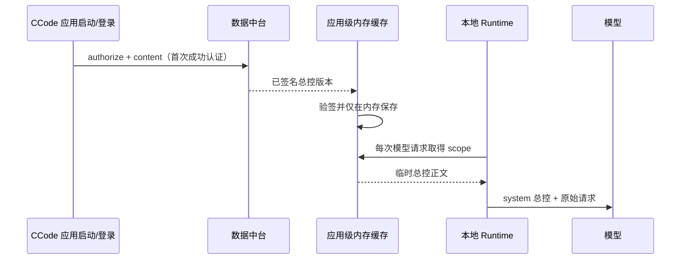
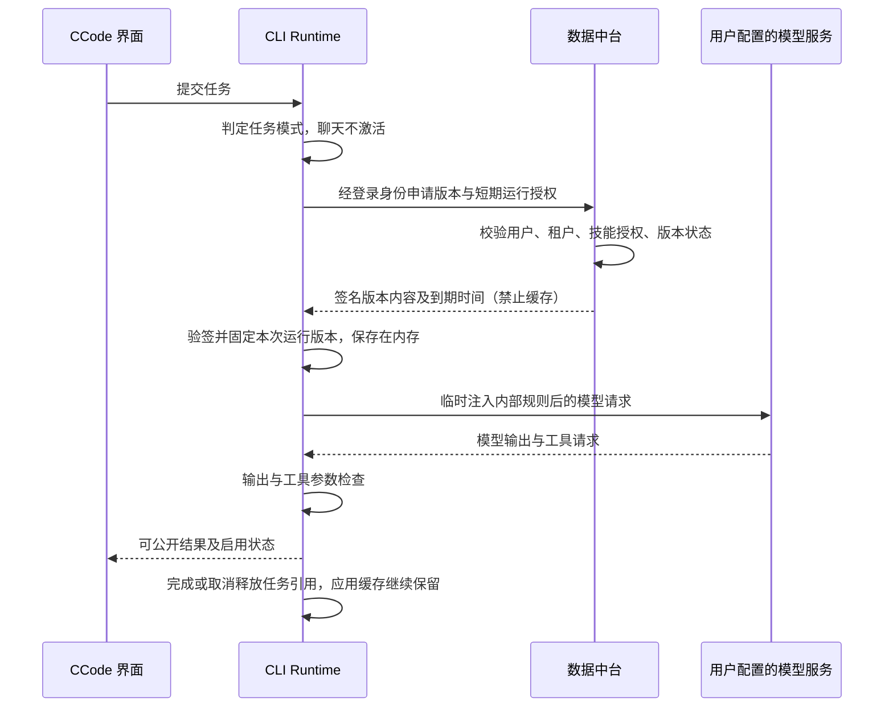
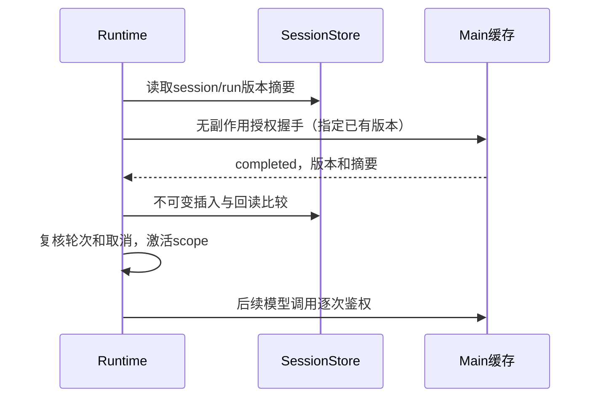
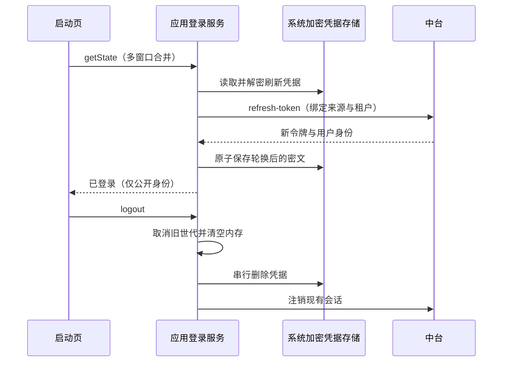
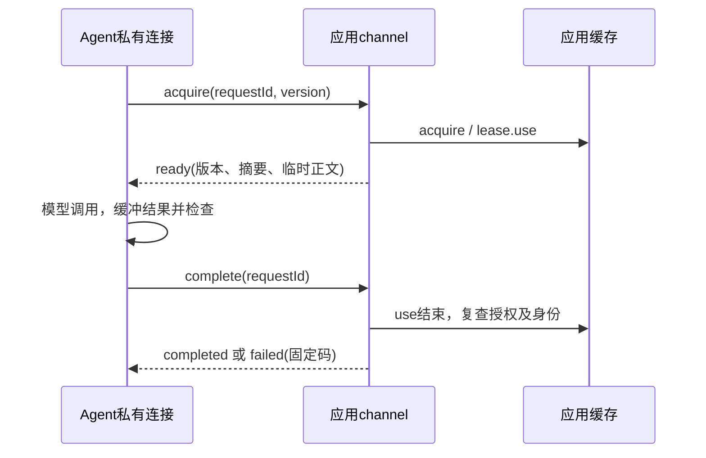
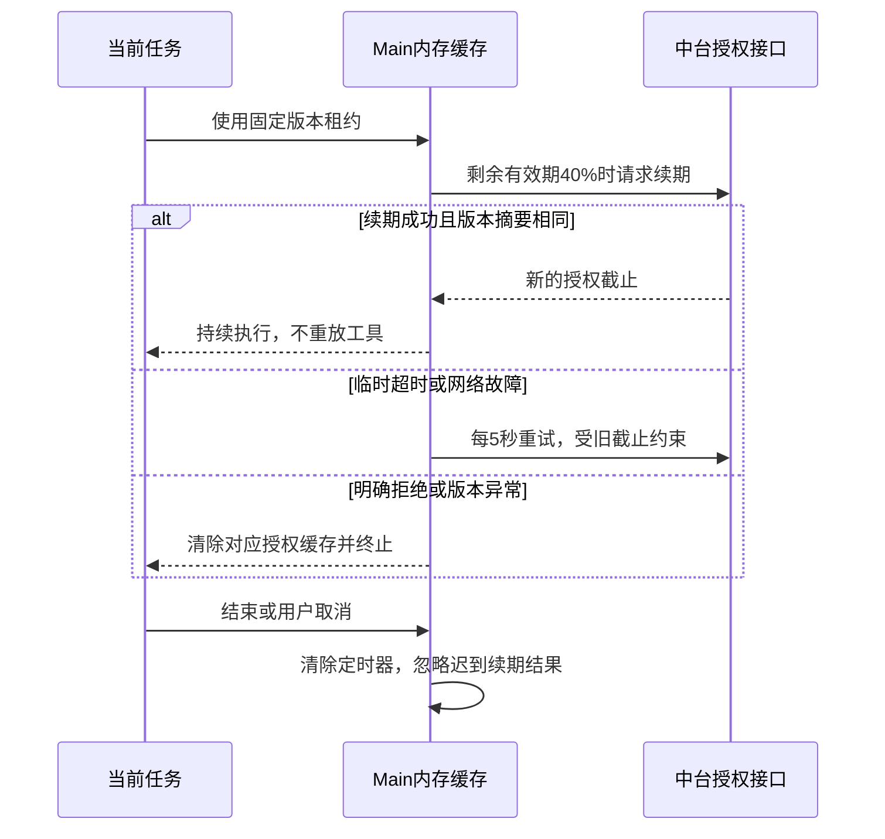

# 当前实现范围说明（2026-10-22，同日取代性修订）

~~默认运行路径已由 [启动全局提示词规范](ccode-startup-global-prompt.md) 替代：认证后获取一次签名内容，标准 ContextBuilder 全局段注入~~（→该规范自身已于 2026-10-22 被总控本地锁定 skill 方案取代，见其头部取代说明；现行方向见 [ccode-controller-local-skill.md](ccode-controller-local-skill.md)（下称「新 spec」）：正文验签后本地加密锁定持有、更新走中台签名推送、stub 常驻 + 命中加载）；~~不再走下文历史设计中的缓存、五分钟租约、按请求 acquire/complete、激活和输出放行~~（→该取代关系由新 spec §1 继承，新 spec 同样不恢复这些机制）。下文保留旧协议与加密备用方案的背景，不代表当前执行合同；被新架构取代的断言以~~删除线~~标注并指向新 spec 对应章节，未标注句子仍为历史记录。当前主路径未启用加密备用服务，也不保证提示词不可被模型泄露；本地锁定副本的加密定位是防君子门槛，不构成保密措施（新 spec §5.3）。

> **〔2026-10-23 实现状态〕**新 spec 路线已于批次3b 在代码闭环落地（锁定存储/更新器 `packages/services/src/controller-locked-store/`、Main 所有权与 getLockedContent、skill-port 命中加载、按需通道 Host relay→Agent Node IPC、旧全局注入链 rg 零命中退役；判例与回执见 `docs/prd/回执-ccode-dev-batch3b-20261023.md`）。本文其余内容为历史合同记录。

# CCode 中台动态总控与内容保密

状态：部分取代（2026-10-22）——总控正文的持有、更新与注入路线已由
[ccode-controller-local-skill.md](ccode-controller-local-skill.md)（新 spec，待评审）按当日
用户与老板方向拍板取代；中台唯一来源与审核发布、Ed25519 签名验签、输出保护与应急备用包
规则保留，逐条清单见文末「取代关系与保留清单」。
历史记录：正在开发。2026-10-21中台服务及总控v1已发布；客户端源码已接线，
启动登录页已实现，完整运行与新安装包尚未验收。

后续用户已授权“独立备用授权服务＋本地签名密文包”，详见
[应急授权规范](ccode-emergency-authorization.md)。~~正常内存模式不变；本文原有
无本地回退约束仅对该规范明确的受限应急密文包作例外~~（→新 spec §1、§5.3、§5.5：
正文改为验签后本地加密锁定持有，「无本地持有/无本地回退」约束整体取消；应急密文包
仍仅按该规范使用，其规则不受影响）。当前备用能力尚未启用，
不能据此放宽现有授权或声称真实服务上线。

## 当前运行规则（2026-10-22，本节已整体被取代）

> 本节四条运行规则随启动全局提示词路线一并被新 spec 取代，保留原文供审计，逐条指向如下。

- ~~客户端启动后的账号恢复或首次登录成功，应用级所有者立即向数据中台申请并验签 `controller` 版本；正文只保留在该应用生命周期的内存缓存中。未登录、授权失败或验签失败时不把本地副本作为回退~~（→新 spec §3、§5.4、§5.5：首次成功登录后经 authorize/content 获取并验签，落地为初始锁定版本；此后更新走中台签名推送，Ed25519 验签通过后原子落地、可回滚；正文以加密锁定副本常驻本地系统数据目录，未登录/离线可用，不再是「回退」而是正式持有形态）。
- ~~已装配私有总控通道的本地 CCode Runtime 在每一次模型请求前自动取得同一个应用级总控 scope，并把总控正文作为请求首位的 system message 注入。模型不再需要先调用 `Skill 总控派单`；该 Skill 仅保留兼容入口，不是授权或注入的前提~~（→新 spec §3、§5.1、§6：整段注入与私有通道注入（P4）整链拆除或休眠；触发改为 stub 常驻 + 完整 skill 命中加载，正文只出现在命中轮上下文）。
- ~~应用级缓存是正文、已验签版本和短期授权的唯一所有者。Runtime、会话、工作流和子代理只持有可调用 scope，不保存正文，也不把正文放入会话历史、任务记录或本地文件~~（→新 spec §4：所有者改为「客户端更新器 = 本地锁定存储唯一写入者」；「正文不进入会话历史、任务记录」的输出保护由新 spec §5.7 延续）。
- ~~新会话、续接和工作流不再以“重新调用总控 Skill”作为开关；它们使用当前应用已加载的总控 scope。应用退出、账号退出或身份切换会清除内存，下一次成功启动/登录重新获取~~（→新 spec §5.1、§5.5：由 stub 意图判定决定是否加载完整正文；登出/换账号不删除本地锁定副本，仅失效更新授权与同步）。

> 下图时序（启动获取→仅内存缓存→逐请求 scope 注入）已被新 spec §3 推送更新链与两层触发结构取代，保留作审计。

## 用户目标

- 核心总控 Skill 由数据中台集中发布固定版本，经鉴权动态下发。
- CCode 本地执行任务，继续使用多个或自定义模型；不把整个任务调度迁移到中台。
- ~~核心正文及其 references 不作为客户端文件保存，也不嵌入安装包~~（→新 spec §1、§5.3：正文改为以加密锁定副本落地本地系统数据目录、离线可用；「不嵌入安装包」继续有效，安装包不预置明文正文，是否允许预置已签名种子包见新 spec OQ-L3）。
- 用户通过聊天询问实现、索取提示词、翻译、编码或导出时，不提供内部 Skill 内容；可以介绍公开能力和当前任务进度。
- 普通聊天不激活总控；执行、调查、交付和继续任务时激活。普通公开 Skill 保持原有机制。

## 保护范围及限制

本设计的“动态内核”是 CLI Runtime 中独立的内存加载组件，不是下载并执行任意原生代码。首期仅接受声明式规则和文本引用，禁止把受保护脚本写入临时文件后运行。

承诺范围是~~应用自身不持久化~~（→新 spec §5.3：正文以加密锁定副本本地持久化，加密定位为防君子门槛、不是保密措施）、不通过普通内容接口返回核心原文，并降低模型输出泄露风险。无法保证有权控制客户端的用户无法调试进程、读取内存或截获模型请求；无法保证操作系统不分页、不生成转储。JavaScript 字符串不能可靠擦除，只能缩短生命周期并释放引用。

规则进入模型请求后，该模型服务能够看到规则。自定义模型兼容不等于对自定义服务保密。提示词拒绝、关键词正则、重复片段检测均不能证明无语义泄露；若要求对模型服务方或客户端管理员也绝对保密，必须改变执行边界，不能用本方案宣称实现。

## 与现有受管发行的关系

`managed-controller-skills.md` 的签名契约可复用于发行真实性检查。~~它的本地原子安装和目录 ACL 路径不适用于本需求的核心总控；保留为普通受管文件的历史方案，不作为本设计的实现证明~~（→新 spec 关联文档、§5.2：本地原子安装路线以修订后的形态回归为本地锁定存储的原子落地与回滚；OS 级写入隔离仍未实现（OQ-L4），本期只做应用层防线并如实声明）。

当前 base64 + Ed25519 是编码与签名，不是内容加密。当前安装包中可读的总控派单副本不满足本需求。正式迁移应停止随包分发核心正文；此前已分发的内容无法收回其保密性。不得擅自删除用户工作区中的原始文件。

## 所有者与加载顺序

> 本节及下图描述的按运行授权、短期租约、按请求注入与 run 版本绑定机制，此前已由启动全局提示词规范取代（无周期续期、无每请求租约），该取代关系由新 spec §1、§6 继承（旧 scope 机制的处置对齐 split/05 OQ-6，不单方面删除）；其中涉及「正文仅内存持有」「禁止本地存储」的断言逐条删除线标注如下。整节保留原文供审计。

- 中台拥有发布版本、撤销、授权和最低版本策略；客户端不得自签或修改信任根。
- 租户来自服务端校验后的身份，不信任客户端传入的租户 ID 即代表有权限。
- Runtime 拥有单次运行的内存快照；同次运行固定版本，更新在下一次运行生效。
- ~~应用级内存服务拥有正文缓存，不能依赖某一个会话 Agent 的存活~~（→新 spec §4：本地锁定存储唯一写入者为客户端更新器，不再依赖应用级内存缓存存活）。任务完成、会话切换和压缩不会清空应用缓存；同身份同版本只下载一次，并发请求合并。~~每次需要总控的模型调用仍重新注入，不能依赖第一轮提示词留在历史里~~（→新 spec §5.1：完整正文仅在命中轮加载，其余轮次仅 stub 常驻）。
- 缓存实现属于 services，由 Main 在应用启动时装配一次；Main仅装配与路由，不持有run到版本的业务映射。窗口Host通过私有通道使用，不创建新的全局Host，也不把正文服务注册到Renderer/Mobile可访问集合。
- 授权与正文分开：短期授权到期后重新向中台校验；版本未变化且授权有效时复用正文。~~完全退出、缓存进程崩溃、注销或切换身份时清除；正文不写磁盘恢复~~（→新 spec §5.5：登出/换账号不作废、不删除本地锁定副本，仅失效更新授权与同步）。应用缓存按身份及版本区分，不跨用户/租户复用。
- 恢复同一 run、续期授权或切换模型时仍使用原绑定版本；该版本撤销或不可用则暂停，不能静默升级。仅明确创建新 run 时绑定新版本。恢复所需的版本标识可持久化，~~核心正文不可持久化~~（→新 spec §5.3、§5.4：正文以加密锁定副本持久化于本地系统数据目录，版本与回滚清单随行）。

恢复绑定由Runtime通过SessionStorePort唯一写入。复用local_setting，scope= session、
scope_id=sessionId、namespace=confidential-controller、key=runKey，value仅含version/digest。
runKey优先target:<targetId>，外部输入其次input:<inputId>，仅新输入无inputId时使用turn:<turnId>。
内部目标续跑在Agent重建后也初始化target键；其他内部续跑只沿用已有键，丢失身份拒绝激活。
首次远端授权使用无副作用回调等待completed，再原子插入（冲突不覆盖）并回读比较，
成功后才激活供模型消费；每次异步返回复核轮次、键与取消。恢复读取严格解析，损坏记录拒绝运行。摘要同时
固定以防不同租户碰巧版本号相同。数据不进入模型历史；不修改消息/任务排序时间。
缺少这两个持久化端口时受保护任务拒绝执行。子任务继承父scope，不另行选择最新版本。
直接工作流入口创建子Runtime前必须确认父scope已激活；未授权时拒绝创建，不能以缺省端口绕开保护。
动态、脚本与专家工作流在启动时取得独立run scope，并在执行脚本及创建actor前完成版本绑定；
运行期间所有actor共享该scope，不能每次重新读取父会话当前scope。恢复同一workflow run
读取其已有绑定并重新授权；绑定缺失的旧运行拒绝恢复，不猜测原版本。新运行继承发起时
父scope的版本。运行绑定仍仅含version/digest，不进入普通workflow journal或派单正文。
绑定键为workflow:<类型>:<runId>，父session构成存储命名空间，恢复校验所有者。
动态工作流恢复在授权期间登记可取消的准备操作，互斥同run恢复；真正launch前复核
服务存活、取消信号与journal原记录。专家工作流复用运行AbortController注册表在授权前
占位，取消先中止它再写状态，恢复和重试写入前复读快照；占位在失败及结算后释放。
显式amend创建新run，继承本次发起父scope版本；resume/retry同run固定原版本。
显式set/replace目标会创建新targetId，视为新run，下一轮可绑定新版本；修改状态或续跑同一目标保留绑定。
软删除保留版本元数据，当前无永久删除入口；fork保留源targetId但具有新sessionId，总控按新命名空间
视为新run，不复制原会话绑定。绑定不进入历史或导出。

- 每次模型调用前检查授权有效期；到期后暂停并重新授权，续期本身不重新下载同版本正文。离线期间不能宣称即时撤销，最长有效期须由中台策略控制。
- 退出登录、切换租户或撤销通知需取消相关请求并清除引用，迟到响应不能重新填充缓存。
- 重启、恢复会话、重新执行均重新鉴权获取。无有效授权、鉴权失败或验签失败时拒绝核心总控任务，普通聊天仍可用。~~不回退到本地同名文件。应急能力启用前无网络仍拒绝~~（→新 spec §5.5：已验签的本地锁定副本是正式的离线使用形态，不是回退例外；用户在任意可写位置放置的同名/改写副本不通过 digest 复核、不进入会话，由新 spec §5.2 加载层防线延续；无任何本地锁定版本时总控不可用，普通聊天可用）；后续仅按应急授权规范使用签名密文及独立短期授权，不能绕过明确拒绝。
- ~~子代理在获授权且必要时复用同版本内存上下文~~（→新 spec §5.1：子代理与工作流子 Runtime 不自动继承完整正文，需要时同样经 stub 命中加载）；禁止通过普通派单文本传递核心规则。~~远端执行端未接入相同保护通道时拒绝受保护任务，不把正文通过普通远控消息转发~~（→新 spec §6：私有通道（P4）整链拆除或休眠；Web/手机端总控可用性列新 spec OQ-L6 待拍板）。

## 中台接口要求

- 复用现有租户、用户名密码登录体系，不复用模型提供商 token。
- 客户端中台身份所有者保存在应用服务内存中，公开接口只返回租户列表和登录状态，不返回access/refresh token。登录、刷新和注销均复用中台现有接口；刷新使用POST表单参数而非URL查询串传递refresh token。身份切换或明确鉴权拒绝立即失效缓存。验证码开启时保留captchaVerification验证，不绕过中台策略。跨重启登录恢复使用下述系统加密凭据，不保存密码或总控正文。

### 跨重启恢复中台登录

- 登录服务是登录态和凭据写入顺序的唯一所有者。Main 注入 Electron safeStorage 能力和本产品 userData 下 `ccode-account/session.enc` 文件路径；Windows 使用系统用户保护，macOS/Linux 使用系统钥匙串。加密不可用或 Linux 使用 basic_text 时拒绝持久化，绝不退回明文或自带固定密钥。
- 唯一落盘内容为系统加密后的版本号、规范化 API base、租户 ID、用户 ID 和刷新令牌。密码、访问令牌、总控正文与授权不落盘。服务端地址绑定避免凭据发送到不同来源。
- 登录与续期成功后原子替换密文；文件 IO 异步、写入和删除串行，迟到请求不得覆盖新身份或恢复已注销凭据。配置持久化后，保存失败返回 UNAVAILABLE，不宣称已成功记住登录。
- 首次读取账号状态时，合并各窗口的恢复请求。读取并解密凭据后向既有 refresh-token 接口发 POST 表单；校验用户身份和令牌结构，通过后生成新的 loginId 并通知缓存。恢复完成前不返回已登录，也不提前启用总控。
- 缺失、成功解密后结构无效、过期或明确拒绝的凭据进入登录页；结构无效/明确拒绝清除密文。无法确定原因的解密失败、服务器身份或令牌结构异常、网络故障、5xx、限流及超时保留密文并显示现有“账号暂不可用/重试”状态，不把暂时不可达误当作退出登录。
- 主动注销、切换账号开始时清除旧凭据并中止旧世代；普通退出应用只清内存，保留密文。退出与恢复/轮换并发时，注销完成后磁盘与内存都不得恢复旧登录。Web/手机不新增凭据文件，继续经现有桌面身份服务。
- 旧版内存会话无法迁移；首次升级后需重新登录一次，此后重启/原地更新可恢复。~~总控正文仍仅内存缓存，每次启动仍重新申请授权~~（→新 spec §5.5：本地锁定副本常驻可用，仅更新推送需要登录身份）；不以保存登录凭据代替授权。

验收：登录→重建应用服务→自动恢复；令牌轮换；多窗口仅一次恢复；断网重试；明确撤销清理；损坏/跨来源凭据；注销与迟到刷新竞态；系统加密不可用不写明文；新旧文件原子替换；公开状态无令牌。交互场景通过账号公开端口与启动页同一 getState 链路验证，真实中台验收不记录密码或令牌。

- 消费与发布权限分离，不提供普通客户端独立浏览、列举、导出或发布核心源文件的产品接口。获授权内容下发本身仍可被控制客户端的用户提取，服务端不能通过同一身份的权限配置实现“允许运行但绝对无法取得下发正文”。
- 提供发布元数据和绑定当前身份的短期内容响应；服务端记录允许的版本、租户、用户及请求审计，不记录正文或凭据。
- HTTPS 传输；响应 `Cache-Control: no-store`。~~客户端不能把正文、加密包或解密密钥存入文件、浏览器缓存、数据库或环境变量~~（→新 spec §5.4：验签通过的正文经客户端更新器写入本地锁定存储；应急加密包仍仅按 [ccode-emergency-authorization.md](ccode-emergency-authorization.md)；「解密密钥不出现在环境变量、配置或工具返回值」由新 spec §5.3 延续）。
- 中台内容加密存储，密钥由服务端独立管理；签名私钥不得进入客户端。客户端只携带信任公钥。
- 不允许登录凭据随重定向发送至其他来源；下载限制大小、超时、响应格式和签名，错误只返回固定诊断代码。
- 正式权威初始内容、发布身份、信任公钥和服务端密钥托管必须在上线前落实；开发临时密钥不能冒充生产信任根。

## 客户端隔离点

1. ~~受保护正文不进入普通 `Skill.loadSkill` 返回值、`<skill_content>`、Skill 预览、文件读取接口或同步/复制/导出功能~~（→新 spec §5.6：保留名 `Skill 总控派单` 调用语义改为「触发锁定加载并返回完整正文」（经锁定加载入口，非普通文件读取）；普通 Skill 浏览、预览、文件读取接口与同步/复制/导出不暴露锁定原件，由新 spec §5.2 展示层防线与 §5.6 过滤逻辑延续）。
2. ~~不经普通 ContextBuilder section 注入；其 section 包含正文与 preview，现有调试路径会记录内容。独立内存组件在模型请求边界注入，不修改权威会话历史~~（→新 spec §5.1、§5.6、§5.7：正文经 Skill 锁定加载进入命中轮上下文；desktop.ts 全局注入声明段随两层触发结构改写（§6 P6d）；诊断与请求转录屏蔽对象改为锁定 skill 加载内容，沿用 skipTranscript 语义）。
3. 受保护调用禁用请求正文捕获、SDK 原始请求/响应转储和异常 body。全路径审计包含调试模式，不能仅依赖生产默认关闭 debug。
4. 历史、恢复快照、压缩摘要、长期记忆、分享和导出仅保留公开任务事实及版本元数据，不复制内部规则。
5. 输出检查在广播、展示、持久化之前执行，覆盖正文、推理内容、工具参数和子代理输出。受保护回答按完整可检查单元缓冲，不能先把流式片段展示后再撤回。
6. 工具调用在执行副作用前检查，避免模型通过写文件、命令参数、网络请求或其他工具输出规则。此检查仍不构成对任意编码、改写或隐蔽通道的完全防护。
7. 用户索取内部规则时使用公开回复：“我可以介绍 CCode 的任务处理能力和当前任务安排，但内部技能内容及私有配置不对外提供。”公开功能介绍不必一概拒绝。
8. 保留名称由可信策略控制，用户文件和插件不能覆盖或通过别名触发旧本地总控。

## 当前源码证据

- `apps/zcode-cli/packages/core/src/tool/handlers/skill.ts`：普通工具返回完整 `<skill_content>`。
- `apps/zcode-cli/packages/core/src/runtime/methods/context.ts`：初始化日志字段包含 section preview/content。
- `apps/zcode-cli/packages/core/src/runtime/methods/context-history-entries.ts`：systemMessages 进入运行时历史条目。
- `apps/zcode-cli/packages/adapters/src/model/runner-debug.ts`：读取 rawRequestBodyCapture 并构造调试记录。
- `apps/zcode-cli/packages/core/src/context/sections/desktop.ts`：现有总控激活指令调用普通 Skill。
- `apps/zcode-cli/packages/bundled-skills/skills/总控派单/SKILL.md`：当前随包本地副本。
- 中台已有租户与登录 API；本轮未找到专用核心 Skill 发行接口。CCode 尚未完成中台用户登录接入。

## 验收场景与实施依赖

### 私有进程通道生命周期

> 本节通道协议（acquire/complete/cancel、ready/completed/failed）按新 spec §6（P4）整链拆除或休眠——正文不再经 IPC 注入。保留原文供审计。

每个受信任子进程连接创建独立channel，应用缓存仍唯一；channel只保存正在进行的
调用关联，不拥有任务或版本状态。仅允许acquire/complete/cancel三类消息。
acquire的正整数requestId在连接内严格递增，最多8个并发；重复/未知字段/非法类型
使连接失效并取消其所有调用，不接受模糊关联。版本由任务owner固定后传入。

ready不代表永久授权。Agent在收到completed前不得广播、保存结果或执行工具；
failed、连接断开或进程退出必须清除临时内容并取消调用。授权到期/注销由lease信号
终止等待，发送failed；不重新下载已缓存同版本。发送失败关闭channel并取消待办。
channel关闭不清除其他窗口可用的应用缓存。该协议不能替代模型输出/工具检查。

Main随窗口Host创建独立MessageChannel，只通过父子进程消息传递一次端口。
交接消息只含类型与协议版本，必须恰好携带一个端口；Host在普通消息校验和日志
之前识别它。重复交接、格式错误、退出后的交接关闭端口，不覆盖已有连接。
该端口不加入Renderer/Mobile attachment注册表、BroadcastHub或通用RPC。
Host/端口退出时释放对应channel；独立连接创建失败只禁用受保护执行，不中断普通工作区启动。

Host转发器将每个Agent连接的本地requestId映射成Main连接严格递增的requestId。
同一Host最多8个在途调用、32个Agent连接；连接关闭只取消该连接的调用。
Main的ready/completed/failed严格解析后按映射单播，绝不广播；ready必须先于
complete，completed必须在complete后。非法消息关闭对应连接，Main协议异常则
关闭整个转发器。转发器不缓存正文或任务状态，Main端口断开取消所有Agent连接。

### 桌面账户入口边界

### Host 到本地 Agent 的进程通道

> 本节第四 Node IPC 通道、`ccode-controller-capability.json` 能力核对与环境变量标记同按新 spec §6（P4）整链拆除或休眠，保留原文供审计。

Host 通过私有工厂注入 chat 主泳道进程管理器；插件与 MCP 状态泳道不获取正文权限。
只有命令显式声明 supportsConfidentialControllerIpc 且注入工厂时，才创建第四个
Node IPC stdio 通道。不能从存储启动能力或可执行文件名推断支持；CLI 消费端完成前
默认命令只对配套Node bundle提供候选入口；进程管理器异步核对伴随的
`ccode-controller-capability.json`（schemaVersion=1、protocolVersion=1、entry固定zcode.cjs、
sha256匹配实际bundle）后声明能力。构建生成该文件，桌面暂存同步复制；缺失、损坏、
旧包或摘要不符不得开通。此声明用于构建兼容性，不替代机器可信边界或代码签名。
字节码、tsx源码wrapper、原生binary及env自定义命令不自动声明。
stdout/stderr 保留普通协议，不传输核心规则。
每个子进程只持有自己的 relay peer。IPC disconnect/error/exit 或 peer 关闭时解除
监听、取消在途调用并断开专用 IPC；不清除 Main 缓存、不影响其他进程。
发送失败只关闭连接，不记录原异常或正文。未装配通道时保护任务必须拒绝执行。

### 桌面账户入口实现

应用启动只装配一个账户与缓存实例。Renderer 通过 IPlatformService.ccodeAccount
访问 getState/listTenants/login/logout，不得访问令牌、正文或 acquire。登录参数在
Main 边界作严格类型与长度校验，错误只返回固定安全码；不序列化原异常。
仅注册的应用窗口顶层 frame 且 URL 为应用入口可调用，插件、网页及子 frame 拒绝。
Web/手机不提供该端口。UI 状态是只读投影，账户和缓存唯一所有者仍为应用服务。
退出确认取消不清缓存；~~实际退出时清除~~（→新 spec §5.5：实际退出不再清除本地锁定副本，仅失效更新授权与同步）。正式发行信任根未配置时不得获取核心内容。

账户入口放在侧栏底部，打开独立登录对话框，包含租户、用户名、密码及提交状态。
复用现有对话框、输入框、按钮、主题与中英翻译。表单有可关联标签，外框限制高度，
仅表单内容滚动。普通聊天保持可用，~~受保护任务仍需中台鉴权~~（→新 spec §5.5：已持有本地锁定副本时总控不依赖在线鉴权，仅更新推送需要登录身份）。密码提交后立即清空，
不进入持久化store、遥测和日志。失败只显示固定提示，不显示原始服务异常。
主进程账户变化广播无正文的失效事件；各窗口重新读取权威状态，忽略迟到结果。
账户状态读取失败不得沿用旧的已登录展示。关闭对话框后不保留表单凭据。

### 启动登录页面

桌面窗口的RootInner挂载之前显示独立中台登录页，复用同一AccountForm；每个窗口本次
加载只处理一次。账号状态仍只从Main读取。已登录时直接进入；未登录、状态读取中或
失败时显示对应提示，允许“暂不登录，继续聊天”。登录成功或跳过后卸载表单并进入
原启动流程，之后注销不强制跳回此页。跳过状态仅属于当前窗口UI，不持久化，~~也不
授予总控执行权限~~（→新 spec §5.5：登录不是总控可用性门槛，未登录且本地已有锁定
副本时总控可用；Web 端可用性列新 spec OQ-L6）。Web/手机没有中台账户端口，直接保留原启动流程。

外层页面与卡片有界且overflow hidden；滚动仅在表单内容。Windows/Linux窗控始终
可用，macOS沿用原生窗控；使用既有品牌资产、主题token、44px控件与中英翻译。
验收场景：新窗口未登录、应用已登录的新窗口、账号读取失败、租户加载失败后重试、
登录成功、主动跳过、进入后注销、窄窗口和长租户列表。未经请求不新增或运行测试，
静态检查不能替代这些交互证据。

先接入中台身份、发布和短期授权，再实现~~Runtime 内存加载、模型请求隔离~~（→新 spec §6：实现对象改为客户端更新器、本地锁定存储与 stub 常驻层、锁定加载与诊断屏蔽，见其在途代码迁移清单）、输出检查，最后迁移打包内容。不能仅增加“不泄露”提示词就宣布完成。

后续验收覆盖：聊天不加载；任务鉴权加载；版本固定；错误签名/过期/跨租户/同名替代拒绝；未启用或无有效应急授权时离线拒绝且不回退；注销与迟到响应；子代理/远端边界；重启重新鉴权；工具参数与流式分片泄露；调试、历史、压缩、分享、导出及安装包不含正文。签名密文备用包的验收单列应急授权规范；检查泄露测试只能提供有限覆盖证据，不能证明绝对保密。

已实现应用级缓存、中台接口、桌面账户桥接、侧栏登录与启动登录页面；私有任务
通道、模型注入和输出检查已在源码接线。中台v1已发布，但客户端完整运行、
异常边界与新安装包尚未验收，不能宣称保护能力已经整体交付。未执行测试。

独立设计审查：package_review 确认方案符合最新需求；已根据意见补充授权内容可被客户端提取的限制，以及同一 run 恢复、续期和切换模型时的固定版本规则。

# 中台唯一来源补充（2026-10-21）

首次发布使用管理员独立生成的Ed25519信任根，SPKI PEM的SHA-256为
`af5badd5898fcaaf68ae054373a81c1e9439dd86ac4f10c6159838239b5ed275`。

> 已知事实矛盾（2026-10-22 标注，保留待拍板；split/05 OQ-1＝新 spec OQ-L1）：桌面 Main 内置信任公钥的 SPKI SHA-256 实测为 `845e7cbf1f90ef9236cc1810d6f1675a6e0b37129df3d0a0d91ab227b91bff21`（`packages/desktop/src/main/index.ts`，node crypto 计算），与上文记录的 `af5badd5...ed275` 不一致；可能是 spec 记录后公钥已轮换但 spec 未更新，或代码内置了非生产信任根。未确认前不得宣称信任根正确，需管理员/中台确认后改代码或改 spec。
>
> **〔2026-10-23 结案：同一把钥匙，两个哈希口径，无轮换〕**总控实算复核（node crypto，对 Main 内置同一份 PEM）：`845e7cbf...bff21` = SPKI **DER 字节**的 SHA-256；`af5badd5...ed275` = **PEM 全文文本（含结尾换行）**的 SHA-256。上文「SPKI PEM的SHA-256」的口径表述不严谨致两值被当成两把钥匙。结论：代码内置公钥即首次发布信任根，无需改代码、无密钥轮换史。今后信任根指纹统一采用 **SPKI DER SHA-256** 口径（`845e7cbf...bff21`，对齐中台 PRD M6-R4 台账公示口径）；`af5badd5...ed275` 保留仅为向后追溯。split/05 OQ-1＝新 spec OQ-L1＝中台 PRD OQ-2 一并结案。

Main仅内置公钥，skillId=controller、name=总控派单、minimumVersion=1；私钥和AES存储密钥
不进入客户端。公钥配置不代表中台接口或内容已发布；~~缺少远端授权仍拒绝执行~~（→新 spec §5.5：已持有本地锁定副本时离线可用；无任何本地锁定版本时拒绝执行，普通聊天可用）。

用户明确要求：总控 Skill 永远由数据中台提供，知识库使用专门的“总控skills”文件夹
管理源文件。该目录与租户、管理员权限绑定；普通聊天、知识库检索、普通下载不得获得
核心正文。中台发布服务从此源生成固定版本并授权下发，~~CCode只在内存消费，不在本地
文件、安装包或离线兜底中保存核心正文~~（→新 spec §1、§5.3、§5.5：客户端以验签后的本地加密锁定副本持有并离线使用；「不随安装包分发」保留，本地锁定副本只经登录下载产生）。创建目录不等于发布、启用或完成权限隔离。

## 长任务授权续期（2026-10-22，本机制已被取代）

> 本节的租约续期机制随「每请求短期授权」路线一并被取代：启动全局提示词规范已声明「无周期续期」，该取代由新 spec §1 继承（新 spec 同样不恢复周期续期与模型调用授权）。保留原文供审计。

授权有效期不是任务时长上限。Main内存缓存owner在当前租约剩余40%时主动续期（五分钟租约约第三分钟），固定身份、版本、摘要；不重放已执行工具、不重复下载正文。网络/服务暂时不可达可每五秒重试，但不得超过当前已获授权截止。当前截止未能续期时AUTHORIZATION_EXPIRED；中台明确拒绝AUTHORIZATION_REJECTED；身份变化IDENTITY_CHANGED；用户停止CANCELLED。新授权必须延长截止且匹配固定摘要。任务结束清除定时器，迟到续期不恢复已结束运行。

本期兜底为有效授权内续期重试，不启用未经部署的备用授权服务，不延长服务器授权、不落盘明文。部署备用服务须继续遵守ccode-emergency-authorization.md。用户明确本次串行、不跑额外验收。

## 取代关系与保留清单（2026-10-22 追加）

本节随 2026-10-22 取代性修订追加。取代方：[ccode-controller-local-skill.md](ccode-controller-local-skill.md)（总控本地锁定 skill 方案，状态：待评审；其自身取代 [ccode-startup-global-prompt.md](ccode-startup-global-prompt.md)，对本文旧默认路径的取代关系由其继承）。拍板依据：2026-10-22 用户与老板方向拍板（经三轮探讨收敛）——敏感的领域专家知识拆分至中台专家 skill 库按需下发（另见 [ccode-expert-skills-distribution.md](ccode-expert-skills-distribution.md)），本地保留的通用派发部分降级为「防君子门槛」级本地加密持有（非保密措施）；更新走中台签名推送（Ed25519 验签后落地、可回滚）；用户不可改锁定原件、只可开分支迭代；触发 = stub 常驻 + 完整 skill 命中加载；启动全局提示词整段注入路线被取代。

### 被取代断言汇总（正文中均已删除线标注并指向新 spec 章节）

1. 总控正文仅内存持有：应用级缓存唯一所有者、正文不落盘、不写磁盘恢复、核心正文不可持久化、总控正文仍仅内存缓存、只在内存消费等断言 → 新 spec §1、§3、§4、§5.3。
2. 禁止任何本地存储形式与「无授权离线回退」禁令：不把本地副本作为回退、不回退本地同名文件、应急启用前无网络仍拒绝、不在本地文件/离线兜底保存核心正文、正文不存入文件等断言 → 新 spec §5.3、§5.5（已验签的本地加密锁定副本是正式持有与离线使用形态，不是回退例外；安装包不预置明文正文保留，预置签名种子包见新 spec OQ-L3；用户放置的同名/改写副本仍被 digest 复核拒绝，新 spec §5.2）。
3. 启动全局提示词/私有通道逐请求注入路线：每次模型请求 scope 注入与 system message 首位注入、应用级 scope 继承、bootstrap 私有进程通道（acquire/complete/cancel、ready/completed/failed、`ccode-controller-capability.json`、`ZCODE_CONFIDENTIAL_CONTROLLER_IPC`）、按请求租约与长任务授权续期、子代理复用同版本内存上下文、远端保护通道拒绝语义 → 新 spec §3、§5.1、§6（P4/P5 拆除或休眠；P10 旧 scope 机制处置对齐 split/05 OQ-6）；该取代先经启动全局提示词规范，现由新 spec 继承。
4. 「受控正文不经 Skill.loadSkill 返回」的旧语义与「不经普通 ContextBuilder section 注入」的内存边界注入机制 → 新 spec §5.6、§5.7（保留名调用改为锁定加载并返回完整正文；诊断与请求转录屏蔽对象改为锁定 skill 加载内容，沿用 skipTranscript）。
5. 登出/切换身份清除正文缓存、未登录/离线不可用总控、每次启动重新申请授权、受保护任务仍需中台鉴权 → 新 spec §5.5（登出/换账号不删除本地锁定副本，仅失效更新授权；未登录且已有副本时可用，仅更新推送需要登录身份）。
6. 「managed-controller-skills.md 本地原子安装不适用于核心总控」的判断 → 新 spec 关联文档、§5.2（本地原子安装以修订后形态回归为本地锁定存储；OS 级写入隔离仍未实现，OQ-L4）。

### 保留继续有效（正文未删除线标注，此处列明）

1. 中台唯一来源与审核发布：知识库「总控skills」文件夹为唯一内容源、中台拥有版本/撤销/授权/最低版本策略、客户端不得自签或修改信任根（新 spec §4 沿用）。
2. Ed25519 签名验签要求：managed-skills 严格 envelope 契约、`verifyManagedSkillBundle`、摘要复核与固定错误码（新 spec §4、§5.4 复用）。
3. 输出保护：正文不进入普通日志、遥测、会话存储、导出、分享与压缩摘要；请求正文捕获/调试转储禁用；输出与工具参数检查在副作用与持久化前执行；用户索取内部规则的固定公开回复；客户端隔离点第 3-8 条（新 spec §5.7 沿用，屏蔽对象改为锁定 skill 加载内容）。
4. 应急备用包规则：独立备用授权服务与中台签名密文包仍仅按 [ccode-emergency-authorization.md](ccode-emergency-authorization.md) 使用（明文正文和长期明文解密密钥不落盘、仅已有授权且绑定版本的运行续跑、明确拒绝/撤销/验签失败不得转备用）；当前备用能力尚未启用，不得据此放宽现有授权或声称真实服务上线。与新 spec §5.3 的常态本地加密用途不同，两者衔接列新 spec OQ-L5。
5. 私有传输机制中被复用部分：中台 authorize/content 接口要求（复用租户登录体系、HTTPS、`Cache-Control: no-store`、限长、固定错误码、审计不记录正文）、Ed25519 信任根部署形态（skillId/name/minimumVersion）、跨重启登录凭据加密（safeStorage/系统加密，新 spec §5.3 复用为本地锁定加密的密钥派生同类实践）。
6. 「保护范围及限制」的诚实边界声明：不承诺对客户端控制者（本地管理员、可调试进程/读内存/截获请求者）保密或防篡改（新 spec §5.2、§5.3 延续并扩展至本地加密的「防君子门槛」定位）。
7. 验证纪律：未经请求不新增或运行测试；静态检查不能替代真实运行验收；未完成真实运行验收不得宣称整体交付（新 spec §7 沿用）。

### 已知事实矛盾（保留待拍板）

桌面 Main 内置信任公钥指纹实测 `845e7cbf...bff21` 与本文记录的首次发布信任根 `af5badd5...ed275` 不一致，详见「中台唯一来源补充」节内 2026-10-22 标注（split/05 OQ-1＝新 spec OQ-L1）；未确认前不得宣称信任根正确。

**〔2026-10-23 已结案〕**两指纹为同一公钥的不同哈希口径（DER vs PEM 全文），非两把钥匙、无轮换；结案证据与新口径见「中台唯一来源补充」节内 2026-10-23 结案标注。
