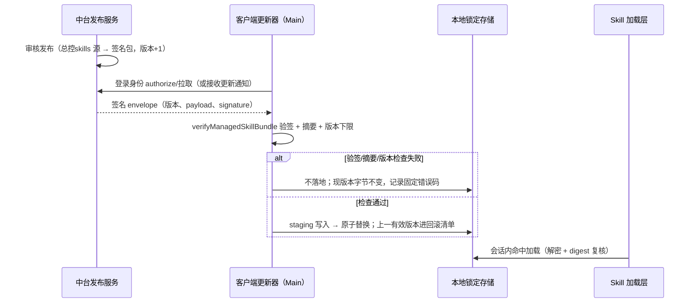
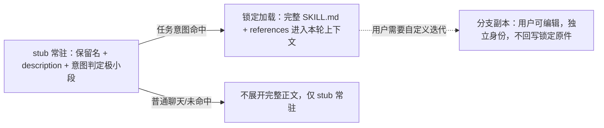

# CCode 总控本地锁定 Skill

状态：待评审
编写日期：2026-10-22
取代：[ccode-startup-global-prompt.md](ccode-startup-global-prompt.md)（启动全局提示词路线，状态已改为「已取代（2026-10-22）」）

关联文档：

- [ccode-confidential-controller.md](ccode-confidential-controller.md)：中台认证、Ed25519 签名验签、输出保护红线继续有效；「正文仅内存持有」与「私有通道注入」两条按本文重估（见 §1、§5）。
- [managed-controller-skills.md](managed-controller-skills.md)：历史受管发布方案。其签名契约（`packages/shared/src/managed-skills/contract.ts`、`verify.ts`）与发行工具（`scripts/publish-managed-skill.mts`）被本文复用；其「本地原子安装」路线在本文以修订后的形态回归，OS 级写入隔离仍未实现（见 §5.2、OQ-L4）。
- [ccode-expert-skills-distribution.md](ccode-expert-skills-distribution.md)：专家技能中台下发方案（并行在途，2026-10-22 拆分）。专家技能不在本文范围。
- `E:\ZCode\docs\prd\split\05-controller-expert.md`：P1-P15 现状盘点（分支 `codex/ccode-update-feed` 在途基线；本文引用其「已实测」断言时标注 P 编号）。
- `E:\ZCode\AGENTS.md`「CCode 总控 Skill 来源」节：现行红线表述将由并行线程修订；本文评审通过并与该节对齐前，不得据本文宣称红线已变更（见 OQ-L8）。

保密约束：本文只描述机制，不复制任何受控总控正文内容。

## 1. 拍板记录（2026-10-22）

方向拍板（2026-10-22 用户与老板讨论收敛，本文直接采用）：

1. 总控 skill（通用派发部分）= 本地内置锁定 skill：正文以验签后的锁定形态常驻本地，不再仅存内存。
2. 更新走中台自动推送：Ed25519 签名，客户端验签后才落地（原子替换），可回滚。
3. 本地存储可加密。加密的定位是防君子门槛而非保密措施，本文必须且已如实写明该定位（§5.3）。
4. 用户不可修改锁定原件；只允许在其上开分支迭代。分支 = 用户副本，不回写锁定原件（§4）。
5. 触发采用两层结构：小 stub 常驻（意图判定极小段）+ 完整 skill 命中加载（§3、§5.1）。
6. 不再采用启动全局提示词整段注入每轮请求的路线。理由：token 经济（完整正文逐轮、逐会话注入成本高）与适用范围（全局注入无法按意图区分普通聊天与任务场景）。
7. 专家技能不在本文范围，另见 ccode-expert-skills-distribution.md。

红线修订依据与日期：原红线「核心总控明文正文不打入安装包、不放入本地技能目录、不作为无授权离线回退」（AGENTS.md「CCode 总控 Skill 来源」节、ccode-confidential-controller.md）隐含的假设是总控正文同时承载敏感的领域专家知识。2026-10-22 拍板将敏感领域专家知识拆分至中台动态下发（ccode-expert-skills-distribution.md），本地保留的通用派发部分降密级为「防君子门槛」加密持有，因此允许本地锁定存储与离线使用。中台认证、签名验签、输出保护三条红线不修订，继续有效。

与旧路线的关系：本文取代 ccode-startup-global-prompt.md；对 ccode-confidential-controller.md 默认执行路径（缓存、短期租约、按请求 acquire/complete、激活要求）的取代关系由本文继承——本文同样不恢复那些机制。

## 2. 目标

- 通用派发总控以本地锁定 skill 形态可用：登录认证后从中台获取并验签落地；离线、未登录时本地锁定副本仍可工作（§5.5）。
- 内容真实性由签名链保证：本地副本字节 = 中台签名字节；任何未通过验签的内容不落地、不加载；篡改后的副本不通过 digest 复核（§5.4）。
- 用户不可修改、覆盖、伪造锁定原件；可在其上开分支（用户副本）迭代，分支与锁定原件的数据边界清晰（§4）。
- token 经济：完整正文只在命中加载的会话轮出现；其余轮次仅常驻极小 stub（§5.1）。
- 诚实定位：本地加密、应用层只读防线均不构成对客户端控制者（有管理员权限/调试能力者）的保密或硬隔离承诺（§5.2、§5.3）。

## 3. 架构与数据流

组件与依赖方向（单向：中台 → 更新器 → 锁定存储 → 加载层 → 会话）：

- 中台发布服务：知识库「总控skills」文件夹为唯一内容源；发布服务生成 Ed25519 签名包与版本策略（沿用 managed-controller-skills.md 契约；中台侧实现不在本仓库）。
- 客户端更新器（Main 装配，services 层）：持中台登录身份，负责拉取/接收更新、验签、原子落地、维护版本与回滚清单。锁定存储唯一写入者。
- 本地锁定存储（系统数据目录，非用户技能目录）：加密正文副本 + 版本清单（version/digest/落地时间）+ 回滚条目（上一有效版本）。
- Skill 加载层：stub 常驻条目 + 锁定命中加载；锁定内容经解密与 digest 复核后进入会话（§5.1、§5.2）。
- 分支副本存储（用户数据目录）：fork 产生的用户可编辑副本（§4）。

首次装配：首次成功登录后经既有 authorize/content 链路获取并验签，落地为初始锁定版本（P1，分支在途）。安装包不预置明文正文（预置已签名种子包是否允许见 OQ-L3）。

推送更新链：

两层触发结构：

## 4. 状态所有者与接口

- skill 内容所有者 = 中台发布版本。本地锁定副本只是已验签字节的只读落地，不是第二权威；中台拥有版本、撤销与最低版本策略，客户端不得自签或修改信任根（沿用 ccode-confidential-controller.md 约束）。
- 客户端更新器 = 本地锁定存储唯一写入者。模型、渲染进程、Renderer/Mobile RPC 无写路径；用户文件系统工具对锁定目录无应用层写入口（§5.2）。
- Skill 加载层 = 锁定内容唯一读取方：加载时 digest 复核，任何来源的「总控派单」内容不与锁定 digest 一致即拒绝（§5.2）。
- 用户数据边界：
  - 锁定原件：系统数据目录内、加密存储、应用层只读；不进入用户技能扫描根，不作为普通 Skill 浏览/导出/复制对象（§5.6）。
  - 分支副本：显式「从锁定 skill 创建分支」入口产生；落在用户数据目录；身份名不得占用保留名（`总控派单` 及其 NFKC/路径别名，判定沿用 `isConfidentialControllerSkill`，P6 指针：`apps/zcode-cli/packages/contracts/src/skills/index.ts`；其权威实现 2026-10-23 提升至 `packages/shared/src/skill-identity`，contracts 出口委托）；分支记录 fork 基线的 version/digest 供审计；更新推送不覆盖、不删除分支，分支也不回写锁定原件。
- 信任与契约接口：`ManagedSkillTrust`（skillId=controller、name=总控派单、minimumVersion、单个 SPKI 公钥）沿用 `packages/shared/src/managed-skills/contract.ts`；验签入口 `verifyManagedSkillBundle` 沿用 `verify.ts`（11 类固定错误码，INVALID_SIGNATURE/HASH_MISMATCH/VERSION_REJECTED 等）。
- 诊断接口：更新与加载结果只暴露版本号、digest、固定错误码与状态（等待中/需要登录/已是最新/验签失败/已回滚），不暴露正文。

## 5. 行为细节

### 5.1 触发判定（stub + 命中加载）

- stub = 锁定 skill 的常驻条目：保留名、description、whenToUse 与极小段意图判定指令（判据如「开始/执行/继续/落实任务、要求交付物或修改文件」为命中；「问候、闲聊、概念解释」为未命中）。stub 常驻于技能清单/系统上下文，预算受现有 metadataBudget 约束，目标是远小于完整正文的量级。
- 完整 skill 命中加载：模型经 Skill 调用加载完整 SKILL.md 与 references（走锁定加载入口，非普通文件读取）；正文只出现在命中轮的上下文中。
- 意图判定是提示词级（stub 内显式判定指令由模型执行），不是代码门禁。母 PRD §4.6 L83「适用范围由产品策略明确，不能依赖模型自行猜测」与该机制的口径差列为 OQ-L2，评审拍板前不宣称满足。
- 子代理与工作流子 Runtime 不自动继承完整正文；需要时同样经 stub→命中加载（与旧路线「全部无条件继承」的差异见旧 spec 取代标注）。

### 5.2 锁定只读的实现层

三层应用级防线，并如实声明其边界：

1. 存储层：锁定目录位于系统数据目录，不在用户技能扫描根内；普通文件工具对锁定目录的写操作被应用层拒绝（固定错误码）。这是应用级防线，不是 OS 硬隔离——当前运行环境为管理员权限单身份，managed-controller-skills.md 已确认不满足硬隔离前置条件（该结论继续有效，OQ-L4）。
2. 加载层：会话内使用的总控内容只能来自锁定加载入口的解密+digest 复核结果；用户在任意可写位置放置的同名/改写副本不通过 digest 复核，不进入会话。
3. 展示层：锁定 skill 不进入普通 Skill 浏览、导出、复制、预览；保留名判定（NFKC 归一 + 路径分段匹配）防止插件、extraRoots、别名抢占（P6）。

诚实边界声明：对能控制客户端的用户（本地管理员、可调试进程/读内存/截获请求者），本方案不提供保密或防篡改的硬保证，对齐 ccode-confidential-controller.md「保护范围及限制」一节的既有结论。

### 5.3 加密定位（防君子门槛）

- 本地锁定副本加密存储。定位必须如实表述：加密是防君子门槛——防普通用户、其他进程对数据目录的顺手翻阅与明文全文搜索命中；不是保密措施，不防有管理员权限或调试能力的攻击者，不宣称对任何对手方保密。
- 密钥建议由系统级凭据派生（Electron safeStorage/DPAPI，仓库已有同类实践：登录凭据加密，见 ccode-confidential-controller.md「跨重启恢复中台登录」与 `packages/services/src/confidential-controller/encrypted-login-store.ts`，分支在途）。密钥不出现在模型可读的环境变量、配置或工具返回值中。
- 加密失败（系统加密不可用）时不得退回明文正文文件：降级为不落地（保持现状不可用），并给出固定错误码；不阻塞普通聊天。
- 与 ccode-emergency-authorization.md 的关系：仓库已有应急密文包模块形态（`packages/services/src/confidential-controller/encrypted-release.ts`，分支在途）；本文的本地加密与其用途不同（常态持有 vs 应急备用），是否复用同一加密形态列为 OQ-L5。

### 5.4 推送验签与回滚

- 更新包契约复用 managed-skills 严格 envelope：schemaVersion=1、payload 原始字节 Ed25519 签名、canonical base64、路径与大小限制（单文件 2 MiB、总量 10 MiB、512 文件）、必含根 SKILL.md；发布侧复用 `scripts/publish-managed-skill.mts` 管道（私钥在外部发布环境，不进客户端）。
- 落地流程：staging 写入 → 验签 → 原子替换正式副本 → 版本清单更新 → 上一有效版本保留进回滚清单。任一步失败不留下半份内容。
- 验签/摘要/身份/版本下限任一失败：不落地，现有锁定内容字节不变，记录固定错误码（复用 INVALID_SIGNATURE/HASH_MISMATCH/IDENTITY_MISMATCH/VERSION_REJECTED 等），下次可重试。失败响应不回传正文。
- 回滚：本地回滚 = 更新器可将加载指向回滚清单中的上一有效版本（同样经 digest 复核）；中台侧撤销/下架 = 中台以版本策略（撤销标记或提升 minimumVersion）表达，客户端在下一次成功连接时执行，本地不猜测版本状态。
- 推送/拉取通道形态：客户端登录后轮询 authorize 或经更新通知触发拉取，具体通道与拆项 3（自有更新通道）的衔接列为 OQ-L7；无论何种通道，落地前置条件只有验签，不因通道不同而放松。

### 5.5 离线与降级

- 离线：stub 与锁定副本均在本地，完整总控能力离线可用；不访问中台。
- 未登录：允许聊天（登录不是聊天门槛）。已存在本地锁定副本时，总控同样可用（副本是登录后合法下载并验签的持有，不是「无授权离线回退」）；仅更新推送需要登录身份。
- 登出/换账号：不删除、不作废本地锁定副本；仅失效更新授权与同步。换账号登录后按新身份获取更新（版本策略以中台为准）。
- 无任何本地锁定版本（全新安装且从未成功登录下载）：总控不可用，任务场景给出固定提示与错误分类；普通聊天可用；不得伪造「总控已启用」。
- 更新失败（网络/验签失败）：本地现版本继续可用，不影响任务执行；失败原因可区分（等待中/需要登录/验签失败/已是最新）。

### 5.6 与 skill-port 三层拦截现状的取舍

现状三层拦截（P6，分支在途）按新方案处置：

1. core Skill handler 保留名拦截（`apps/zcode-cli/packages/core/src/tool/handlers/skill.ts`：保留名走专用分支、二次拦截）：保留框架，语义从「返回激活确认文本」改为「触发锁定加载并返回完整正文」；无锁定副本时维持现有拒绝文案形态。
2. adapter skill-port 过滤（`apps/zcode-cli/packages/adapters/src/confidential-controller/skill-port.ts`：discover 过滤同名+注入仅元数据条目、load 一律 UNAVAILABLE）：过滤逻辑保留（普通目录同名技能仍被排除）；load 的保留名分支从「一律 UNAVAILABLE」改为「经锁定存储返回内容」；discover 注入的元数据条目即 stub 常驻的载体之一。
3. 捆绑副本不随包（bundled-skills 下 `总控派单` 已从版本管理移除，磁盘空目录）：继续维持；本地锁定副本只经登录下载产生，不经安装包分发。
4. desktop.ts 提示词级指令（「已作为全局系统指令私有提供/不要调用 Skill 总控派单」，P6d）：随两层触发结构改写为 stub 判定说明，不再声明全局注入。

### 5.7 输出保护（红线保留）

- 锁定正文不进入普通日志、遥测、会话存储、导出、分享与压缩摘要；会话事件流只记录版本号/digest 与加载事实。
- 模型诊断与请求转录屏蔽含锁定正文的 payload：沿用 skipTranscript 语义，屏蔽对象从「全局系统提示词」改为「锁定 skill 加载内容」（P7 的屏蔽链路改造复用）。
- 用户索取内部规则时使用固定公开回复（口径沿用 ccode-confidential-controller.md「客户端隔离点」第 7 条）；公开能力介绍不受限。
- 分支副本是用户数据，不受上述正文保护约束；但导出/日志中区分锁定原件与分支（身份名不同）。

### 5.8 审计元数据

- 版本号、digest、fork 基线（分支）、更新与回滚事件进入可审计元数据面（衔接 split/05 R1.2 的「版本、来源、适用范围」字段方向；台账消费由拆项 6 承接）。元数据不携带正文。

## 6. 在途代码迁移清单

盘点指针引自 split/05（P1-P15，分支 `codex/ccode-update-feed` 在途基线，236 条未提交变更见 P14）。只列事实与处置方向，不评价对错；实施前以落地分支重估。

迁移/改造（既有代码换用途保留）：

- P1 authorize/content + `verifyManagedSkillBundle` 验签链路 → 保留；产物从「拼接为 systemPrompt」改为验签后写入本地锁定存储。
- P2 `createControllerApplication`/`getBootstrap` 登录代次内存缓存 → 改造为更新器 + 锁定存储所有者；不再随登出清空正文。
- P3 desktop main 内置信任根（skillId/name/minimumVersion/公钥）→ 保留位置，语义改为更新信任；内置公钥指纹与 spec 记录不一致（split/05 OQ-1）**〔2026-10-23 结案：同钥异码、无轮换，见 OQ-L1，内置公钥即首次发布信任根〕**。
- P6a/P6b 保留名拦截与 skill-port 过滤 → 保留；load 语义按 §5.6 改造。
- P7 `confidentialController`/`startupGlobalSystemPrompt`/`skipTranscript` 诊断屏蔽 → 保留；屏蔽对象改为锁定 skill 加载内容。

拆除/休眠：

- P4 bootstrap/bootstrap-ready 私有通道、`ccode-controller-capability.json` 能力核对、`ZCODE_CONFIDENTIAL_CONTROLLER_IPC` 环境标记 → 整链拆除或休眠（正文不再经 IPC 注入）。
- P5 `runtimeConfig.globalSystemPrompt` 注入链（`zcode-protocol-entrypoint.ts` 无条件并入、`context/builder.ts` 全局段、CLI `main.ts` 协议就绪前读取）→ 拆除。
- P6d desktop.ts 全局注入声明段 → 按 §5.6 第 4 条改写。
- P10 休眠的旧 scope 机制（`assertControllerReady`、`prepareWorkflowController`、session-store 绑定端口、acquire/complete 私有消息）→ 处置对齐 split/05 OQ-6，本文不单方面删除。

新增：

- 本地锁定存储（加密副本 + 版本/回滚清单）、更新器、stub 常驻层、分支副本机制（§3-§5）。

## 7. 验收场景

判据均可回读核对；涉及真实运行环境的场景须实机验收，签名 fixture/静态检查通过不能替代（沿用旧 spec 的验证纪律）。

1. 推送包验签失败时锁定内容字节不变：对签名包注入篡改（改 payload 字节/换签名/降版本号）后触发更新，落地前后对本地锁定副本逐字节哈希比对一致；错误码为 INVALID_SIGNATURE/HASH_MISMATCH/VERSION_REJECTED 之一，可回读更新记录。
2. 用户编辑锁定原件被拒但复制为分支可编辑：对锁定目录发起写（文件工具/命令）被应用层拒绝并返回固定错误码，锁定副本 digest 不变；「创建分支」入口在用户数据目录生成分支副本，对其编辑可保存；分支身份名不含保留名，锁定原件字节不变。
3. 更新推送成功后版本可追溯且可回滚：合法新版本落地后版本清单出现新 version/digest；执行回滚后加载内容 digest 与上一有效版本一致；中台撤销标记在下次连接后生效（加载被拒或按策略提示），离线期间不猜测。
4. 离线可用与聊天不展开：断开中台后启动，stub 常驻可见；发起任务意图请求，该轮上下文含锁定 SKILL.md 正文（脱敏诊断可见加载事实与版本）；仅问候/闲聊轮的请求转录中全文搜索正文特征零命中。
5. 导出与日志脱敏：对普通聊天导出、会话历史、遥测与日志执行锁定正文特征全文搜索零命中；会话事件流仅含 version/digest。
6. 保留名不被抢占：在用户技能根/插件目录放置同名 `总控派单`（含 NFKC 变体与路径别名）后，skill 发现列表中锁定条目仍唯一且指向锁定副本，digest 与锁定存储一致；同名普通技能被过滤。
7. 全新环境降级诚实：全新安装、从未登录的环境发起任务意图，得到「总控未装配」固定提示与错误分类，普通聊天可用；不得出现「总控已启用」类表述。

## 8. 开放问题

- OQ-L1【信任根事实矛盾，沿用 split/05 OQ-1】**〔2026-10-23 已结案：同钥异码〕**desktop main 内置公钥指纹（`845e7cbf...bff21`，SPKI DER SHA-256）与 ccode-confidential-controller.md 记录的首次发布信任根（`af5badd5...ed275`，实为 PEM 全文含尾换行的 SHA-256，原记录口径表述不严谨）经总控实算复核为**同一把公钥**；无轮换、代码无需改。新方案验签信任根即为 Main 内置公钥，指纹统一口径 SPKI DER SHA-256（对齐中台 PRD M6-R4）。结案证据：ccode-confidential-controller.md「中台唯一来源补充」节 2026-10-23 结案标注。
- OQ-L2【口径确认】stub 意图判定是提示词级（模型执行判定指令），与母 PRD L83「适用范围由产品策略明确，不能依赖模型自行猜测」存在口径差：stub 把判定规则显式化并常驻，但判定本身仍由模型完成。是否认定满足 L83、或补充代码化范围开关（如按会话类型禁用加载），需评审拍板（关联 split/05 OQ-3）。
- OQ-L3【产品拍板】安装包是否允许预置「已签名种子包」以支撑开箱即用：本文默认不允许（首装配走登录下载）；若允许，需定义种子包的信任等价性（同一信任根验签）与版本下限语义。
- OQ-L4【能力边界】锁定目录的 OS 级写入隔离（独立更新器身份、受限模型进程身份）在当前管理员运行环境不满足前置条件（managed-controller-skills.md「Windows 隔离落地前置条件」结论），本期只做应用层防线并如实声明；是否以及何时补硬隔离单独立项。
- OQ-L5【实现选择】**〔2026-10-23 已按实现结案〕**本地加密形态：系统凭据派生密钥（safeStorage/DPAPI，推荐，与登录凭据加密同路）vs 复用应急密文包模块形态（encrypted-release.ts）；以及加密粒度（整包 vs 按文件）。**落地取值：safeStorage 派生（Main 经 `packages/desktop/src/main/index.ts` 复用既有 encryption 注入）+ 整包加密**（controller-locked-store 序列化整个 bundle 后一次加密，manifest 只存密文快照不存明文，判例 C18/C22，台账 2026-10-23）。若后续单文件粒度需求出现再重开。
- OQ-L6【范围确认】Web/手机端（无中台账户端口）总控可用性：本地锁定存储位于桌面系统数据目录；Web 会话是否经桌面 Host attachment 使用锁定副本、还是 Web 端不支持总控，需与远程控制边界（AGENTS.md「进程、协议与远程控制」节）共同拍板。
- OQ-L7【通道衔接】中台推送的具体通道（登录轮询、更新通知、自有更新通道复用）与节奏，与拆项 3（`docs/prd/split/03-update-channel-and-release.md`）衔接后定义。
- OQ-L8【文档同步】本文评审通过后需同步修订：AGENTS.md「CCode 总控 Skill 来源」节（并行线程在途）、ccode-confidential-controller.md 头部默认路径说明、managed-controller-skills.md 头部说明；未同步前按现行 AGENTS.md 约束执行。
