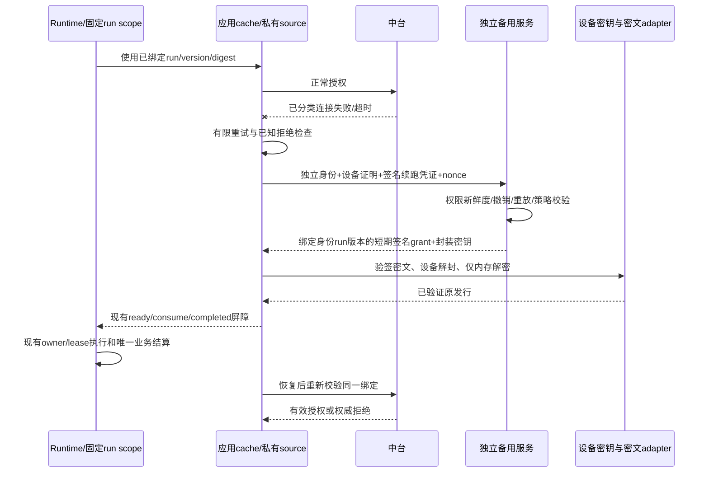
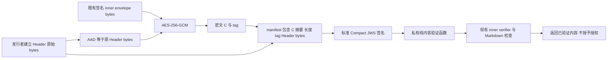

# 总控独立备用授权与签名密文备用包

状态：ECA-1 内部故障分类已完成独立验收；ECA-2a 私有内容验证已实现，并通过聚焦合成验证、根检查和独立代码审查。其余授权协议仍待冻结。尚未启用备用服务或声明真实运行验收。

## 目标与授权范围

用户在“比较总控 Skills 存储方案”聊天明确要求：中台故障时，客户端向独立备用服务取得解密能力，继续已有总控流水线，并将此方案纳入当前开发。本规范限定调整原来的无本地备用包约束：只允许中台发布的签名密文及必要元数据持久化；正常路径仍在应用内存消费正文。

不使用自创碎片算法。明文正文、长期明文内容密钥不得进入文件、日志、历史、分享、导出或安装包。应用解密后，控制客户端进程者仍可能提取正文或密钥；到期不能抹除已提取内容。此方案不承诺永久离线运行或即时获知离线期间的撤权。

本次授权不包括生产部署、真实业务数据操作或发布新版核心正文。主备服务配置、正常专用身份与设备密钥设施缺失时，登记依赖，先完成客户端合同、隔离实现及合成测试。

## 方案选择与唯一所有者

只提高主服务可用性不能覆盖客户端重启后取回备用内容；长期本地密钥会失去每次应急授权控制。采用独立备用授权服务、预置签名密文、每次短期设备封装密钥的方案。

| 对象 | 唯一所有者 | 约束 |
| --- | --- | --- |
| 正式正文、版本、摘要及密文发行 | 中台发布者 | 备用服务只同步，不改写、不升版 |
| 正常授权与权威拒绝/撤销序列 | 中台权限服务 | 签名状态按身份、版本、run 范围适用 |
| 应急授权 | 独立备用服务 | 依据预同步权限和密钥材料，不依赖故障主源在线查询 |
| 明文及有效使用租约 | 现有应用级 controller cache | 新 source 只提供经验证发行，不另建正文所有者 |
| run 身份、版本绑定及业务结算 | 现有 Runtime/SessionStore/工作流 engine | 不新增调度器、run 终态或业务重试所有者 |
| 密文文件 | 私有备用包 adapter | 异步有界读写、签名校验、原子替换；不放普通 Skill 目录 |
| 设备私钥 | 平台设备安全存储 adapter | 不导出明文长期密钥；不支持的平台拒绝启用应急 |

主备的身份验证、权限快照、密文对象与受保护内容密钥必须故障前就绪。独立服务若共享主服务唯一数据库、网络出口、DNS、KMS、身份校验端点或同一主机，须列为共同故障点，不能称独立可用。灾备发布/同步通道与客户端取密钥通道分权。

## 身份、发行与密码合同

- 中台签名发行标识包括 skillId、整数 version、原签名 payload digest、密文摘要、算法与 keyId；密文重加密不能静默改变 run 绑定的正文版本/摘要。
- 使用标准认证加密，例如 AES-256-GCM；每个内容密钥下 nonce 唯一，明确版本化 AAD 绑定发行及身份适用域。ECA-2a 内容容器的精确字节处理与限制见下文；不依赖 JSON 属性排序，签名与 AAD 均使用原始 bytes。其余授权协议另行冻结。
- 密文签名和原发行验签均必须通过；先限制长度、校验签名/身份，再允许解密。解密后重新检查原发行签名、摘要和 Markdown 合同，再进入现有内存 cache。
- 内容密钥按设备公钥封装，采用平台与服务端共同支持的标准封装协议；私钥驻留平台安全存储。服务端内容密钥在 KMS/等价受保护存储中管理，不能放普通配置或明文数据库字段。
- 应急 grant 必须签名绑定具体 ciphertextDigest 和封装密钥的摘要、算法及接收设备 keyId，防止将合法授权与其他密文/密钥混用。精确字节格式、独立身份 authority 与设备安全存储等级是 ECA-2 接通前的必需协议决策，不能把普通凭据加密器或 safeStorage 的存在当作非导出设备密钥已实现。
- 不把本地 version/digest 当作已授权 run 证据。正常授权阶段必须取得可由备用服务验证的签名续跑凭证，绑定 tenant/user/device/session/run、version/digest、允许范围、授权序列与期限；新建/fork/amend 不能借用旧 run 凭证。
- 设备注册、凭证更新、注销与重启后的独立身份恢复需明确接口。模型提供商 token、客户端自报用户身份和本地可改元数据均不构成应急身份凭证。
- 本地仅存签名密文、公开校验材料、必要索引及服务端签名的非秘密绑定证明；不存可直接使用的明文内容密钥。设备封装结果是否可持久化必须由平台安全存储合同明确，第一阶段不允许普通文件保存。

## 触发、拒绝与策略

第一阶段只允许已经正常获授权并绑定版本的 run 续跑。功能缺少任何验证依赖时保持关闭；仅发现密文文件不自动启用。

候选切换只来自受控主源请求中的明确连接失败或独立请求超时，且有限重试耗尽。HTTP 401/403、业务拒绝、账号禁用、版本撤销、签名/摘要不符、TLS/证书错误、重定向、协议损坏、调用方取消、身份切换和未知异常均不可切换。HTTP 5xx/429 首阶段不因状态码直接切换。通用 UNAVAILABLE 不具有切换资格。

客户端分类只是路由前提，不是授权依据。备用服务独立验证设备证明、run 凭证、权限快照年龄、最新撤销水位、请求 nonce/受众/期限、租户用户和设备状态；任何一项未知或过期拒绝。nonce 由服务端挑战或等价抗重放协议提供，消费记录原子提交；客户端不能靠重新分类错误绕过服务端拒绝。

有效权威拒绝优先于较旧许可。按同一主体/资源/run 的签名序列和作用域比较，禁止跨租户套用；已知拒绝不得因网络故障清除。无签名或无法解析的响应本次安全拒绝，但不伪造永久撤销记录；解除权威拒绝只能由可验证的更新授权状态决定。备用快照落后会产生有界撤权窗口，需服务端策略明确接受。

应急最大时长、快照最大年龄、续跑凭证期限及重试预算由服务端受控策略限制，客户端只能进一步收紧。保守建议：应急窗口不长于权限快照允许滞后，默认禁止新任务，缺少显式策略即拒绝；本文不把“数小时/一天”设成获批生产值。

## 切换与恢复顺序



切换发生在授权/内容获取层，不重新提交业务工具或创建 run。每个异步返回检查身份代次、取消、run 绑定与许可有效期；迟到主/备响应不能复活取消或覆写更高拒绝水位。completed 前再次校验，缓存存在不能替代授权。主源恢复后重新检查同一 version/digest；失败只停止后续受保护操作，不自动重放已经发生的业务副作用。

注销/切换租户清除当前明文、使用租约及密钥引用，隔离原身份密文索引。恢复时必须重新证明身份和同 run 资格；两个服务都不可用且无有效授权时停止。设备撤销、版本撤销和策略过期必须使后续使用失败；不改 owner/lease 或工作流 journal 来制造成功。

## 与当前源码的差异及分阶段交付

ECA-1 前的 http-source 将网络、TLS、部分业务/协议异常归为 UNAVAILABLE，超时与取消混合。ECA-1 现已在内部区分连接故障、独立超时和不可切换结果，公开错误码保持兼容；platform-auth 刷新失败会清除登录；private acquire 只有 version，cache key 不含 run，现有持久化只有 version/digest。这些不满足应急续跑合同，不能直接套 fallback。

1. ECA-1：私有主源故障分类和安全拒绝测试。保持现有公开错误码、普通授权行为及无备用运行事实；区分候选网络故障和不可切换失败，不实现真实备用连接。
2. ECA-2a：仅实现下文固定 JWS/AES-GCM 内容校验与既有内层验签，使用内存合成向量；不接生产调用者。后续 ECA-2b 再冻结签名续跑凭证、应急 grant、设备封装、权限水位映射、完整时间接受谓词及拟议服务端重放账本；ECA-2a 不替代其授权与重放验收。
3. ECA-3：平台设备存储与私有密文 adapter，异步原子存储、身份隔离、损坏/旧包/重启测试。没有可靠设备存储时拒绝启用。
4. ECA-4：主备 source 装配与签名 run 凭证接线，保留唯一 cache/Runtime owner、completed/取消和迟到保护；不把单纯 version 请求升级为续跑许可。
5. ECA-5：独立备用服务的受控实现与预同步适配、隔离进程合成验收；部署目标、身份/KMS/权限源确定后才进行正常授权环境验收。当前无部署就绪声明。

各片段独立评审 spec/计划/实现，运行目标测试及项目类型、Lint、架构检查。全量测试仅用户明确要求时运行。

ECA-1 精确限制：只有取得 token 并实际开始 fetch 后的受控连接错误或独立请求超时才可标记候选；token/刷新失败不改变现有清除身份语义。浅层固定 errno 白名单以外的异常均安全拒绝。已经观察到的 TLS、HTTP、业务或解析拒绝不得被随后超时覆写；调用方取消优先，AUTH_REQUIRED/IDENTITY_CHANGED 保持原优先级。内部分类不暴露到 Renderer/私有 IPC 新字段，不记录原始 cause 或响应正文；它不是应急授权许可。

## 接受的验收场景

| ID | 场景与必须断言 |
| --- | --- |
| ECA-T01 | 连接失败/超时分类可候选；调用方取消优先，不当主源故障 |
| ECA-T02 | 401/403、业务拒绝、TLS、未知错误、验签/摘要失败均不得请求备用 |
| ECA-T03 | 主备均不可用、grant过期、快照过旧、缺策略时拒绝，不无限重试 |
| ECA-T04 | 跨租户/用户/设备/run、nonce重放、撤销序列回退均拒绝 |
| ECA-T05 | 密文篡改、错误签名、旧版本、错误AAD/封装设备均拒绝；无明文落盘 |
| ECA-T06 | 重启后独立证明身份与原run；新任务/fork不借旧凭证离线启动 |
| ECA-T07 | 主备切换/主源恢复保持version/digest和既有结算；业务副作用不重复 |
| ECA-T08 | 身份切换、取消、迟到响应、过期在completed前拒绝；已有结果不被重写 |
| ECA-T09 | 日志、stderr、历史、导出、安装包不含明文/密钥；合成测试只证明所测出口 |

Desktop本地、远程Host与手机恢复链分别验收。第一阶段不向Web/mobile公开密文、密钥或备用权限接口；未接通设备保护的远端拒绝应急。当前未新增UI选择，也不改普通聊天、模型提供商认证、任务排序或工作区身份规则。

## ECA-2a：固定签名密文内容验证合同

本片段只验证内容真实性、完整性和精确发行绑定。新增私有同步纯函数，输入已提供的 bytes、可信期望发行、外层发布公钥与既有内层 trust，以及仅在测试/内部参数中传递的 CEK；输出 `VerifiedManagedSkillBundle`。成功解密不等于授权、租约或 run 续跑资格。没有生产调用者，不新增 owner，不装配 source/application/cache，不提供 Renderer/IPC/公共导出，不实现网络、文件存储、设备、grant、continuation、策略、时间或重放账本。不得据此宣称备用服务启用。

### 唯一标准 profile 与可信输入

只接受 RFC 7515 Compact JWS 和 RFC 8037 的 `alg=EdDSA`，密钥曲线固定 Ed25519。使用 Node 标准 crypto 的封闭子集，不新增通用 JOSE 框架、不支持多签名、JWE、detached/unencoded payload 或算法协商。后续需要这些能力须重新评审，不能逐步扩成自写 JOSE 库。

内部函数合同为 `verifyEncryptedControllerRelease(input, expectedRelease, contentTrusts, innerTrust, cek): VerifiedManagedSkillBundle`，同步、无 callback/stream/await。`input` 仅含 `manifestJws: string`、`ciphertext: Uint8Array`；不定义新的磁盘文件容器。`expectedRelease` 包含 tenantId、skillId、version、releasePayloadDigest，来自内部可信调用方，仍不作为授权证明。`innerTrust` 使用现有 `ManagedSkillTrust`；跨包只从 `@zcode/shared/managed-skills` 公开入口导入类型、限制和 `verifyManagedSkillBundle`。

`contentTrusts` 是内部可信调用方提供的只读条目集合，每项仅有 `kid` 和 `publicKey`；空集合、重复 kid 或无法精确选择 kid 均拒绝。集合最多 32 项，每个 kid 非空且最多 256 UTF-8 bytes。`publicKey` 仅接受 `KeyObject` 且 `type === "public"`、`asymmetricKeyType === "ed25519"`，或一个有界（最多 1 KiB）的单 SPKI `PUBLIC KEY` PEM。PEM 先严格检查单块公钥格式，再 `createPublicKey` 并验证上述类型；拒绝 PRIVATE KEY、拼接 PEM、证书和 JWK。不能只看 asymmetricKeyType，不能用 createPublicKey 自动接纳私钥。消息内的 kid 只用于有界查表，不能加载 URL、消息携带 key 或远端信任根。外层公钥不覆盖内层独立 trust。

### JWS 字节与 JSON 规则

Compact JWS 为 ASCII `protected.payload.signature`，恰好三段、均非空、无空白。每段只允许 `[A-Za-z0-9_-]`，无 `=` 填充；解码后 base64url 回编码必须与原段相同，拒绝非规范 pad bits。不得把原内层标准 base64 改为 base64url。

签名输入精确为 `ASCII(protectedSegment + "." + payloadSegment)`，调用 `crypto.verify(null, signingInput, trustedPublicKey, signatureBytes)`；signature 必须 64 bytes。不加自定义 domain 前缀、不签解码后 payload、不重新序列化。protected header 经严格 schema 后恰好为：

```json
{"alg":"EdDSA","kid":"synthetic-content-key","typ":"ccode-encrypted-manifest+jws"}
```

示例 kid 不是生产配置。`typ` 为固定应用 profile 标识，不声称已注册 IANA 媒体类型。任意未知 header 字段拒绝，包括 `crit`（即使空数组）、`b64`（即使 true）、`jwk`、`jku`、`x5c`、`x5u`、`x5t`、`zip`；不接受 unprotected header。固定 alg 不允许 none、HMAC、RSA 或 Ed448 回退。

protected、manifest、AAD header 各只进行一次原生 `JSON.parse`，采用 RFC 7515 §4 允许的词法最后重复成员（last-wins）语义，再严格 schema 校验并贯穿使用解析结果。转义等价成员名也使用最后值。禁止 first-wins、merge、regex 另取字段或混合解析；未知成员即使重复仍是未知成员，应拒绝。最后 alg=none 拒绝；最后 alg=EdDSA 仅在完整原文通过可信 Ed25519 签名后可继续。验签覆盖全部原始文本，不将这一规则描述成“重复成员全部拒绝”。跨语言实现采用相同值或更严格拒绝。

所有 JSON bytes 必须通过 fatal UTF-8 解码；在解码前显式拒绝 `EF BB BF` BOM 前缀（TextDecoder 默认可能吞 BOM，fatal 不等于拒绝 BOM）。该规则也适用于解密后的内层 envelope JSON；内层 payload 的其他规则仍由既有 verifier 决定。允许 JSON 合法空白和属性顺序变化，不新增 canonicalizer、tuple 编码、全域 NFC/大小写转换或自写 tokenizer；业务 ID 精确比较。版本及长度为正安全整数，拒绝非整数、Infinity、NaN、负值及溢出。

### Manifest、AAD 与发行次序

JWS payload 是 manifest 原始 UTF-8 JSON bytes。manifest 只允许以下字段：

| 字段 | 类型与约束 |
| --- | --- |
| schemaVersion | 固定整数 1 |
| headerBase64url | AAD header 原始 UTF-8 JSON bytes 的规范无填充 base64url |
| ciphertextDigest | SHA256(C)，小写 64 hex；C 不含 tag |
| ciphertextBytes | C 精确长度，正安全整数 |
| tagBase64url | 规范 base64url，解码恰好 16 bytes |

AAD header 只允许以下字段：

| 字段 | 类型与约束 |
| --- | --- |
| schemaVersion | 固定整数 1 |
| tenantId | 非空，最多 256 UTF-8 bytes，精确匹配 expectedRelease，不支持 wildcard |
| skillId | 现有 managedSkillIdentitySchema 且精确匹配 expectedRelease/innerTrust |
| version | 正安全整数，精确匹配 expectedRelease，不能只检查不低于 floor |
| releasePayloadDigest | 原内层 payloadBase64 解码 bytes 的 SHA256，小写 64 hex，精确匹配 expectedRelease |
| plaintextBytes | P 精确长度，正安全整数 |
| algorithm | 固定 AES-256-GCM |
| ivBase64url | 规范 base64url，解码恰好 12 bytes |

AAD 恰好为 `headerBase64url` 解码保存的原始 bytes，无前缀、无重序列化。P 是现有 `ManagedSkillEnvelope` 的 UTF-8 JSON bytes；其中 payloadBase64/signatureBase64 保留原标准带填充 base64。Header 不含 C 摘要或 tag，因此没有加密/签名循环。外层签名同时绑定原 Header、tag、C 摘要及长度。



发行者每包生成新随机 CEK32/iv12，同 CEK 下 iv 唯一；重加密重新生成 CEK/iv。纯消费函数不能证明发行者历史未复用 nonce，此限制不能宣传成已由客户端保证。CEK 不进入 manifest。可以对 manifest 原始 payload bytes 计算独立摘要用于后续协议，但不能替换 releasePayloadDigest，本片段不持久化或签发 grant。

### 资源上限与校验顺序

| 对象 | 上限/长度 |
| --- | --- |
| Compact JWS | 16 KiB ASCII |
| protected 解码 bytes | 1 KiB |
| manifest 解码 bytes | 8 KiB |
| AAD header 解码 bytes | 4 KiB |
| C 与 P | 各 20 MiB，复用 MANAGED_SKILL_BUNDLE_LIMITS.envelopeBytes |
| CEK / IV / tag / signature | 32 / 12 / 16 / 64 bytes |
| kid / tenantId | 各非空，最多 256 UTF-8 bytes |

首先检查原始输入类型/长度，再 split、copy 或 decode，禁止先复制超限 C。base64url 在解码前按 decoded 限额推导 encoded 长度上限（例如 `4 * ceil(limit / 3)` 的保守上限），解码后再次核实际上限和规范回编码。无压缩，必须 `C.byteLength === ciphertextBytes === plaintextBytes`。内层原限制仍为 payload 15 MiB、累计文件 10 MiB、单文件 2 MiB、最多 512 文件，不扩大原有路径/文件 hash 合同。

执行顺序固定如下：

1. 检查 input、expectedRelease、trusts、CEK 类型与长度，在限额内复制 C/CEK；不修改调用者 Buffer。同步函数不交出中间引用。
2. 检查 Compact 结构、规范 base64url；只解析 protected 作可信公钥选择并验原签名输入。外签名通过前不解析业务 manifest、不解密。
3. 严格解析 manifest/AAD，保存原始 AAD bytes；核期望 tenant/skill/version/digest、算法、长度与 SHA256(C)。任何失败不得调用解密。
4. `createDecipheriv("aes-256-gcm", cekCopy, iv, { authTagLength: 16 })`，`setAAD(rawHeaderBytes)`、`setAuthTag(tag)`。update 输出只留局部 Buffer；final 成功前不解析、字符串化、返回、写日志或传消费者。
5. final 成功后组合有界 P，核长度、BOM/fatal UTF-8，解析 inner envelope，调用原 verifyManagedSkillBundle；重算原 payloadBase64 bytes 的 SHA256，检查期望/header digest 和返回 skill/version，再检查每个文件 path 满足 `/\.md$/i`。既有 verifier 本身不保证 Markdown-only，因此必须保留此附加门禁。
6. 仅全部检查成功才返回 owned `VerifiedManagedSkillBundle`。GCM 失败、inner 验签/路径/hash/摘要/版本/Markdown 任一失败均不得返回部分或全部内容。finally 尽力清零自己的 CEK/临时解密 Buffer；不修改 caller Buffer，不清零成功返回文件。失败后已产生但不返回的文件 Buffer 尽力清零；JS 字符串/GC/崩溃转储不提供物理擦除保证。

统一内部错误码固定为：`INVALID_ENVELOPE`（类型/编码/schema/资源/长度）、`UNTRUSTED_SIGNATURE`（外层 trust/key/签名）、`BINDING_MISMATCH`（期望发行或密文摘要不符）、`DECRYPT_FAILED`（AEAD/CEK 解密失败）、`INVALID_CONTENT`（内层或 Markdown 校验）。输入 CEK 长度错误属于 INVALID_ENVELOPE，长度正确但错误密钥导致认证失败属于 DECRYPT_FAILED。所有原始 crypto/JSON/schema/inner 异常捕获后映射固定安全 message/code，不挂 cause、原数据或 key，不发日志、不接受 debug hook。这是内容验证错误，不接现有 source 的备用切换判定。

### ECA-2a 合成验收

| ID | 场景与必须断言 |
| --- | --- |
| ECA-2A-T01 | 内外不同 Ed25519 key、随机 CEK/iv 的真实 JWS/AES 正向向量，原文件 bytes 一致；独立构造 RFC signing input，不仅同一实现自签自验 |
| ECA-2A-T02 | Header/manifest 合法空白与属性顺序变化并重签可验证；不重签改字节失败；AAD 使用原 bytes 而非回编码 |
| ECA-2A-T03 | 固定算法/key用途、private KeyObject/PEM、未知 kid/字段、crit/b64/JWK/URL、Compact 段数、base64url/pad bits 非法均拒绝；无动态取 key |
| ECA-2A-T04 | 重复 alg/kid/typ/version/tenant 及转义等价 key 精确 last-wins；最后 none 拒绝，最后 EdDSA 仍须完整签名；未知字段不消失 |
| ECA-2A-T05 | C/tag/iv/AAD/header/外内签名篡改，两个合法包混搭，期望 tenant/skill/version/digest 不符均拒绝 |
| ECA-2A-T06 | 限额前后、非法 UTF-8/BOM、声明/C/P 长度不符、整数边界、缺/额外字段、错误 CEK 长度；先限长再复制/解码 |
| ECA-2A-T07 | GCM update 已有字节但 final 失败零返回；外层合法但 inner hash/path/minimumVersion/SKILL.md/非 Markdown/digest 失败仍零内容交付 |
| ECA-2A-T08 | caller Buffer 不变、成功结果独立、只有内部导出；源码无 IO/logger/source/cache/IPC 装配；原 cache 用例不回归 |

这些场景只补充 ECA-T05 的内容校验，不覆盖 ECA-T03/T04/T06/T07/T08 的授权与运行语义。“失败零明文返回”不等于全应用日志、管理员内存提取或系统崩溃转储绝对无泄漏。当前已有 81 项内容验证用例与 1 项 cache 回归通过，覆盖上述多类拒绝与正向场景，但未穷尽每个资源限制的 N-1/N/N+1 边界矩阵；部署、设备及真实续跑验收保持未完成。