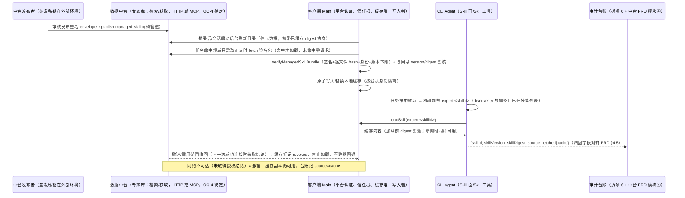

# 中台专家 skill 按需下发（客户端侧 spec）

- 状态：待评审
- 编写日期：2026-10-22（同日完成与并行产物的实读对齐，见下）
- 台账来源：`E:\ZCode\docs\prd\总控台账.md` 开发批次 1「中台专家 skill 下发 spec→产出 docs/specs/ccode-expert-skills-distribution.md」行（2026-10-22 19:07 派发，锚 `ccode-product-prd.md#L79`）
- 母 PRD 锚点：`E:\ZCode\docs\prd\ccode-product-prd.md` §4.6（L74-L83）、§2 目标 5（L20）、§5（L95-L97）；拆项 `E:\ZCode\docs\prd\split\05-controller-expert.md`（R3.3 专业专家、R1.2 版本/来源元数据面、盘点 11 MCP 基础设施）
- 中台侧合同：`E:\ZCode\docs\prd\ccode-dataplatform-prd.md`（v0.1，批次 20261022-D1，待评审）——本文已实读对齐：§1.2 Skill 三层架构、§3.2 模块②（M2-R1~R5）、§4.2 专家 skill 获取协议、§4.5 归因字段、§7 P3 分期、OQ-4。接口语义契约以该 PRD §4.2 为准；端点命名、路径与内部实现由中台定（该 PRD §4 头声明）。该 PRD 属待评审状态，评审冻结前本文引用其条目均视为草案对齐。
- 关联并行产物：`E:\ZCode\docs\specs\ccode-controller-local-skill.md`（总控本地锁定 skill spec，待评审，2026-10-22；本文已实读对齐：其取代 `ccode-startup-global-prompt.md`，总控改为本地锁定形态，本文第 5.3 节命名空间隔离与其保留名机制衔接，其 §5.6 载明 skill-port load 语义将改造）
- 盘点基线：分支 `codex/ccode-update-feed` 当前工作区（2026-10-22 实测 236 条未提交变更；本文代码断言均按当前工作区字节实读，不预测在途改动走向）
- 保密约束：本文只描述机制与契约要点，不复制任何受控总控正文或中台未公开内容。

## 一、拍板记录（2026-10-22 方向拍板，直接采用）

以下为本轮用户与老板讨论收敛的拍板结论（与中台 PRD §1.2「Skill 三层架构」表一致，本文按其直接展开，不重新论证）：

1. 专家 skill（拼多多等领域专家知识）唯一存于数据中台；客户端不在安装包内捆绑专家内容（中台 PRD M2-R2「唯一来源」）。
2. 客户端在任务命中领域时按需获取并加载：**命中才加载、未命中零请求**（中台 PRD M2-R3、S4 判据），不做启动期全量预取。
3. 获取内容必须验签（Ed25519 签名 envelope，防篡改），验签失败不得加载；签名可独立验签，不信任传输层即信（中台 PRD §4.2 共通硬要求 1）。
4. 下发内容携带 version 与 digest，供审计台账归因「该任务用的是哪版专家技能」（中台 PRD §4.5 归因字段 skillVersion/skillDigest）。
5. 本地缓存：断网可用、避免每次任务重复拉取的延迟；本地仅缓存已验签版本，不作为第二权威源（M2-R2），缓存键与淘汰策略由客户端定。
6. 传输形态 MCP 或 HTTP 由中台定（中台 PRD OQ-4）；本 spec 按该 PRD §4.2 双方案并列承接客户端侧的双形态兼容设计。
7. 专家 skill 命名空间必须与总控锁定 skill（`ccode-controller-local-skill.md`）和用户自有 skill 三方隔离，互不可覆盖。
8. 与总控 skill 的差异定位（对齐中台 PRD §1.2 三层表）：两者都允许本地持有已验签内容且离线可用，差异在**获取模式与内容权威**——总控是通用派发、本地内置锁定形态、更新走中台自动推送、可开分支迭代；专家是领域知识、中台唯一来源、按需拉取、用户只读不可改。旧口径「总控正文仅内存、无离线回退」（`ccode-startup-global-prompt.md`）已被 `ccode-controller-local-skill.md` 取代；AGENTS.md「CCode 总控 Skill 来源」节的现行红线文本由并行线程按其 OQ-L8 修订，修订落定前不因专家机制放松任何现行约束。

母 PRD §4.6 锚定（原文，`ccode-product-prd.md` L81）：「总控可以引用企业数据中台中的必要步骤、规则和专业能力说明。产品需保留版本、来源和适用范围等可审计元数据，但不把受控正文混入普通聊天记录或导出内容。」专家 skill 即该句中「专业能力说明/专业专家」（L78「分派专业专家」、§2 目标 5「后续专业专家」）的客户端承载形态，本 spec 落实其中「版本、来源」两字段与按需获取机制；「适用范围」字段沿用拆项 05 R1.2 的元数据面扩展与中台 PRD M2-R1（租户/用户组/角色，粒度待中台定），不在本文重复定义。注意边界：L81 后半句「不把受控正文混入普通聊天导出」约束的是总控受控正文；专家正文按 Skill 工具正常语义进入会话上下文（这是其存在的目的），两者的导出口径差异见行为细节 6.7 与开放问题 OQ-7。

## 二、目标与范围

目标：

1. 定义「中台发布 → 客户端按需获取 → 验签 → 本地缓存 → Skill 面加载 → 审计归因」的端到端客户端机制，承接中台 PRD 模块②（M2-R1~R5）的客户端侧义务。
2. 复用既有签名验签契约（`@zcode/shared/managed-skills`）与签发管道（`scripts/publish-managed-skill.mts`）作为下发载体，不自建第二套签名格式（对齐 M1-R3 同款复用声明）。
3. 按 PRD §4.2 承接 HTTP 与 MCP 双方案的统一客户端抽象（双形态兼容设计是 PRD 明确交给客户端 spec 的任务，见其 §4.2 共通硬要求 3），共同安全不变量为信任独立于通道。
4. 定义三种 skill（总控锁定 / 中台专家 / 用户自有）的命名空间隔离规则，保证互不可覆盖。
5. 定义缓存生命周期、失效策略与离线降级语义，使断网时命中领域的任务可继续执行且台账可归因到缓存版本。

范围内：客户端侧获取、验签、缓存、命名空间、加载触发、审计元数据传递的机制与契约要点；验收场景（与中台 PRD S4 互补：S4 验中台侧服务端判据，本文场景验客户端侧判据）。

范围外：

- 中台侧发布系统、知识库管理、签名私钥与信任根轮换运营（中台 PRD 范围，本文只承接客户端义务）。
- 总控 skill 本体的本地锁定、推送更新、stub 触发、分支迭代（`ccode-controller-local-skill.md` 范围）。
- 台账记录模型与关闭门禁（「缺少专家加载不得标完成」的校验实现属拆项 6，本文只提供输入字段）。
- 普通用户本地 skill、插件 skill、bundled skill 的既有行为（保持不变）。
- 代码实现与测试（本 spec 为待评审设计文档）。

## 三、现状依据（复用面与缺口）

以下断言均按当前工作区实读标注；「已实测」附路径与符号名。

- E1【已实测】签名验签契约现成。`E:\ZCode\packages\shared\src\managed-skills\contract.ts`：严格 envelope（schemaVersion=1、payloadBase64、signatureBase64 定长 88）、payload（skillId/name/version 正整数/files[]，每文件 path/contentBase64/sha256）、限额（envelope 20 MiB、payload 15 MiB、文件总量 10 MiB、单文件 2 MiB、512 文件）、`ManagedSkillTrust { skillId, name, publicKeyPem, minimumVersion }`。`E:\ZCode\packages\shared\src\managed-skills\verify.ts` 符号 `verifyManagedSkillBundle`（L45-L140）：Ed25519 验签覆盖 payload 原始字节（不重序列化）、逐文件 SHA-256 复核、身份必须等于 trust 的 skillId/name（L98-L100，IDENTITY_MISMATCH）、version ≥ minimumVersion（L101-L103，VERSION_REJECTED）、路径安全（NFC、禁穿越、Windows 保留名、大小写冲突去重，L19-L43）、必须有根 SKILL.md（L130-L132）。
- E2【已实测】签发管道现成，且复用意图已有记录。`E:\ZCode\scripts\publish-managed-skill.mts` 符号 `publishManagedSkill`（L48-L145）：把独占目录签成单行 JSON envelope、用派生公钥自验通过才落盘、临时文件 + 同目录硬链接原子发布且拒绝覆盖；源树拒绝软链/硬链/特殊文件/私钥材料。`E:\ZCode\docs\specs\managed-controller-skills.md` L3 明示「本文的签名契约仍可复用」。**评估结论：复用该契约为专家 skill 下发载体成立，与既有 skill 机制无根本不兼容，拦停预案不触发。**
- E3【已实测】中台 HTTP 下发三段式先例（controller 通道）。`E:\ZCode\packages\services\src\confidential-controller\http-source.ts`：`authorize` POST `system/ccode-controller/authorize`（响应上限 8192 字节，L107-L129）、`download` POST `system/ccode-controller/content`（上限 envelopeBytes+8192，L130-L142），Bearer token + tenant-id。`E:\ZCode\packages\services\src\confidential-controller\application.ts` 符号 `assemble`（L37-L72）：authorize 取 grant → 校验 skillId/version/digest(64hex)/expiresAt → download → `verifyManagedSkillBundle` → payload SHA-256 与 grant.digest 复核 → 仅接受 `.md`。注意：controller 的消费语义（拼接为 systemPrompt、仅内存）不适用于专家 skill——专家走 Skill 面加载语义（见架构图），但「grant 元数据与 bundle 内容双重核对」的模式直接复用。
- E4【已实测】信任根部署先例与多信任形态。`E:\ZCode\packages\desktop\src\main\index.ts` L685-L687 实测含 `skillId: "controller"`、`minimumVersion: 1`（L682-L691 区间据拆项 05 盘点 3 含 apiBaseUrl 与内置 Ed25519 公钥 PEM）；`createControllerApplication` 的 `options.trusts` 为数组（`application.ts` L22）——多 skill 信任列表的配置形态已存在，专家 skill 信任可按同层扩展。信任根指纹的权威归属与不一致判定流程见中台 PRD M6-R4/M6-R5（本仓库内置指纹待中台判定，见 OQ-3）。
- E5【已实测】Skill 面注入元数据条目的现成范式（当前在途代码形态）。`E:\ZCode\apps\zcode-cli\packages\adapters\src\confidential-controller\skill-port.ts` L5-L41：discover 时过滤与保留名冲突的本地条目并 push 仅元数据条目（`source: "remote"`、`scope: "admin"`、`safeToAutoLoad: false`、空 path），load 保留名一律抛 UNAVAILABLE。`E:\ZCode\apps\zcode-cli\packages\contracts\src\skills\index.ts`：`SkillSource` 已含 `"remote"` 枚举（L17）、`SkillRoot.namespace`（L39）、`SkillMetadata.qualifiedName`（L57）；保留名判定 `isConfidentialControllerSkill`（L10-L13，NFKC 归一 + 路径分段）。注意：`ccode-controller-local-skill.md` §5.6 已计划把 load 保留名分支从「一律 UNAVAILABLE」改为「经锁定存储返回内容」——专家条目的 discover 注入复用同一包装范式，但专家条目本就是真实可加载技能（正文来自验签缓存），与保留名分支互不干扰。
- E6【已实测】Skill 加载路径与审计钩子现状。`E:\ZCode\apps\zcode-cli\packages\core\src\tool\handlers\skill.ts`：默认正文上限 `MAX_SKILL_BYTES = 100_000`（L19，dynamic-workflows 例外 200_000）、`recordSkillTelemetryMetadata` 钩子（L88-L93）现仅传 name/qualifiedName/pluginId/source，**无 version/digest 字段**；加载结果携带 baseDirectory 供 references 相对路径解析（L99-L107）。
- E7【已实测】MCP 基础设施完整存在。`E:\ZCode\apps\zcode-cli\packages\core\src\runtime\methods\mcp.ts`：`startMcpStartup`（L41）、`registerMcpTools`（L139）、回合边界 `refreshMcpToolsIfChanged`（L203）、OAuth 授权等待上限 15s（L12、L76）；连接池/stdio/OAuth 族在 `E:\ZCode\apps\zcode-cli\packages\adapters\src\mcp\`，配置辅助在 `E:\ZCode\apps\zcode-cli\packages\bootstrap\src\mcp-config.ts`。当前无数据中台 MCP server 配置（拆项 05 盘点 11：根 `.mcp.json` 不存在、`dp.sccsai.com` 全仓库仅 desktop main 一处）。
- E8【已实测】缺口：专家 skill 的获取/缓存/加载路径完全不存在。对 `expertskill|expert-skill|expert_skill` 全仓库 git grep 零命中（2026-10-22 实测）；任务级审计无 version/digest 传播（拆项 05 盘点 8：`controllerVersion` 等零命中）；本地技能发现 `E:\ZCode\apps\zcode-cli\packages\adapters\src\skills\roots.ts` 的优先级机制（L21-L73，`extraResolvedRoots` 通道 L70）只覆盖文件系统根，无 remote 下发消费先例。

## 四、架构与数据流（中台发布→按需获取→验签→缓存→加载）



阶段要点：

1. **中台发布**：中台以 `publishManagedSkill` 同构管道产出签名 envelope 并发布进专家库；skillId/name/version/适用范围由中台审核确定（M2-R1），客户端不自签、不改信任根（对齐 `managed-controller-skills.md`「内容权威」与拆项 05 R1.1 的客户端义务表述）。
2. **目录/检索（仅元数据）**：客户端持有一份不含正文的专家目录（skillId、name、领域标签、摘要、version、digest、适用范围标识），用于命中判定与版本协商（PRD §4.2 检索端点语义）。目录条目不携带任何文件内容。
3. **按需获取**：任务命中领域且缓存 miss/过期时，经 transport（HTTP 或 MCP）fetch 签名包；未命中领域对中台零请求（M2-R3、S4）。通道只是运输层：安全不依赖通道，验签与信任根独立于通道（PRD §4.2 共通硬要求 1，见行为细节 6.1）。
4. **验签**：`verifyManagedSkillBundle(envelope, trust)`，trust 来自客户端部署的专家信任清单（内置公钥，Main 持有）；再与目录条目的 version/digest 复核（复用 E3 的双重核对模式）。任何一步失败→拒绝进入缓存与加载。
5. **缓存**：验签通过后原子写入 CCode 私有数据目录下的专家缓存区（独立于 ZCode 数据目录，对齐母 PRD §4.2；按登录身份隔离）。缓存保存验签产物（文件 + payload 级 digest + version + 写入时间），加载时复验。
6. **加载**：Skill 面 discover 注入 `expert:` 命名空间元数据条目；模型经 Skill 工具（或总控分派步骤，见 6.5）触发 loadSkill，正文与 references 从缓存解析，进入会话上下文；skillVersion/skillDigest/source 记入审计元数据（6.6）。

## 五、状态所有者与接口

### 5.1 专家 skill 内容所有者 = 中台

- 每个专家 skill 的内容、版本序列、撤销、适用范围与发布策略的唯一权威是数据中台（M2-R1/R2）。客户端本地副本只是缓存（cache），不是事实源、不作为第二权威；缓存不得被客户端侧任何进程重新签名或提升版本。
- 客户端内置的专家信任清单（skillId→公钥/最低版本）随客户端部署更新，不由用户配置、不由下发内容自带（envelope 内不存在可自我授权的公钥字段，E1/E2 契约保证）。
- 客户端内所有者划分：桌面 Main 持有平台认证（复用 controller application 的认证代次模型，认证复用中台登录、不新增第二套凭据，M6-R1）与信任清单；缓存存储的唯一写入者是单一服务（建议 services 层新增 ExpertSkillCacheStore，唯一写路径，原子替换）；Renderer 与 Agent 进程不直接读写缓存文件，经端口访问。跨进程接口若进入协议面，须同步 `packages/shared` 严格类型与运行时校验（对齐 `E:\ZCode\AGENTS.md`「进程、协议与远程控制」节纪律）。

### 5.2 本地缓存副本的生命周期与失效策略

- 生命周期键：`identity（登录账号/tenant） × skillId`，内容按 digest 版本化（digest 相同即内容相同，同 digest 不重复落盘；对齐 PRD §4.2「缓存键 = digest」与 M2-R2「缓存键与淘汰策略由客户端定」的双向表述：条目按 skillId 索引，内容寻址按 digest）。身份切换（登出、换账号、换租户）后旧身份缓存不可被新身份读取（对齐母 PRD §4.3 L56 权限上下文隔离），可清空或按身份目录隔离。
- 生成：仅验签通过后写入；写入为 temp 目录 + 原子 rename（对齐 E2 原子发布思路：失败不留下半份缓存）。
- 失效与更新触发：
  1. 目录刷新发现更高 version 且新 envelope 验签通过 → 原子替换为新版本；
  2. 信任清单 minimumVersion 上调，缓存版本低于下限 → 该条目标记不可用（VERSION_REJECTED 语义），等待重新获取，不得继续加载旧版；
  3. 中台撤销/适用范围收回（授权结论在下一次成功连接时取得，离线期间不猜测版本状态——语义对齐 `ccode-controller-local-skill.md` §5.4 撤销表述与中台 PRD OQ-6 方向）→ 条目标记 revoked，禁止加载，不静默回退缓存；
  4. 网络不可达/超时（未取得授权结论）→ 缓存条目保持可用（离线降级，见 6.4）；
  5. 缓存总量/条目数上限 + LRU 淘汰（防膨胀；被淘汰不构成功能故障，重新获取即可）。
- 防篡改：缓存不做 OS 级写隔离（那是 `managed-controller-skills.md` 写入隔离阶段的独立议题，前置条件结论见 `ccode-controller-local-skill.md` OQ-L4），但**加载前必须复验**：逐文件 sha256 + payload digest 与缓存记录一致，不一致按缓存损坏处理（拒绝加载该版本，尝试重新获取；仍失败则该 skill 不可用并给出明确错误），被篡改内容在任何路径下不得进入会话上下文。
- 一致性绑定：一次任务回合内绑定加载时的 {skillId, version, digest}，回合内不切换版本（对齐 `managed-controller-skills.md`「会话必须绑定所使用的版本」规则）；子代理继承同一版本。

### 5.3 三种 skill 的命名空间隔离规则

下表为**目标态**（总控行的目标形态依据 `ccode-controller-local-skill.md`；当前在途代码中总控仍为「仅授权占位 + load UNAVAILABLE」，见 E5 现状）：

| 维度 | 总控锁定 skill | 中台专家 skill | 用户自有 skill |
| --- | --- | --- | --- |
| 身份 | 保留名「总控派单」/ skillId `controller`，本地锁定原件 | `expert:<skillId>`（skillId 为无 `/ \ :` 的裸标识符，E1 契约 L16-L20 保证） | 用户/项目目录、插件、bundled 的既有名称 |
| 内容位置 | 系统数据目录锁定存储（加密副本） | 中台唯一来源；本地仅验签缓存 | 用户数据目录 |
| 加载语义 | stub 常驻 + 命中加载（local-skill spec §5.1/§5.6） | `source: "remote"`，discover 注入元数据条目，正文来自验签缓存，走 Skill 工具正常输出 | 现行为不变 |
| 用户可改性 | 不可改原件，可开分支（分支是用户副本） | 只读（M2-R2；中台审核发布） | 完全可控 |

硬规则：

1. **保留名保护双向生效**：专家信任清单在部署期校验不得包含保留身份（skillId/name 命中 `controller`/「总控派单」的专家条目拒绝部署）；用户侧任何来源（目录、插件、extraRoots）命中保留名的既有过滤（E5 范式）保持。专家 skillId 与保留名冲突的技术兜底是 E1 的 IDENTITY_MISMATCH（trust 身份不匹配即拒绝），部署期清单校验是前置防线。
2. **`expert:` 前缀独占**：qualified 名 `expert:<skillId>` 只能由专家通道产生。用户在用户根/项目根创建名为 `expert:<x>` 或以 `expert` 命名空间占位的技能不生效（discover 合并时过滤并产出 `skill_duplicate_name` 类诊断，复用 E5 过滤范式）；专家条目也不得使用插件 `plugin:skill` 形态。
3. **专家条目不可被本地同名覆盖**：本地任何目录出现与已发布专家 skillId 同名的技能时，discover 结果中专家条目唯一且来源为 remote；本地同名条目被过滤（受管身份不由用户 frontmatter 自报，对齐 `managed-controller-skills.md` 产品规则）。总控锁定 skill 的分支副本（用户数据目录、身份名不含保留名）同样不得占用 `expert:` 前缀。
4. **用户自有 skill 行为不变**：不因专家机制禁用或降级任何普通技能能力（对齐 `managed-controller-skills.md`「不得为保护总控技能而默默禁用全部客户端工具」的同等原则）。
5. 保留名/命名空间判定的实现挂点沿用 `isConfidentialControllerSkill` 同族的 contracts 层函数（NFKC 归一 + 路径分段匹配范式，`contracts/src/skills/index.ts` L10-L13），新增 `isExpertSkillIdentity` 同构实现；单一事实来源放 packages/shared 的 skill-identity 模块（2026-10-23 自 contracts 提升，contracts 出口委托），不散落在 adapter（与 `ccode-controller-local-skill.md` §5.6 对 P6a/P6b 保留判定的处置一致）。

### 5.4 客户端接口草案（端口形态，实现落点建议）

```ts
// transport 抽象（HTTP 与 MCP 双实现，通道由中台定 OQ-4，语义对齐 PRD §4.2）
interface ExpertSkillTransport {
  search(identity, query: { domainTags?: string[]; keywords?: string }, signal): Promise<ExpertSkillCatalogEntry[]>; // 仅元数据
  get(identity, skillId, options: { cachedDigest?: string }, signal): Promise<ManagedSkillEnvelope | NotModified>;    // digest 协商：未变化返回轻量未变更响应（M2-R4）
}
interface ExpertSkillCatalogEntry { skillId; name; domainTags[]; summary; version; digest; scopeRef; } // scopeRef=适用范围标识（M2-R1）

// 缓存存储（唯一写入者，services 层）
interface ExpertSkillCacheStore {
  get(identity, skillId): CacheEntry | undefined;   // {version, digest, filesBaseDir, cachedAt, validUntil, state}
  put(identity, verified: VerifiedManagedSkillBundle): Promise<void>;  // 原子替换
  markRevoked(identity, skillId): void;
  clearIdentity(identity): void;
}

// Skill 面适配（adapter 层，复用 skill-port 包装范式）
interface ExpertSkillLoadResult { metadata: SkillMetadata & { version; digest }; /* 正文按 SkillContent 语义 */ }
```

审计输出（6.6）：`ExpertSkillUsage { skillId, name, skillVersion, skillDigest, source: "fetched" | "cache", loadedAt }`（字段名对齐 PRD §4.5 归因字段）。

## 六、行为细节

### 6.1 获取协议双方案（语义契约以中台 PRD §4.2 为准）

安全不变量（两方案共同，先于通道选择成立，对齐 PRD §4.2「共通硬要求」）：

- 信任根内置、验签独立于通道——即使传输通道被替换或伪造，无签发私钥无法构造可通过 `verifyManagedSkillBundle` 的内容；通道只承担运输与授权。
- envelope 契约 = E1 的 `managedSkillEnvelopeSchema`/`managedSkillPayloadSchema`，不因通道改变字节格式。
- 认证复用中台登录身份（Bearer token + tenant-id，M6-R1；租户取服务端认证上下文，M6-R3），不为专家获取新增第二套客户端凭据。
- 版本/digest 协商：客户端携带已缓存 digest，内容未变化时中台返回轻量未变更响应、不重传正文（M2-R4）。
- 命中才加载、未命中零请求（M2-R3）；适用范围外请求拒绝并返回固定错误码（M2-R5）；全部获取请求留服务端审计。
- 超时、重试与状态区分对齐母 PRD §5 L97 与 PRD §5.7：等待中/需要登录/需要权限/执行失败/已完成五态可区分，固定错误码、不用超时掩盖同步问题。

方案 A（HTTP，与现网 admin-api 体系一致，PRD §4.2 方案 A）：

- 检索：`GET` 元数据/检索端点，入参领域标签或关键词，返回条目列表（skillId、version、digest、摘要、适用范围标识）；仅元数据，客户端侧建议响应体积上限 64 KiB 量级。
- 获取：`GET` 内容端点返回签名包；客户端验签 + digest 复核后进本地缓存；响应上限沿用 `MANAGED_SKILL_BUNDLE_LIMITS.envelopeBytes` 量级、`Cache-Control: no-store`（与既有基线一致，M2-R4）。
- 协商：携带已缓存 digest（If-None-Match 语义），未变化返回轻量未变更响应。
- 端点命名与路径由中台定（PRD §4 头声明），不沿用本文任何示例名。

方案 B（MCP，统一工具面，PRD §4.2 方案 B）：

- 中台提供 MCP 服务器，客户端经中台登录态注入连接配置（认证复用 M6-R1，不新增凭据）；复用 `registerMcpTools`/连接池/stdio-OAuth 基础设施（E7）。
- 工具面按 PRD 建议：`skill.search`（同方案 A 检索语义）与 `skill.get`（返回签名内容 + 元数据）；工具响应同样必须过 E1 验签，信任不来自 MCP server 本身。
- 回合边界工具刷新（`refreshMcpToolsIfChanged`）与 15s OAuth 等待等既有行为照常。

两方案在客户端收敛为 5.4 的 `ExpertSkillTransport` 单一抽象（PRD §4.2 共通硬要求 3 把双形态兼容设计明确交给本 spec 承接）；先实现哪方案随中台 OQ-4 拍板，另一方案作为可切换实现，不影响缓存与加载层。选择标准供中台评估的表述见 PRD 原文（MCP 利统一工具面与企业能力扩展；HTTP 利缓存体系与既有端点一致性）。

### 6.2 版本与 digest

- version：每 skillId 单调递增正整数（payload 内字段，E1 契约；M1-R1 同款语义）；回滚防护两层——信任清单 minimumVersion（硬下限，低于即 VERSION_REJECTED）与目录 version 比较（客户端不主动降版本）。
- digest：payload 原始字节的 SHA-256 hex（对齐 controller grant digest 语义，`application.ts` L54-L58 的计算与复核方式）；目录条目与 envelope 双侧一致才接受。digest 同时是缓存内容寻址键（5.2）与协商参数（M2-R4）。
- 审计三元组 {skillId, skillVersion, skillDigest} 是台账归因的最小字段（6.6，命名对齐 PRD §4.5 归因字段表），digest 保证同 version 下内容唯一性（防同版本号偷换内容）。

### 6.3 缓存失效与更新

- 目录刷新时机：登录成功后、每次会话启动后台刷新（非阻塞；携带已缓存 digest 做协商，未变化返回轻量响应并刷新有效期，不重传正文）；刷新结果只影响「是否触发重新获取」，不影响已加载回合。
- 加载路径策略（对齐拍板第 5 条与 PRD S4 判据「本地缓存有效时再次命中不产生新请求」）：
  - 缓存条目在有效期内（客户端侧 TTL/协商确认）→ 命中直接加载，零网络请求；
  - 有效期届满后命中 → 先加载旧版保证任务不被网络阻塞，同时后台协商刷新；发现新版→获取→验签→原子替换，下一回合生效；
  - 缓存 miss → 同步获取（带明确超时与等待态展示，超时按 6.4 离线语义处理）。
- 替换原子性：temp+rename；替换失败保留旧有效版本（对齐 `managed-controller-skills.md`「失败保留上一个仍有效的受信版本」）。
- 其余失效触发按 5.2 清单执行（版本下限、撤销结论、LRU、身份切换）。

### 6.4 离线降级

- 断网/中台不可达（未取得授权结论）且缓存可用：任务继续使用缓存副本，加载照常 digest 复验，审计 source=cache、skillVersion=缓存版本（拍板示例场景；PRD §5.3 可用性降级契约同款语义）。
- 断网且无缓存：命中领域的专家步骤按明确失败处理（错误分类对齐 controller 错误码族的 UNAVAILABLE 语义，`apps/zcode-cli/packages/adapters/src/confidential-controller/contract.ts` L20-L22 实测含该码族），不得以提示词模拟专家内容、不得生成虚假完成结论（对齐母 PRD §5 L96）；是否阻断整个任务由总控编排与拆项 6 门禁决定，本文只保证失败原因可区分、可回读。
- 与总控 skill 的差异再申明（拍板第 8 条）：两者离线都可用；差异不在离线可用性，而在获取模式（总控=推送更新常驻锁定；专家=命中拉取+缓存）与撤销生效时机（总控对齐 local-skill spec §5.5「登出不作废本地锁定副本」；专家缓存随身份隔离，且适用范围收回即禁用，因为专家内容的授权边界是租户/适用范围而非「曾经合法下载过即终身持有」——该差异的最终口径列 OQ-4）。

### 6.5 加载触发（命中领域→按需获取并加载）

触发来源（优先级从高到低；来源 1、2 为客户端代码化判定，不依赖模型猜测是否启用——对齐母 PRD §4.6 L83 的显式化精神；来源 4 为模型按已列条目调用）：

1. **总控分派步骤声明**：总控产出的步骤计划中 stepType=专业专家、目标 skillId 的步骤（拆项 05 R3.1 步骤契约/R3.3 的衔接点：专家 skill 是「专业专家」最小形态的候选承载）→ 客户端按声明获取并加载；
2. **目录领域标签匹配**：任务上下文命中目录条目的 domainTags（检索语义按 PRD §4.2；标签 schema 与匹配粒度待中台定，OQ-6）；
3. **用户显式调用**：用户键入 `/expert:<skillId>`；
4. **模型 Skill 工具调用**：专家条目出现在可用技能列表（system-reminder）后，按 Skill 工具既有规则调用。

未命中任何来源的会话不发起获取，服务端审计中该会话的专家获取请求数为 0（M2-R3、S4）。加载执行：走既有 Skill 工具与 SkillPort 路径（E6）；SKILL.md 正文受 `MAX_SKILL_BYTES`（100_000）默认上限约束，大型专家知识以 SKILL.md 入口 + references 文件按需读取的既有技能结构组织；references 读取也必须落在缓存目录内且过文件级 sha256 复验（缓存外相对路径解析被拒绝）。

### 6.6 审计元数据传递（台账归因）

- 每次专家 skill 实际加载产出 `ExpertSkillUsage { skillId, name, skillVersion, skillDigest, source: fetched|cache, loadedAt }`，与任务/回合标识关联后进入拆项 6 的台账契约输入（最小字段对齐拆项 05 R1.2 元数据面与 PRD §4.5 归因字段：skillVersion、skillDigest 由客户端装配记录提供，tenantId 取服务端认证上下文；不携带正文）。
- 现有 `recordSkillTelemetryMetadata` 钩子（E6，`skill.ts` L88-L93）扩展 skillVersion/skillDigest/source 字段，或新增平行的专家使用记录钩子——实现期定，spec 只约束字段必达台账面。
- 验签失败、缓存损坏、撤销禁用等负向事件同样产生可回读记录（skillId + 固定错误码 + 时间，M2-R5/§5.7 的固定错误码要求），供拆项 6 判定「专家步骤是否真实完成」。

### 6.7 导出与日志口径

- 专家正文进入会话上下文属产品设计目的（与总控受控正文不同密级，拍板第 8 条；总控正文的输出保护红线见 local-skill spec §5.7，不因专家机制变化）；但普通日志、遥测、诊断不主动复制正文（对齐 `E:\ZCode\AGENTS.md` 日志纪律：debug 级才允许逐条正文级诊断数据，生产不落盘；PRD M4-R8 遥测白名单同向）。
- 会话导出/分享中专家正文是否需要与普通 skill 区别对待（母 PRD L81 的适用范围边界）→ OQ-7。
- 信任公钥、目录响应、错误分类不含敏感凭据；请求头凭据不落日志（M6-R7）。

## 七、验收场景（可回读判据；客户端侧，与中台 PRD S4 的服务端判据互补）

1. **首次命中领域全链路**：任务命中「拼多多」领域且本地无缓存 → 执行记录可按序回读：目录检索事件 → 签名包获取事件 → 验签通过事件 → 缓存写入事件（缓存目录出现该 skillId 条目）→ Skill 工具加载事件；审计记录含 {skillId, skillVersion, skillDigest, source: fetched}，与中台侧该次获取的服务端审计记录（M2-R5）版本一致。
2. **篡改下发内容**：中台/测试桩返回被篡改的 envelope（改动 payload 字节或替换签名，对应 PRD S4「构造 digest 不符样本」）→ `verifyManagedSkillBundle` 返回 INVALID_SIGNATURE/HASH_MISMATCH 类固定错误码、拒绝写入缓存；若本地已有旧版缓存，加载路径继续使用旧版（缓存旧版仍可用），审计记录 {skillVersion=旧版本, source=cache} 且验签失败事件可回读；被篡改内容不出现在任何会话输出。
3. **断网缓存可用与恢复后更新**：断网后发起命中领域任务且缓存存在 → 无网络请求成功记录、加载来自缓存、审计 {source: cache, skillVersion=缓存版本}；网络恢复后的新任务触发目录协商，取到更高 version 并原子替换缓存（缓存条目 version 变化可回读），期间内容未变化时收到轻量未变更响应（无正文重传）。
4. **版本下限防回滚**：中台下发的 version 低于信任清单 minimumVersion → VERSION_REJECTED，拒绝加载与缓存写入；客户端不出现版本回退。
5. **三方命名空间隔离**：用户在用户技能根创建与已发布专家 skill 同名技能 → discover 结果中专家条目唯一（source=remote、qualifiedName=expert:\<skillId\>），本地同名条目被过滤且产生诊断记录；用户创建 `expert:` 前缀命名的技能不生效；专家信任清单中 skillId/name 命中保留名「总控派单」/`controller` 的配置在部署期被拒绝；总控分支副本不含 `expert:` 前缀。
6. **无缓存 + 断网的失败语义**：清空缓存并断网发起命中领域任务 → 专家步骤终态为明确失败（固定错误码 UNAVAILABLE 类可回读），任务不得标 completed（门禁衔接拆项 6），无任何提示词冒充专家内容的输出。
7. **本地缓存篡改**：直接修改缓存目录内文件字节 → 加载时 digest/sha256 复验失败 → 拒绝加载该版本（尝试重新获取；仍不可达则该 skill 明确不可用），被篡改内容不进入会话上下文，负向审计事件可回读。
8. **未命中零请求**：整个会话不命中任何已发布领域 → 会话事件流与网络层记录中专家获取请求数为 0（可与中台侧 S4 服务端审计互证）；同会话内缓存有效的重复命中不产生新请求。

## 八、开放问题

- OQ-1【契约对齐状态】本文已实读对齐中台 PRD v0.1（批次 20261022-D1）§4.2/§3.2/§4.5；该 PRD 为待评审状态，其后续修订（尤其端点命名定稿、目录字段 schema、适用范围粒度）需同步本文。端点命名与路径由中台定，本文不预设具体路径。
- OQ-2【通道拍板，沿用 PRD OQ-4】HTTP vs MCP 择一或并存由中台定；MCP 方案的连接配置注入机制（中台登录态注入的具体载体：登录响应下发 / 配置通道下发）与既有 MCP 配置面（`bootstrap/src/mcp-config.ts`）的挂接方式需实施前定义。认证已拍板复用中台登录（M6-R1/方案 B 表述），不新增凭据。
- OQ-3【信任根运营，对齐 PRD M6-R4/R5 与 P0】**〔2026-10-23 部分结案：M6-R5 指纹「不一致」已定性为同钥异码——`845e7cbf`（SPKI DER SHA-256）与 `af5badd5`（PEM 全文含尾换行 SHA-256）为同一把公钥，无轮换；「判定出具前不得依赖未确认指纹签名发布」的冻结顾虑解除，见 PRD OQ-2 结案〕**专家 skill 与总控是否共用签名密钥族，还是 per-skill/per-publisher 独立密钥（`trusts` 数组形态已支持，E4）——该部分仍待中台拍板；专家 skill 生产签发仍需等待中台 PRD P0 的 M6-R4 信任根台账登记与公示闭环（指纹统一 SPKI DER SHA-256 口径）；客户端专家信任清单的初始指纹取自中台信任根台账公示清单。
- OQ-4【专家撤销与授权边界】专家缓存的身份隔离与「适用范围收回即禁用」语义（6.4）与总控「登出不作废本地锁定副本」（local-skill spec §5.5）口径不同：专家内容的授权边界按租户/适用范围动态判定还是按「合法下载即持有」，撤销结论的获取时机（下次连接时降级，对齐 PRD OQ-6 方向）需产品与中台拍板。
- OQ-5【与总控本地锁定 spec 的衔接】`ccode-controller-local-skill.md` 已落盘（待评审）：保留名判定挂点（contracts 常量 `isConfidentialControllerSkill`）与其 §5.6 处置一致，本文 `isExpertSkillIdentity` 同族实现；其 OQ-L8 的 AGENTS.md 红线修订不影响专家命名空间规则，但「受控正文」一词在修订后的适用范围（是否覆盖专家正文）需随其评审一并澄清。
- OQ-6【领域命中判定载体】目录 domainTags 的 schema、检索入参粒度与客户端匹配策略（关键词/规则/配置）由中台目录定义还是客户端策略配置（PRD M2-R1「粒度待中台定」）；判定必须代码化可回读（不依赖模型猜测），具体机制待中台 PRD 冻结。
- OQ-7【导出口径】专家正文在会话导出/分享中按普通 skill 内容处理（进入导出）还是按受控内容过滤（母 PRD L81 的适用范围），需产品拍板；本文默认按普通 skill 语义（进入上下文即进入会话记录），日志与遥测不主动复制。
- OQ-8【references 按需读取】大型专家包的 references 文件级按需读取（Skill 工具加载 SKILL.md 后由 Read 类工具读缓存内文件）需要缓存目录作为 baseDirectory 暴露给会话；文件级 sha256 复验的实现位置（SkillPort 适配层 vs 缓存层）实现期定，spec 只约束「缓存外路径解析被拒绝 + 加载前复验」两条不变量。
