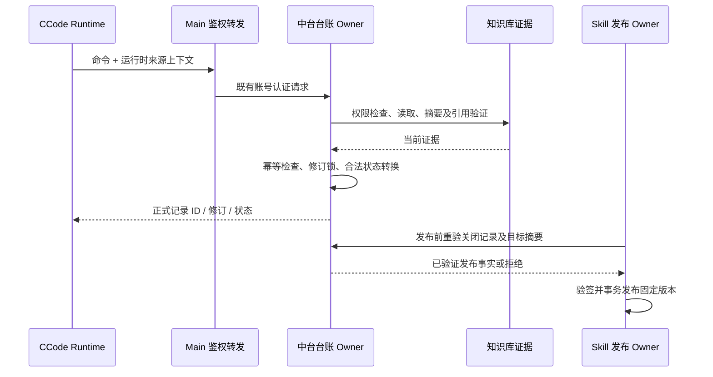

# CCode 来源台账与验收发布门禁

状态：设计中，未实现、未部署。用户于 2026-10-22 明确选择接入 CCode 的台账写入、验收关单与 Skill 发布入口。

## 目标与边界

根因、台账及迭代记录必须可追溯。格式合格、证据存在和结论成立分别表示，不因字段齐全自动认定根因。正式台账由中台业务服务拥有；Markdown 和任意本地文件为草稿或导出，不能改变正式状态。本地 Git hook 仅辅助预检，不作为不可绕过的安全边界。

本期新增受控台账工具与中台状态转换；不把一般聊天结束或现有工作流运行完成改成业务验收关单。普通文件编辑继续可用，不能凭文件内容提升正式台账状态。不修改附件的核心总控正文，不将其打包进客户端；中台已有总控发布后继续使用签名、固定版本及内存加载机制。

## 所有者与身份

- 中台 `CcodeLedgerService` 为记录、修订、验收与关闭状态唯一所有者，使用 PostgreSQL 事务及行锁。
- 租户、创建者及操作用户从既有认证上下文获取，不接受请求体覆盖。读写均验证租户及授权。
- CCode runtime 从可信工具执行上下文附带 sessionId、turnId、toolCallId、workspace identity。模型不能覆盖这些字段。
- 会话引用是认证客户端的来源声明，中台无法独立访问本地会话，不能声称已独立验证该会话真实内容。
- 可核验的证据必须是有读取权限的中台知识库文件，读取实际字节、计算 SHA-256 并核验声明摘要；文本证据验证 UTF-8 与行范围。只有时刻、文件名或未归档本地路径不构成可核验证据。
- 不增加另一套身份系统，不把中台令牌发送给模型或写到日志。

## 记录与状态

记录包含服务端 ID、修订号、任务标识、业务对象、事项、结论等级（observation/hypothesis/root-cause）、说明、来源上下文、带时区时间、Skill 版本及摘要、证据引用集合。采用现态表与不可变操作审计表，同一事务写入，不允许随意覆盖历史来源。

提交操作采用幂等命令 ID，唯一键为租户、调用用户、命令 ID；身份和权限验证后、证据读取之前检查。同一操作及相同内容返回原结果，不重做转换；相同 ID/不同内容拒绝。转换必须携带 expectedRevision。时间由服务器记录提交时间；发生时间需合法时区，不以字符串正则替代日期解析。

正式状态为 submitted → accepted/rejected，accepted → closed。每次转换 revision 加一；不支持原地修改记录正文，rejected/accepted/closed 的勘误或重提均新建记录并关联 supersedesRecordId，重新验收。重复 close 的原命令幂等返回；新命令 close 已关闭记录拒绝。所有转换先核验当前修订、来源、证据摘要和权限；异常、超时、不可解析、缺少证据均拒绝推进。

权限映射（2026-10-24 修订）：review accept/reject 分别使用既有 `biz:knowledge-base:review:approve` / `biz:knowledge-base:review:reject`，并验证每份证据所属目录的审核权限；close 使用 `system:ccode-controller:publish`；发布沿用现有 publish 权限及目录管理读取检查。原 submit/get 映射的 `system:ccode-controller:use` 已随「总控读=全员」拍板退役（`docs/prd/ccode-dataplatform-prd.md` §4.6，authorize/content 对全部登录用户开放）；本模块 submit/get 的权限归属（get 倾向随读开放、submit 倾向 publish 或独立权限）待实施前重新拍板。读取记录只允许创建者或具有 publish 权限的管理者；不强制不同自然人审核，不擅自增加双人业务规则。

验收需要明确判据、验证结果和证据，记录审核者及来源上下文；root-cause 需要复现/对照证据与反证说明，hypothesis 不得通过验收自动升级。代码只能保证验收资料与状态规则，不能通用地证明证据与自然语言因果关系。验收后证据被替换、撤销或失去权限时，关单与发布重新核验并拒绝失配。

## CCode 入口

增加 ControllerLedger 专用工具：提交、读取、验收与关单通过运行时端口和 Main 现有中台认证访问服务。工具不接受用户/租户或伪造运行上下文；错误返回固定分类与可修正字段，不包含凭据或核心总控正文。权限检查保持现有工具审批，不能借台账写入绕过文件、网络或业务权限。

私有进程协议使用严格运行时校验、有界载荷、单调请求 ID、超时及取消；复用现有连接路由与登录世代。Main 负责鉴权转发，不持有业务台账状态。注销、连接断开及旧运行回包不能污染新运行。

## Skill 发布门禁

既有 knowledge/publish 增加关闭记录 ID/修订绑定；只有 purpose=skill-release 的记录可发布，其 target 严格绑定 knowledgeFileId/sourceArchiveDigest/skillId/version，区别于运行时所用 Skill 版本。在当前锁定目录及源文件的事务内，重新校验台账已 closed、证据有效、目标文件及解密后版本与摘要吻合。发布记录保留台账 ID/修订和验证摘要。已有线上版本继续可授权读取，新的发布必须满足新协议，不能默认信任历史 APPROVED 状态或缺失台账的请求。

锁顺序统一为台账行、知识库目录、按 ID 排序的知识库文件行；所有流程遵循，网络读取采用字节上限与既有超时。锁定文件记录版本并比较已读取的实际字节摘要；不能宣称数据库锁可以阻止外部 OSS 原地替换。门禁保证实际消费字节与冻结摘要一致，新操作重新校验，不保证恶意管理员在操作完成后不能修改存储。

system 层发行服务不反向依赖 biz；只接受由唯一上层门禁创建的已验证发布事实，并维持签名/版本递增约束。封装与审核不等于发布，发布端再次校验以防检查后替换。核心正文保持现有加密与私有通道约束。

## 20 轮验收

在隔离数据库/模拟网络中运行不同场景与成功对照，记录版本、环境、输入摘要、预期、实际判定、退出码、副作用及日志。验证 Windows CCode/Node 与 Java 服务、隔离 PostgreSQL；不执行附件 PowerShell 脚本，不把 PowerShell 版本作为独立产品环境。不得将环境缺失写成通过。采用单元契约、真实数据库并发及客户端端口集成三层，20 轮不以重复成功样本冒充。

1. 合格来源与证据完整链路。
2. 缺来源字段。
3. 不存在的证据 ID。
4. 跨租户/跨对象引用。
5. 缺精确事件或消息引用。
6. 空记录与缺业务对象。
7. 非法日期、缺时区。
8. 非法状态与跳过验收关单。
9. 纯行号/时刻/本地路径冒充证据。
10. 中文、空格和不同编码引用。
11. 空证据、目录、行号越界。
12. 摘要不一致。
13. 假设不能自动成为已验证根因。
14. 根因缺复现/反证资料。
15. 双写相同修订冲突。
16. 同一命令重试幂等与异内容冲突。
17. 自由文本豁免不能放行缺失来源。
18. 网络/数据库故障及进程重启恢复。
19. 验收后证据或目标 Skill 密文包被替换。
20. 绕过客户端直接调用关单/发布仍拒绝。

每次修复重跑受影响轮次及成功对照，独立审查报告。仅在实际证据齐全时声称通过；本期不自动部署中台、升级官网或改造客户端自动更新。
