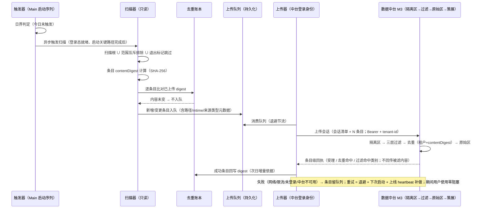

# CCode 客户端 Skill 回流上传（客户端侧 spec）

- 状态：待评审
- 编写日期：2026-10-22
- 台账来源：`E:\ZCode\docs\prd\总控台账.md` 2026-10-22 19:25 派单行「开发批次1·skill 回流上传 spec→产出 docs/specs/ccode-skill-sync-upload.md」（实读该行位于台账正文第 31 行；任务卡表述为第 32 行，行号偏差不影响任务同一性）
- 中台侧合同：`E:\ZCode\docs\prd\ccode-dataplatform-prd.md`（v0.1，批次 20261022-D1，待评审）——本文已实读对齐：§1.2 Skill 三层架构、§3.3 模块③（M3-R1~R8）、§4.3 回流上传批量格式与去重键、§4.5 归因字段、§7 P4 分期、OQ-8。接口语义契约以该 PRD §4.3 为准；端点命名、路径与内部实现由中台定（该 PRD §4 头声明）。该 PRD 属待评审状态，评审冻结前本文引用其条目均视为草案对齐。
- 关联并行产物：
  - `E:\ZCode\docs\specs\ccode-controller-local-skill.md`（总控本地锁定 skill spec，待评审，2026-10-22；本文已实读对齐：锁定存储不在用户技能扫描根、保留名判定、分支副本落用户数据目录——上传范围互斥规则与其命名空间机制衔接）
  - `E:\ZCode\docs\specs\ccode-expert-skills-distribution.md`（专家 skill 下发 spec，待评审，2026-10-22；本文已实读对齐其 §5.3 三方命名空间隔离表——专家缓存位于 CCode 私有数据目录、`expert:` 前缀身份，与本地上传范围互斥）
  - `docs/specs/ccode-audit-telemetry.md`（审计遥测 spec，台账 2026-10-22 19:25 已派、**尚未落盘**；本文按拍板「使用统计不走本链路」引用其定位，不依赖其未定稿细节，冻结后需复核边界，见 OQ-9）
- 盘点基线：分支 `codex/ccode-update-feed` 当前工作区（约 236 条未提交在途改动；本文代码断言均按当前工作区字节实读，不预测在途改动走向）
- 保密约束：本文只描述机制与契约要点，不复制任何受控总控正文；不枚举用户真实 `~/.zcode` 数据目录内容，仅引用代码路径常量。

## 一、拍板记录（2026-10-22 方向拍板，直接采用）

以下为本轮用户与老板讨论收敛的拍板结论（任务卡转述，本文按其直接展开，不重新论证）：

1. **触发：每日首次启动执行一次**（替代凌晨 2 点墙钟定时；错峰天然——各设备启动时间天然分散，漏跑由补传覆盖）；错过窗口的由上线 heartbeat 补做。与中台 PRD M3-R1「每日首次启动触发一次回流上传（不使用凌晨墙钟类定时）；当日上传失败下次启动重试」一致；「上线 heartbeat 补做」是客户端侧对补传语义的在线态补充触发源（heartbeat 载体现状缺口见 §三 E5 与 OQ-3）。
2. **范围：用户自有 skill 与工作区自建 skill 的全量内容上传**。产品前提如实记录：**企业内部、全员知情配合是产品前提**——本链路按该前提设计，不做客户端侧的内容合规判定（见第 5 条）。**总控锁定 skill 与中台管理的专家 skill 不在上传范围**（内容权威在中台，无需回流），互斥规则见 §5.3。使用统计（哪些被用、频次、报错率）走审计遥测通道（`ccode-audit-telemetry.md`，在途），**不走本链路**。
3. **去重与增量：内容哈希去重**（内容不变不重传，客户端侧本地去重账本判定）；中台按 **租户 + contentDigest** 幂等（PRD §4.3 去重键）。
4. **退出机制：skill 目录级 `.no-upload` 标记文件或约定 private 子目录，命中即跳过**。定位：防误收临时/涉密自用内容——退出区是用户的自主声明边界，客户端不追问原因、不记录退出区内容本身（语义见 §6.2）。
5. **密钥/凭据过滤在中台入口（持久落盘前的隔离区过滤），客户端不做内容过滤**——但客户端须在 payload 中保留足够元数据（路径、mtime、来源类型）供中台过滤与告警回执定位。过滤与策展流程以数据中台 PRD M3 模块（M3-R3 隔离区三层过滤、M3-R6 策展工作台、M3-R7 策展回流）为准，本文不重定义。
6. **失败语义：上传失败排队重试，绝不阻塞用户使用**；中台不可用时明确失败状态可观察（状态面见 §6.5）。

## 二、目标与范围

目标（可验证）：

1. 定义「每日首启触发 → 扫描 → 哈希去重 → 打包上传 → 中台过滤策展」的端到端客户端机制，承接中台 PRD 模块③（M3-R1/R2/R8）的客户端侧义务：全量上传、每日首启触发、条目级回执消费。
2. 客户端零内容过滤：不做任何密钥/凭据检测，过滤责任完整留在中台入口（拍板第 5 条、M3-R3）；客户端只保证元数据（路径、mtime、来源类型）足以让中台的过滤命中与告警回执定位回本地条目。
3. 增量零冗余：内容未变的 skill 在后续触发中零上传请求（本地去重账本 + 中台 租户+contentDigest 幂等双层）。
4. 失败不阻塞：上传链路全程异步后台，任何失败（网络/限流/未登录/中台不可用）不影响聊天、任务执行、技能加载与启动关键路径；失败原因可区分、可回读。
5. 范围互斥可验证：总控锁定 skill、专家 skill、plugin/bundled 等非自建来源不进入待传清单，互斥规则与两个并行 spec 的命名空间机制一致。

范围内：客户端侧扫描面定义、退出标记、去重账本、上传队列与重试、payload 格式（与中台 M3 对齐）、回执消费与状态面的机制与契约要点；验收场景（客户端侧判据，与中台 PRD S5/S6 服务端判据互补）。

范围外：

- 中台侧隔离区、三层过滤、原始区保留、策展工作台、签名发布回流（中台 PRD M3-R3~R7，本文只对齐接口）。
- 使用统计/审计遥测上报（`ccode-audit-telemetry.md`，并行在途）。
- 总控锁定 skill 的本地存储与推送更新（`ccode-controller-local-skill.md`）、专家 skill 获取与缓存（`ccode-expert-skills-distribution.md`）。
- skills 之外的其他设置同步（`packages/services/src/settings-sync/` 既有导入行为保持不变）。
- 代码实现与测试（本 spec 为待评审设计文档）。

## 三、现状依据（复用面与缺口）

以下断言均按当前工作区实读标注；「已实测」附路径与符号名。

- E1【已实测】skill 发现面与扫描根解析。`E:\ZCode\apps\zcode-cli\packages\adapters\src\skills\roots.ts` 符号 `resolveDefaultSkillRoots`（L21-L73）：extraRoots（project/zcode）→ home 下 `.zcode/skills` 与 `.agents/skills`（user scope，L108-L119 `skillRootsForBase`）→ 工作区至 git worktree 根链上每级目录的 `.zcode/skills`/`.agents/skills`（project scope，L75-L97）→ additionalDirectories → extraResolvedRoots。`SkillRoot { path, scope: "user"|"project", source, priority }`；桌面品牌实例的 home 随 `ZCODE_DESKTOP_HOME_DIR` 隔离（L28-L29）。**结论：上传扫描根直接复用该解析，保证「上传的 = 用户实际在用的技能面」；home 解析差异见 E6。**
- E2【已实测】有界扫描策略共享可复用。`E:\ZCode\packages\shared\src\skill-scan-policy.ts`：`SKILL_FILE_NAME="SKILL.md"`（L12）、`SKILL_SCAN_EXCLUDED_DIRECTORY_NAMES`（L21-L34，node_modules/dist/build 等 12 项）、`MAX_SKILL_SCAN_DEPTH=8`（L43）、`shouldWalkSkillDirectoryEntry`（L53-L61，点目录仅放行 `.system`）。`E:\ZCode\packages\services\src\skills\skillDiscoveryWalk.ts` 符号 `walkSkillMarkdownPaths`（L33-L107）：深度优先、软链 realpath 去重防 Windows junction 环路。**结论：回流扫描器复用该遍历与策略，回流专属排除规则（退出区、互斥身份）在应用层叠加，不修改共享策略。**
- E3【已实测】批量扫描/去重/逐条状态范式现成。`E:\ZCode\packages\services\src\settings-sync\settingsSyncService.ts`：多源根扫描按 agent+scope 分组（L618-L637 `getExternalSkillRoots`）；`seenSourcePaths` Set 去重（L1477-L1486）；frontmatter name/version 读取含宽松回退（L833-L879 `readSkillMetadataFromMarkdown`）；逐条目状态记录 imported/skipped/failed 与 skipReason 分类（L1785-L1879）；来源根摘要（discovered/importable/skipped 计数，L1265-L1314）；`createServiceLogger("settings-sync")`（L35）。**结论：上传会话的「会话清单（条目数）+ 逐条目状态」结构与该范式同构，直接借鉴。**
- E4【已实测】身份枚举与保留名判定。`E:\ZCode\apps\zcode-cli\packages\contracts\src\skills\index.ts`：`SkillSource = "agents" | "zcode" | "bundled" | "plugin" | "remote"`（L17）、`SkillRoot.namespace`（L38）、保留名判定 `isConfidentialControllerSkill`（L10）。**结论：范围互斥的来源过滤可直接按 `SkillSource` 与保留名/`expert:` 前缀判定，单一事实来源在 contracts 层。（2026-10-23 修订：判定权威已提升至 `packages/shared/src/skill-identity`，contracts 出口委托，语义不变）**
- E5【已实测】缺口：回流上传链路零代码、heartbeat 载体未定义。对 `skillSyncUpload|skill-sync-upload|skillReflow|reflow` 全仓库 git grep 零命中（2026-10-22 实测）；`.no-upload` 仅在生成物 `bash-command-registry.ts` 中作为 shell 命令词出现，与标记机制无关。现有 heartbeat 均属其他域：`packages/shared/src/web-remote-relay/`（手机远控）、`packages/desktop/src/host/cronRunLifecycle.ts`（班车手动认领）、`packages/desktop/src/main/appTelemetryRuntime.ts`——**无面向中台登录态的通用「上线 heartbeat」实现，列为 OQ-3**。`ccode-audit-telemetry.md` 未落盘（台账 2026-10-22 19:25 已派在途）。
- E6【已实测】home 解析存在两套现行方式。`roots.ts` L29 优先 `ZCODE_DESKTOP_HOME_DIR`（品牌桌面隔离 home）；`settingsSyncService.ts` L409-L411 `resolveUserHomeDir` 用 `HOME/USERPROFILE`。**结论：回流扫描取 roots.ts 语义（上传面必须等于实际加载面）；与 settings-sync 面的差异在实施时统一，本文按 roots.ts 为准。**

## 四、架构与数据流（每日首启触发→扫描→哈希去重→打包上传→中台过滤策展）

组件与依赖方向（单向：触发器 → 扫描器 → 去重账本 → 上传队列 → 上传器 → 中台 M3；状态面只读旁路）：

- 触发器（桌面 Main 启动序列）：判定「今日是否已触发」，异步发起扫描，不占启动关键路径。
- 扫描器（services 层，只读文件系统）：按扫描根 + 范围互斥 + 退出标记枚举条目，计算 contentDigest，读条目元数据。
- 去重账本（本地持久化）：skillKey → 已上传 contentDigest + uploadedAt，内容不变不入队。
- 上传队列（本地持久化）：待传条目唯一持有者；进程重启后队列存活。
- 上传器（services 层，持中台登录身份）：组会话、发送、消费条目级回执、回写账本。
- 中台 M3（不在本仓库）：隔离区 → 三层过滤 → 去重 → 原始区 → 策展工作台（M3-R3~R7）。



阶段要点：

1. **触发**：每日首次启动判定用本地日界标记（lastTriggerDate ≠ 今日）幂等；同日重启不重复扫描（§6.1）。
2. **扫描**：复用 `resolveDefaultSkillRoots` 与共享扫描策略（E1/E2），叠加回流专属排除：范围互斥（§5.3）与退出标记（§6.2）。条目 = 含 SKILL.md 的目录（含其 references 子树内常规文件）。
3. **哈希去重**：客户端对每条目计算 contentDigest（SHA-256，规范化基准待中台冻结，OQ-2）；与去重账本比对，未变条目零入队——「内容不变不重传」在客户端侧成立，中台幂等键（租户+contentDigest）是第二层保险（防多设备、防客户端账本丢失后的重复，对齐 PRD §4.3 服务端重算摘要比对）。
4. **打包上传**：一次上传会话 = 会话清单（schemaVersion、triggerType、条目数、会话摘要、ccodeRelease、platform）+ N 个条目（字段见 §5.2 对应表）；认证复用中台登录（Bearer token + tenant-id，M6-R1），不为回流新增第二套凭据。
5. **中台过滤策展**：全部在入口、持久落盘前完成（M3-R3）；客户端不参与、不镜像过滤规则。
6. **回执消费**：逐条目受理状态（受理/去重命中/过滤命中，M3-R8）回写本地状态面与账本；过滤命中为终态（服务端已受理并处置，非传输失败），客户端不自动重试（§6.4）。

## 五、状态所有者与接口

### 5.1 所有权划分

- **上传队列所有者 = 单一服务**（建议 services 层新增 `SkillReflowUploadService`）：队列的唯一写入者与消费者；Renderer、Agent 进程、技能加载路径均不读写队列。触发器、扫描器、上传器是该服务的内部阶段，不是独立写路径。
- **去重账本所有者 = 同一服务**（与队列同生命周期持久化于 CCode 私有数据目录，对齐母 PRD §4.2 私有数据目录边界；存储形态 JSON/SQLite 实现期定）。
- **扫描器只读文件系统**：对用户技能目录零写入（与 settings-sync 导入的写语义不同，回流只读）。
- **中台 M3 是过滤、策展、发布回流的唯一权威**；客户端不持有过滤规则副本、不预判命中。
- 跨进程接口若进入协议面（状态查询、手动重试入口），须同步 `packages/shared` 严格类型与运行时校验（对齐 `E:\ZCode\AGENTS.md`「进程、协议与远程控制」节纪律）。

### 5.2 payload 格式与中台 PRD §4.3 逐字段对应

会话清单（对应 PRD §4.3「会话清单（条目数、会话摘要）」）：

| 客户端字段 | 对应 PRD §4.3 | 说明 |
| --- | --- | --- |
| schemaVersion | （PRD 未列，按 M4-R5 N-1 精神显式携带） | 初始 1；新增字段可选 |
| triggerType | （PRD 未列） | `dailyFirstLaunch` / `startupRetry` / `onlineHeartbeat`，供中台侧区分补传来源（OQ-1 扩展确认） |
| entryCount | 条目数 | 直接对应 |
| sessionDigest | 会话摘要 | 条目 contentDigest 有序聚合的 SHA-256，客户端侧定义，供会话级核对 |
| ccodeRelease、platform | （§4.5 归因字段族同款） | 客户端自报；tenantId 由服务端认证上下文提供，客户端不传（M4-R4） |

条目字段（对应 PRD §4.3「条目字段：本地 skill 标识/name、全文内容、contentDigest（客户端计算）、最近修改时间、可选描述」）：

| 客户端字段 | 对应 PRD §4.3 条目字段 | 说明 |
| --- | --- | --- |
| relativePath | 本地 skill 标识 | **提案**：本地标识 = 相对扫描根的条目路径（如 `~/skills/report-helper`、`workspace/.zcode/skills/foo`），同时充当拍板第 5 条要求的「路径」——一字段兼顾两处要求；PRD 未明示标识形态，列 OQ-1 待中台确认 |
| name | name | frontmatter name（回退目录名），读取范式同 E3 `readSkillMetadata` |
| contentFiles[] | 全文内容 | SKILL.md + 条目目录树内常规文件（path + 字节）；软链与特殊文件排除（安全姿态对齐 `scripts/publish-managed-skill.mts` 源树约束）；「全文」是否必含 references 子树 → 哈希范围并入 OQ-2 |
| contentDigest | contentDigest（客户端计算） | SHA-256 hex；规范化基准（换行/编码归一）与哈希范围沿中台 OQ-8，未冻结前客户端按「条目全部纳入文件的规范化字节流」计算并在 schemaVersion 内固化 |
| mtime | 最近修改时间 | 条目级 lastModified = 纳入文件 mtime 最大值；文件级明细 fileMtimes[] 为扩展（OQ-1） |
| description | 可选描述 | frontmatter description，缺省省略 |
| sourceType | （PRD 未列） | `user` / `workspace`（拍板第 5 条「来源类型」；fork 标记见 OQ-4）；扩展字段待中台确认（OQ-1） |

对应关系结论：PRD §4.3 既有五项字段客户端全部提供；`relativePath`/`sourceType`/`triggerType`/`sessionDigest`/`fileMtimes` 为本文提案的扩展（服务拍板第 5 条元数据定位要求），PRD 未列——**冲突/缺口列 OQ-1，中台确认前按本表作为双方评审基线**。

### 5.3 范围互斥规则（与两类受管 skill 及其他来源）

| 来源 | 是否上传 | 判定依据 |
| --- | --- | --- |
| 总控锁定存储（系统数据目录） | 否 | 不在技能扫描根内，天然互斥（local-skill spec §3/§4「锁定目录不在用户技能扫描根」） |
| 保留名条目（用户任意可写位置出现「总控派单」/`controller` 及 NFKC/路径别名） | 否（防御性过滤） | `isConfidentialControllerSkill`（contracts L10）；同名条目本就被 skill-port 过滤（expert spec E5 范式），回流扫描同规则排除 |
| 专家 skill 缓存（CCode 私有数据目录） | 否 | 不在技能扫描根内；`source: "remote"`、`expert:` 前缀身份（expert spec §5.2/§5.3） |
| `expert:` 前缀 / `source: "remote"` 条目 | 否（防御性过滤） | 受管身份不由用户产生（expert spec §5.3 硬规则 2） |
| 用户根（home `.zcode/skills`、`.agents/skills`） | **是** | roots.ts user scope（E1） |
| 工作区根（workspace 及 worktree 链上 `.zcode/skills`、`.agents/skills`） | **是**（自建） | roots.ts project scope（E1） |
| plugin 来源（pluginId 非空） | 否 | `SkillSource="plugin"`（E4）；商店分发物非自建，内容对商店侧已公开 |
| bundled 来源 | 否 | `SkillSource="bundled"`（E4）；随发行版分发，无回流价值 |
| extraRoots / additionalDirectories / extraResolvedRoots | 默认否（归属不明） | roots.ts 配置通道（E1）；无法确认「自建」，保守排除，OQ-5 |
| 总控分支副本（用户数据目录，身份名不含保留名） | 待拍板 | 是用户可编辑数据但内容派生自中台发布物；默认按用户自有 skill 处理并计划以 sourceType 附 `forkOfController` 标记，最终口径 OQ-4 |

硬规则：互斥判定实现挂点沿用 contracts 层同族函数（`isConfidentialControllerSkill` + expert 前缀判定），单一事实来源在 packages/shared 的 skill-identity 模块（2026-10-23 自 contracts 提升，contracts 出口委托），不散落在 services/adapter（与两个并行 spec 的 §5.3/§4 处置一致）；互斥排除的条目产生 skip 诊断计数（可观察，不记内容）。

### 5.4 客户端接口草案（端口形态，实现落点建议）

```ts
// 条目与队列（services 层 SkillReflowUploadService 唯一所有者）
interface SkillReflowEntry {
  key: string;                 // 扫描根 scope + relativePath，去重账本主键
  relativePath: string;
  name: string;
  sourceType: "user" | "workspace";
  contentDigest: string;       // SHA-256 hex
  lastModified: string;        // ISO 8601
  queuedAt: string;
  attempts: number;
  lastError?: { code: string; at: string };  // 固定错误码，不含内容
}
interface SkillReflowSessionReceipt {        // 中台条目级回执（M3-R8）消费后的本地终态
  key: string;
  outcome: "accepted" | "dedupHit" | "filterHit";
  filterCategory?: string;     // filterHit 时中台回告的命中类别
  settledAt: string;
}
interface SkillReflowStatus {                // 只读状态面（Renderer/诊断可见，不含内容）
  state: "idle" | "scheduled" | "scanning" | "queued" | "sending"
       | "needLogin" | "retryableFailed" | "done";
  queueDepth: number;
  lastTriggerDate?: string; lastSuccessAt?: string;
  counters: { scanned; uploaded; dedupSkipped; optOutSkipped; rangeExcluded; filterHit; failed };
  lastError?: { code: string; at: string };
}
```

## 六、行为细节

### 6.1 触发与补传

- 触发源三个，均幂等（当日去重标记 lastTriggerDate）：
  1. **每日首次启动**：桌面 Main 启动序列完成关键路径、中台登录态就绪后异步触发（拍板第 1 条主触发；错峰天然，不叠加随机延迟）；
  2. **下次启动重试**：当日已有触发但队列未清空 → 不重新全量扫描，仅消费既有队列（对齐 PRD M3-R1「当日上传失败下次启动重试」）；
  3. **上线 heartbeat 补做**：客户端检测到由离线转在线（heartbeat 载体待定，OQ-3）且队列非空 → 消费队列；当日从未成功触发（如启动时离线）→ 补触发完整扫描。PRD 文本只约定源 2，源 3 是拍板对补传语义的在线态强化，二者并存不冲突。
- 未登录：触发挂起，状态 `needLogin`；登录成功即转为可执行（不要求等到次日）。
- 日界使用本地时区自然日（与「每日首次启动」的用户语义一致；跨时区漫游导致的日界漂移不构成故障）。
- 同日多次重启：源 1 仅首个满足日界条件的启动触发扫描；判定依据为持久化标记，进程崩溃不造成当日重复会话。

### 6.2 退出标记语义

- **主机制 `.no-upload`**：任意目录内存在名为 `.no-upload` 的标记文件（内容不要求，空文件即可）→ 该目录整棵子树跳过，不进入待传清单。放在 skill 条目目录 = 该 skill 退出；放在扫描根下中间目录 = 该中间子树退出。
- **辅助约定 `private/` 子目录**：扫描根下名为 `private` 的子目录（任意层级命中）整棵跳过，用于成片放置涉密/临时自用 skill 而不必逐目录放标记。
- 实现层：二者是回流扫描器的应用层排除规则，叠加在共享扫描策略（E2）之上，**不修改** `SKILL_SCAN_EXCLUDED_DIRECTORY_NAMES` 等共享策略（避免影响技能加载面）。
- `.no-upload` 文件本身与 `private/` 目录不作为条目内容上传；命中退出区的条目计入 `optOutSkipped` 计数（可观察），不记录、不上传其内容与路径明细之外的信息。
- 退出是用户自主声明：客户端不校验理由、不告警、不提示移除；移除标记后下一次触发该条目按新增处理（验收场景 7）。

### 6.3 增量判定

- contentDigest 不变 → 不入队（本地账本第一层）；变更 → 全量内容重传（条目级无差分，中台按 租户+contentDigest 自行新旧并存，对齐 PRD §4.3 去重键语义——「增量」只体现在客户端请求量，不要求中台做版本合并）。
- 新增 skill → 入队；本地删除 skill → 不上传、无远端删除通告（tombstone），账本条目本地过期清理；远端如何感知删除为开放问题（OQ-6）。
- 账本丢失/清空（如数据目录重置）→ 下次触发按全量重传，中台幂等键去重兜底（第二层），不产生原始区重复记录（对齐 PRD S6 前半判据）。
- 客户端建议体积护栏（防单会话过大）：单文件 2 MiB、单条目 10 MiB、单会话条目内容总量上限与分页方式待中台定（OQ-8）；超限条目 skip + 固定错误码，不静默截断。

### 6.4 失败重试与不阻塞

- 队列持久化于 CCode 私有数据目录，进程重启存活；同一 key 同一 digest 在队列中至多一条（重试不重复入队）。
- 重试策略：可重试失败（网络/超时/5xx/限流）指数退避，上限后等待下次启动或上线 heartbeat；限流响应按中台错误码与重试提示退避（对齐 PRD M4-R6 同款语义）。不用超时掩盖同步问题：每次失败记录固定错误码与时间。
- 不可重试失败：schema 校验拒绝、超限、鉴权明确拒绝 → 条目终态 failed + 固定错误码，不无限重试；需要登录 → `needLogin` 挂起而非失败。
- 过滤命中（filterHit）：终态，不重试（服务端已受理并完成处置，重试只会再次命中，M3-R3）。
- **绝不阻塞**：上传链路无任何同步等待点进入聊天/任务/技能加载/启动关键路径；上传器与技能加载零依赖（加载路径不读队列与账本）；最坏情况（中台长期不可用）表现为队列滞留 + 状态可观察，功能面无损（对齐 PRD §5.3 降级契约「遥测/回流本地排队待补传」）。

### 6.5 可观察状态

- 状态面：§5.4 `SkillReflowStatus`（state/queueDepth/计数器/最近错误），供诊断与后续 UI 消费；状态五态可区分（等待中/需要登录/发送中/可重试失败/已完成），对齐母 PRD §5 L97 可观察要求。
- 日志：`createServiceLogger("skill-reflow-upload")`（范式同 E3）；info 记录触发、会话受理、终态计数等生命周期事件；debug 记录逐条目诊断（生产不落盘）；**任何级别不落条目内容与凭据**（对齐 `E:\ZCode\AGENTS.md` 日志纪律与 PRD M6-R7）。
- 回执留痕：条目级回执（accepted/dedupHit/filterHit + 类别）保留于本地状态面，供用户侧核对「我传了什么、结果如何」的最小事实（不回传被滤内容，M3-R8；用户可见性的完整口径归 PRD OQ-3，本文不预设）。

## 七、验收场景（可回读判据；客户端侧，与中台 PRD S5/S6 服务端判据互补）

1. **退出区两日不出现**：构造带 `.no-upload` 的 skill 目录 A 与 `private/` 子目录下的 skill B，连续两日（两次日界触发）的扫描清单、上传会话条目中均无 A、B；`optOutSkipped` 计数两次各含 A、B（计数可回读，A、B 内容不出现在任何日志与 payload）。
2. **内容不变零请求**：某 skill 首日成功上传后内容不变，第二日触发时该条目不入队——当日回流上传请求数为 0（网络层与状态面 `dedupSkipped` 双证）；去重账本该 key 的 digest 与首日一致可回读。
3. **中台不可用排队且零阻塞**：断开中台后触发每日首启 → 聊天、任务执行、技能加载、启动耗时均无阻塞等待（可回读对比基线）；状态面为 `retryableFailed`/`queued` 且失败分类明确；恢复在线（heartbeat）后同一队列一次清空，无重复条目，条目回执齐备。
4. **范围互斥零误收**：构造用户根放保留名「总控派单」（含 NFKC 变体）、`expert:foo` 前缀目录、plugin 来源条目各一 → 三者均不出现在待传清单，`rangeExcluded` 计数各 +1，有 skip 诊断记录；锁定存储与专家缓存目录的任何文件字节不出现在上传 payload（会话摘要与条目清单可核对）。
5. **增量变更正确入队**：新增 skill X、修改 skill Y 内容、删除 skill Z 后次日触发 → 会话仅含 X、Y（Y 全量内容重传），Z 不出现且无远端删除请求；中台侧 Y 新旧两个 contentDigest 各一条记录、X 受理（服务端回执对齐 PRD §4.3 去重键语义）。
6. **回执定位与过滤终态**：上传含模拟凭据的 skill → 中台回执为 filterHit + 命中类别；客户端凭 payload 的 relativePath/sourceType/mtime 可唯一定位本地条目（回执 → 本地路径回读成立）；该条目状态为终态 filterHit，后续触发不重试；回执中无被滤内容（M3-R8）；该命中事实走中台回告通道，本地仅留类别与条目标识。
7. **退出区恢复**：移除 A 的 `.no-upload` 后下一次触发 → A 出现在待传清单并正常上传（首传语义，非增量跳过）。
8. **触发幂等**：同日内多次重启客户端 → 扫描会话至多一次、上传会话至多一个（内容未变时当日请求数恒为 0），重启次数不引起请求数增长；启动时离线的设备在当日转在线后经 heartbeat 补做，回执齐全。

## 八、开放问题

- OQ-1【契约扩展确认】§5.2 扩展字段（relativePath 兼作「本地 skill 标识」、sourceType、triggerType、sessionDigest、fileMtimes）超出中台 PRD §4.3 条目字段清单；拍板第 5 条要求客户端携带路径/mtime/来源类型，PRD 未列前两者与来源类型——需中台确认纳入 §4.3 或以扩展字段形式冻结；PRD 评审修订时同步本表。
- OQ-2【规范化基准，沿用中台 PRD OQ-8】contentDigest 的规范化方式（换行、编码归一）与哈希范围（条目 = SKILL.md 还是含 references 子树；本文按含子树提案）；客户端按「条目全部纳入文件的规范化字节流」计算并在 schemaVersion 内固化，基准变更需双方同步。
- OQ-3【heartbeat 载体】「上线 heartbeat 补做」的平台在线心跳当前无通用实现（E5：现有 heartbeat 均属远控/班车/遥测域）；载体选项（复用 appTelemetryRuntime 连接态、中台登录态续租探测、新增轻量 ping）与拆项 3 更新通道、拆项 6 遥测链路的挂接方式待实施前定义。
- OQ-4【分支副本口径】总控分支副本（用户数据目录、身份名不含保留名）是否默认上传：按用户自有数据默认上传 + `forkOfController` 来源标记，还是默认排除（防策展侧 fork 噪音与去重歧义——分支基线内容中台本有，重传价值低）；需与 `ccode-controller-local-skill.md` 评审一并拍板。
- OQ-5【配置根归属】extraRoots / additionalDirectories / extraResolvedRoots 配置产生的扫描根默认排除（保守）；是否存在需要纳入的合法配置场景（如企业指定共享根）待产品确认。
- OQ-6【删除语义】本地删除 skill 不上传、无 tombstone（PRD M3 未定义删除通告）；中台策展侧对「上传者已删除」内容的处置（照常策展/标记存疑）待中台确认，客户端本期不做。
- OQ-7【租户级开关】PRD M5-R3 上报可见性策略可按租户关闭诊断上报；回流上传是否受租户级开关约束（企业「全员知情配合」前提下默认常开）待与 M5-R3 策略通道一并定义。
- OQ-8【会话体积与分页】单会话条目数/体积上限、超大会话分页语义、压缩方式 PRD §4.3 未定义；客户端护栏（单文件 2 MiB/单条目 10 MiB 量级建议值）需与中台入口限制对齐后冻结。
- OQ-9【并行产物复核】`ccode-audit-telemetry.md`（台账 2026-10-22 19:25 派、未落盘）冻结后复核「使用统计走遥测、内容回流走本链路」的边界无字段重叠；中台 PRD（待评审）评审冻结时同步本文 §5.2 对应表。
