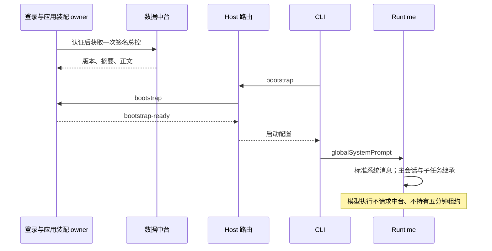

# CCode 启动全局总控提示词

状态：已取代（2026-10-22）。

> **取代说明（2026-10-22）**：本文描述的启动全局提示词路线已被 [ccode-controller-local-skill.md](ccode-controller-local-skill.md)（总控本地锁定 skill 方案，状态：待评审）取代。拍板日期 2026-10-22；依据：当日用户与老板讨论收敛——总控通用派发 skill 改为本地内置锁定 skill（Ed25519 签名推送更新、验签后落地、可回滚；本地加密持有，定位为防君子门槛；用户不可改原文、只可开分支；触发采用 stub 常驻 + 完整 skill 命中加载两层结构），不再采用启动全局提示词整段注入每轮请求的路线（token 经济与适用范围考虑）。红线修订依据：敏感领域专家知识已拆分至中台动态下发（另见 ccode-expert-skills-distribution.md），本地通用派发部分允许本地加密持有；中台认证、签名验签、输出保护红线保留。
>
> 下文保留原文供审计：被取代的断言以~~删除线~~标注并指向新 spec（下称「新 spec」= ccode-controller-local-skill.md）对应章节；未标注句子仍为历史记录，不代表当前执行合同。文末追加「在途实现迁移清单」。

## 当前产品规则

本规范取代 ccode-confidential-controller 中默认执行路径的缓存、短期租约、按请求 acquire/use/complete 和总控激活要求。~~客户端每次启动并成功认证后向中台获取一次签名总控版本，之后在本次登录生命周期内作为标准全局系统提示词使用~~（→新 spec §1、§3：不再作为全局系统提示词整段注入，改为本地锁定 skill + stub 常驻/命中加载两层触发；对 confidential-controller 旧路径的取代关系由新 spec 继承）。此阶段不实施此前讨论的 85%/15% 分片（新 spec 亦未采用分片，此句作为历史记录保留）。

数据中台仍是内容来源；保留下载时的认证、签名、版本和摘要校验（新 spec §5.4 保留此条）。下载授权的 expiresAt 只约束获取，不控制运行时间（保留）。无周期续期、模型调用授权~~或离线回退~~（→新 spec §5.5：已验签的本地锁定副本是正式的离线使用形态，不是回退例外；周期续期与模型调用授权仍不引入）；~~正文不写入安装资源、环境变量、命令参数、会话数据库或日志~~（→新 spec §1、§5.3：正文改为以加密锁定副本落地本地系统数据目录、可离线使用；「不写入环境变量、命令参数、会话数据库或日志」的禁令在新 spec §5.7 延续，安装包预置仍默认禁止，见新 spec OQ-L3）。

~~桌面首次进入工作区前必须完成登录和全局配置装配；移除“跳过登录继续聊天”入口~~（→新 spec §5.5：登录不再是总控可用性门槛，未登录/离线可聊天并使用本地锁定副本，仅更新推送需登录身份）。没有中台账户端口的 Web 入口保持原行为（Web 端总控可用性列为新 spec OQ-L6）。~~后续登出保留工作区展示，旧 CLI 停止，重新登录后新 CLI 重新装配~~（→新 spec §5.5：登出/换账号不删除本地锁定副本，仅失效更新授权；「旧 CLI 随通道停止」的语义随私有通道拆除一并重估，见文末迁移清单）。

## 所有者与接口

- ~~application 拥有当前登录代次的一次启动装配 Promise；成功后的只读结果供多个窗口及 CLI 启动共享，失败允许下次初始化重试。不存在多版本缓存、淘汰、命中或模型租约服务~~（→新 spec §4：所有者改为「客户端更新器 = 本地锁定存储唯一写入者」；本地保留多版本回滚清单（新 spec §5.4），租约/缓存服务仍不引入）。
- ~~Main/Host 复用专用 IPC 传递启动配置，使用 bootstrap/bootstrap-ready 消息；Host 仅路由。普通 renderer/mobile RPC 不传正文~~（→新 spec §6：bootstrap/bootstrap-ready 私有通道整链拆除或休眠，正文改经 Skill 加载层进入会话；「普通 renderer/mobile RPC 不传正文」的边界在新 spec §4、§5.7 延续）。
- ~~CLI 在协议服务就绪前读取配置一次，通过 runtimeConfig.globalSystemPrompt 进入标准 ContextBuilder 系统段~~（→新 spec §3、§6：globalSystemPrompt 注入链拆除，改为 stub 常驻 + 锁定命中加载）。已有 systemPrompt 是替换式 persona，不能用它覆盖基础规则或破坏 workflowActor（该约束继续有效，新 spec §5.1 沿用）。
- ~~所有主会话、恢复、普通子代理和工作流子 Runtime 继承 globalSystemPrompt~~（→新 spec §3、§5.1：不再无条件继承；由 stub 意图判定决定是否加载完整正文，子代理/工作流按需同样命中加载）。标准模型调用不创建 confidential controller execution scope，也不归并为 EXECUTION_FAILED（语义保留；旧 scope 机制的处置见文末迁移清单与 split/05 OQ-6）。
- 现有 systemPrompt 持久化保持不变（继续有效）；~~globalSystemPrompt 不进入会话配置或 saveMessage.system~~（该对象撤销；「锁定 skill 正文不进入会话配置或 saveMessage.system」由新 spec §5.7 延续）。模型诊断及请求转录需屏蔽含全局正文的 payload（保留→新 spec §5.7：屏蔽对象改为锁定 skill 加载内容）。
- ~~登出/换账号/退出作废启动结果并关闭已取得配置的通道，CLI 随通道失效停止；迟到下载不能污染新代次~~（→新 spec §5.5、§5.4：登出/换账号不再作废本地锁定副本，仅失效更新授权；迟到/无效下载不落地、不污染锁定存储的语义由新 spec 验签门继承）。用户取消仅取消其启动等待（取消语义在更新器语境下沿用）。

> 下图描述的启动装配时序已被取代（→新 spec §3 数据流：更新链 + 两层触发结构取代启动注入时序），保留作审计。

桌面 continuous 与手机 replayable 均复用原有 Runtime 和队列，路由 owner/lease 不在本次删除范围内。

## 验收

1. ~~登录和并发窗口初始化只有一次授权与下载；超过五分钟仍可创建/续接任务，不再访问中台总控接口~~（→新 spec §5.5、§7：任务运行与中台解耦的结论保留；「只有一次下载」改为按推送更新，验收以新 spec 场景 1-4 为准）。
2. ~~失败初始化可重试；签名/摘要错误拒绝；身份切换阻止迟到结果并关闭旧消费者~~（→新 spec §5.4：签名/摘要错误改为「拒绝落地、锁定内容字节不变并保留旧版本」，错误码沿用 INVALID_RELEASE 族；身份切换不再关闭本地副本，见新 spec §5.5）。
3. ~~首轮、续接、工作流、普通子代理都有全局段~~（→新 spec §5.1：全局段概念撤销，按 stub 判定命中加载）；基础提示词/persona 保持（保留）；~~正文不进入存储或模型日志~~（存储语义变更→新 spec §5.3 本地加密锁定副本；「不进入普通日志」保留→新 spec §5.7）。
4. ~~bootstrap 完成不要求 complete~~（→新 spec §6：bootstrap 协议整体拆除/休眠）；模型异常保持原有类型与重试语义（保留）。
5. 执行根及 CLI 类型检查/lint、受影响测试、架构检查，生成新版 Windows 安装包。静态/模拟验证与真实中台、真实模型验收分别报告。

### 桌面交互验收场景

使用独立测试数据目录启动：~~未登录时只显示登录表单、无跳过操作~~（→新 spec §5.5：登录门禁取消，聊天与本地锁定副本不依赖登录）；登录失败留在表单并可重试；~~登录成功且总控装配完成后进入工作区~~（总控可用性不再以启动装配完成为前提→新 spec §5.5）。执行两轮任务及子任务，再退出账号，~~确认旧进程停止且工作区仍保留~~（→新 spec §5.5：登出不再作废本地锁定副本，仅停止更新同步）；重新登录后继续原任务。Web 未提供账户端口时保持原来的进入行为。此场景需真实 Electron/中台/模型环境，SSR 和签名 fixture 的通过不能替代实机验收（该验证纪律由新 spec §7 继承）。

### 0.0.7 预览产物

本轮产品版本为 0.0.7，CLI 私有启动协议能力为 2。安装包来自当前工作区，其他原有未提交的品牌和工作流变更保留，相关提交不混入本轮总控提交。低可用内存环境下，前端构建通过 Vite `build({ build: { sourcemap: false } })` 关闭本次 renderer sourcemap；这是产物构建选项，不改变产品运行逻辑。安装包不自动上传或发布。

## 在途实现迁移清单（2026-10-22 追加）

本节随取代性修订追加，说明哪些已实现代码将随新方案（ccode-controller-local-skill.md）迁移或拆除。盘点指针引自 `E:\ZCode\docs\prd\split\05-controller-expert.md`（P1-P15；分支 `codex/ccode-update-feed` 在途基线，236 条未提交变更见 P14），此处只列事实不评价对错；实施前以落地分支重估为准。权威清单见新 spec §6。

迁移/改造（既有代码换用途保留）：

- P1 `authorize`/`content` + `verifyManagedSkillBundle` 验签链路（`packages/services/src/confidential-controller/http-source.ts`、`application.ts`）→ 保留；产物从「拼接为 systemPrompt」改为验签后写入本地锁定存储。
- P2 `createControllerApplication`/`getBootstrap` 登录代次内存缓存 → 改造为客户端更新器 + 锁定存储所有者，不再随登出清空正文。
- P3 desktop main 内置信任根（skillId/name/minimumVersion/公钥，`packages/desktop/src/main/index.ts`）→ 保留位置，语义改为更新信任；内置公钥指纹与 spec 记录不一致（split/05 OQ-1，即新 spec OQ-L1）待拍板。
- P6a core Skill handler 保留名拦截、P6b adapter skill-port 过滤（`skill.ts`、`skill-port.ts`）→ 保留过滤与保留名判定；load 语义从「一律 UNAVAILABLE」改为「经锁定存储返回内容」。
- P7 `confidentialController`/`startupGlobalSystemPrompt`/`skipTranscript` 诊断屏蔽链路 → 保留；屏蔽对象改为锁定 skill 加载内容。

拆除/休眠：

- P4 bootstrap/bootstrap-ready 私有通道、`ccode-controller-capability.json` 能力核对、`ZCODE_CONFIDENTIAL_CONTROLLER_IPC` 环境标记 → 整链拆除或休眠。
- P5 `runtimeConfig.globalSystemPrompt` 注入链（`zcode-protocol-entrypoint.ts` 无条件并入、`context/builder.ts` 全局段、CLI `main.ts` 协议就绪前读取）→ 拆除。
- P6c 随包捆绑副本不随包（bundled-skills 下 `总控派单` 已从版本管理移除）→ 继续维持；本地锁定副本只经登录下载产生。
- P6d desktop.ts「已作为全局系统指令私有提供/不要调用 Skill 总控派单」指令段 → 随两层触发结构改写。
- P10 休眠的旧 scope 机制（`assertControllerReady`、`prepareWorkflowController`、session-store 绑定端口、`acquire`/`complete` 私有消息）→ 处置对齐 split/05 OQ-6，不在本次取代性修订中单方面删除。

新增（随新方案落地）：

- 本地锁定存储（加密副本 + 版本/回滚清单）、客户端更新器、stub 常驻层、分支副本机制（新 spec §3-§5）。
