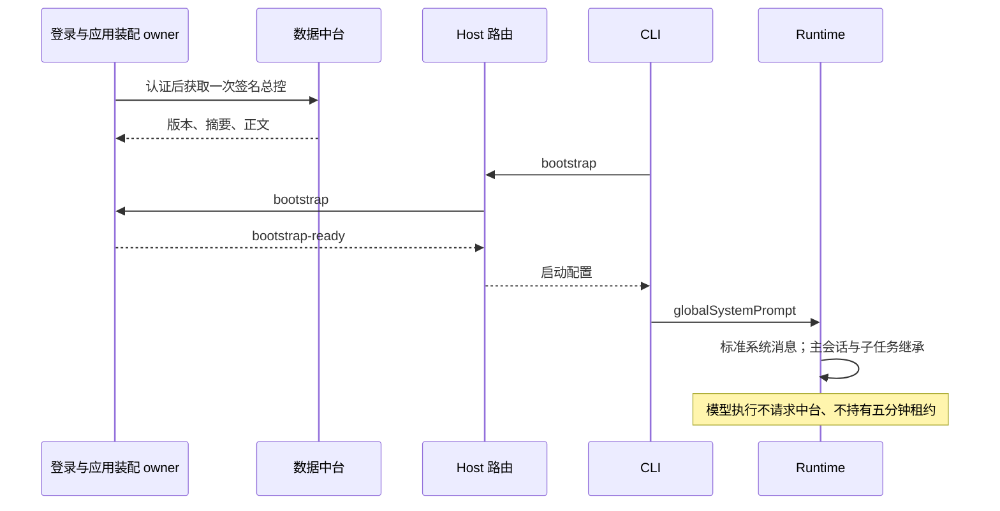

# CCode 启动全局总控提示词

## 当前产品规则

本规范取代 ccode-confidential-controller 中默认执行路径的缓存、短期租约、按请求 acquire/use/complete 和总控激活要求。客户端每次启动并成功认证后向中台获取一次签名总控版本，之后在本次登录生命周期内作为标准全局系统提示词使用。此阶段不实施此前讨论的 85%/15% 分片。

数据中台仍是内容来源；保留下载时的认证、签名、版本和摘要校验。下载授权的 expiresAt 只约束获取，不控制运行时间。无周期续期、模型调用授权或离线回退；正文不写入安装资源、环境变量、命令参数、会话数据库或日志。

桌面首次进入工作区前必须完成登录和全局配置装配；移除“跳过登录继续聊天”入口。没有中台账户端口的 Web 入口保持原行为。后续登出保留工作区展示，旧 CLI 停止，重新登录后新 CLI 重新装配。

## 所有者与接口

- application 拥有当前登录代次的一次启动装配 Promise；成功后的只读结果供多个窗口及 CLI 启动共享，失败允许下次初始化重试。不存在多版本缓存、淘汰、命中或模型租约服务。
- Main/Host 复用专用 IPC 传递启动配置，使用 bootstrap/bootstrap-ready 消息；Host 仅路由。普通 renderer/mobile RPC 不传正文。
- CLI 在协议服务就绪前读取配置一次，通过 runtimeConfig.globalSystemPrompt 进入标准 ContextBuilder 系统段。已有 systemPrompt 是替换式 persona，不能用它覆盖基础规则或破坏 workflowActor。
- 所有主会话、恢复、普通子代理和工作流子 Runtime 继承 globalSystemPrompt。标准模型调用不创建 confidential controller execution scope，也不归并为 EXECUTION_FAILED。
- 现有 systemPrompt 持久化保持不变；globalSystemPrompt 不进入会话配置或 saveMessage.system。模型诊断及请求转录需屏蔽含全局正文的 payload。
- 登出/换账号/退出作废启动结果并关闭已取得配置的通道，CLI 随通道失效停止；迟到下载不能污染新代次。用户取消仅取消其启动等待。

桌面 continuous 与手机 replayable 均复用原有 Runtime 和队列，路由 owner/lease 不在本次删除范围内。

## 验收

1. 登录和并发窗口初始化只有一次授权与下载；超过五分钟仍可创建/续接任务，不再访问中台总控接口。
2. 失败初始化可重试；签名/摘要错误拒绝；身份切换阻止迟到结果并关闭旧消费者。
3. 首轮、续接、工作流、普通子代理都有全局段；基础提示词/persona 保持；正文不进入存储或模型日志。
4. bootstrap 完成不要求 complete，模型异常保持原有类型与重试语义。
5. 执行根及 CLI 类型检查/lint、受影响测试、架构检查，生成新版 Windows 安装包。静态/模拟验证与真实中台、真实模型验收分别报告。

### 桌面交互验收场景

使用独立测试数据目录启动：未登录时只显示登录表单、无跳过操作；登录失败留在表单并可重试；登录成功且总控装配完成后进入工作区。执行两轮任务及子任务，再退出账号，确认旧进程停止且工作区仍保留；重新登录后继续原任务。Web 未提供账户端口时保持原来的进入行为。此场景需真实 Electron/中台/模型环境，SSR 和签名 fixture 的通过不能替代实机验收。

### 0.0.7 预览产物

本轮产品版本为 0.0.7，CLI 私有启动协议能力为 2。安装包来自当前工作区，其他原有未提交的品牌和工作流变更保留，相关提交不混入本轮总控提交。低可用内存环境下，前端构建通过 Vite `build({ build: { sourcemap: false } })` 关闭本次 renderer sourcemap；这是产物构建选项，不改变产品运行逻辑。安装包不自动上传或发布。
