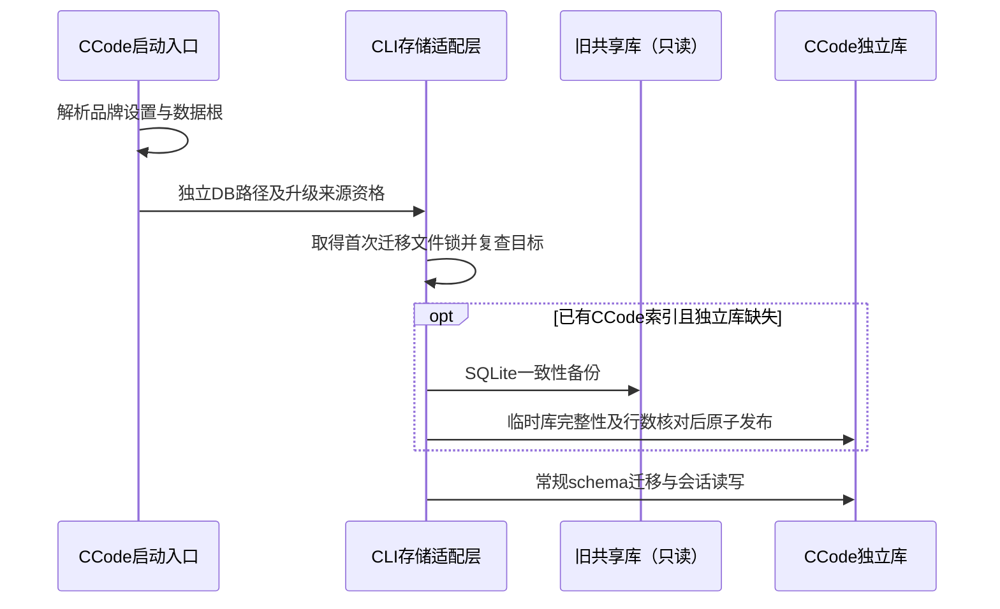

# CCode 配置与聊天数据隔离

## 产品规则

0.0.3—0.0.5 的 Host 索引已使用品牌目录，但 CLI 的默认 sessionDbPath 仍指向用户主目录，导致两个应用共享聊天正文。启动恢复和日志导出也残留真实 HOME 路径。

发布包以 `%APPDATA%/CCode Preview/data`（正式身份为 CCode）作为设置根；其下 `.zcode/v2/setting.json` 为启动设置唯一来源。有效的既有自定义数据目录继续使用，真实 HOME 不作为品牌版的共享数据回退。应用必须向本地 Host/CLI 显式传入独立 storage root 和 session DB，不能继承原版的数据库环境覆盖。独立 CLI、远端 CLI 和项目 cwd 语义不变。

## 升级与聊天保留

- Host 继续持有现有任务列表、项目、置顶、归档等组织态；不复制原版 Host 索引，不修改会话 ID、cwd、workspaceIdentity 或标题。
- 仅已有 CCode 索引且独立 CLI 库不存在的升级实例，允许从旧默认 CLI 库进行一次 SQLite 一致性备份。CLI 存储适配层负责备份，不由 Host 修改会话事实。
- 源库以只读方式打开，使用 SQLite backup 包含已提交 WAL 内容；不能直接复制正在使用的 db.sqlite。目标先写同目录临时文件，校验 quick_check 和所有用户表行数，然后原子发布。
- 使用现有文件锁串行首次迁移；锁内复查目标，目标已存在绝不覆盖。复制失败阻止启动并保留源库，不能以空库掩盖历史丢失。
- 共享库历史已混合，不能可靠判断每条消息来自哪个产品；保留一致性快照中的全部历史，不猜测删除。UI 列表仍使用 CCode 自己的 Host 索引。首次迁移之后不再持续同步，两个产品各自写自己的库。
- 旧附件与工作目录保留原路径，不搬迁、不删除；今后的日志、模型记录与执行产物使用品牌根目录。旧版进程仍在运行时产生的后续写入不会自动合并到快照，升级应在旧任务结束后退出旧客户端进行。

## 本次实现与验证

先修正启动设置及日志路径，再统一品牌运行环境，最后在 CLI 打开库前接入一次性快照。检查首次迁移、重复启动、源库缺失、失败不覆盖、同源正在写入、独立CLI不迁移等边界。用户要求串行、不追加压力测试或交互验收；执行类型、Lint、架构及构建检查，如实区分静态证据与运行验收。
