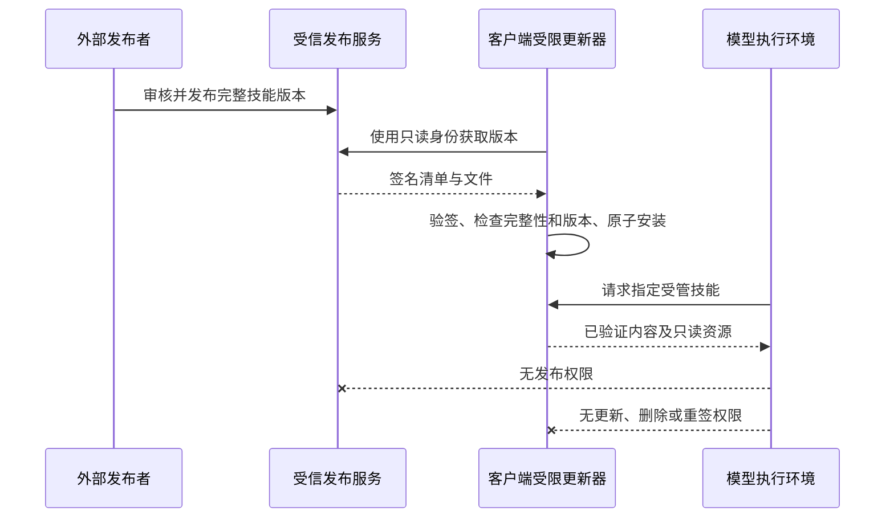

# 总控技能受管发布与客户端保护

> 2026-10-21 需求更新：核心总控改为中台动态下发、客户端仅内存加载且不保存本地文件，详见 `ccode-confidential-controller.md`。本文的签名契约仍可复用，本地安装与 ACL 隔离方案不再作为核心总控的目标实现。下文进度及审查记录属于此前阶段，不能作为新需求已实现的证明。
>
> **〔2026-10-23 状态更新〕**本文签名包契约（Ed25519 envelope、路径/大小限制、版本下限、`verifyManagedSkillBundle`）已被新路线完整复用：`ccode-controller-local-skill.md` §5.4 的更新落地流程即本契约的锁定存储实现（批次3b 落地：`packages/services/src/controller-locked-store/`，验签失败字节不变/原子替换/回滚清单，台账 2026-10-23）。ACL/OS 级隔离仍未实现（OQ-L4 结论不变）。

状态：独立子代理审查通过分期开发，正在实现；尚未启用保护。不能将本文作为已具备安全隔离的证明。

## 审查决定与执行顺序

用户已授权由独立子代理代为技术方案审核并继续目标。2026-10-20 的 approve_controller_design 审查允许继续实现，不再等待人工技术审批。默认以数据中台为目标权威发布者，先用独立于 HTTP 的签名发行包契约打通发布与消费，再接入数据中台发布 API。开发 fixture 不代表正式签发，也不替用户挑选可信初始版本。

1. 内容权威：完整技能目录的 Ed25519 签名包、严格路径与大小校验、版本下限、保留名称拒绝覆盖、验证失败不 fallback。客户端仅拥有公钥；发行 CLI 独立持有私钥。签名覆盖序列化 payload 的原始字节，验证通过后才解释文件内容。
2. 消费与管理：CLI、Host 技能发现/加载和管理/同步共用受管策略，绑定发行版本；现有普通技能行为保持兼容。保护配置缺失不能被描述为启用。
3. 写入隔离：Windows 先完成独立更新器和受限模型进程的真实权限验证；其它平台未验证时明确不支持完整保护。此阶段完成前不得宣称本地文件不可修改。
4. 外部发布接入与全链路验收：数据中台只读消费与独立发布权限、正式信任根部署、迁移、三轮绕过验证及独立复审。全部通过才完成目标。

第一阶段契约放入 `@zcode/shared/managed-skills` 的受控 Node 模块，由服务和 CLI 公开入口复用。发行包不携带可自行信任的公钥；调用方提供受信公钥、预期技能 ID/名称和最低版本。文件路径统一使用发行格式中的 `/`，拒绝链接、绝对路径、父路径、Windows 特殊文件名及大小写冲突。任何未实现的隔离能力保持明确未完成。

## 目标

总控技能只能由客户端之外的受信发布流程更新。ZCode 内模型及其子代理不得自行修改、迭代或替换正式总控技能。保护范围包含 `SKILL.md`、references、脚本以及发布清单，不能只保护入口文件。

已定位本机技能 `~/.zcode/skills/总控派单`，以及 `cs_agents/desktop/zcode-chat/bundled-skills/总控派单` 仓库副本。数据中台项目为 `cs-platform-service`。仓库副本尚未被确认为权威发布源。

## 当前证据

- CLI `adapters/src/skills/roots.ts` 允许额外根优先于用户技能根。
- CLI `adapters/src/skills/index.ts` 按路径去重，并按名称选择第一个匹配项；锁定原文件无法防止同名替代。
- CLI exec 直接生成宿主进程，Node REPL 可以导入文件系统和子进程模块。
- 当前总控目录对运行客户端的 Administrator 身份可写。
- 服务端技能删除、复制和远程同步接口没有受管技能身份。
- 数据中台当前只有 `cs-platform-verify` 的安装流程，没有总控技能文件包的发布接口。
- cs_agents 的治理 API 管理 scenario JSON；其现有评测、发布和回滚机制可参考，但不能直接作为目录文件包接口。
- cs_agents 的 `desktop/zcode-chat/account-preview/bundled-rules.cjs` 将打包技能复制到用户目录，并保留已有用户编辑。这是现有安装行为，不满足本次禁止客户端迭代的要求。

因此，提示词、隐藏编辑入口、文件只读属性和内置文件工具的路径黑名单均不足以满足目标。

## 所有者与边界

正式版本唯一所有者为数据中台的独立发布服务。客户端仅获取和使用已发布版本，不拥有发布凭据或签名私钥。先通过离线签名发行契约验证内容边界，不能根据本机已有副本自行宣布某个版本可信。



### 两项独立验收要求

1. 内容授权：不加载未授权改动、同名替代、未签名附属文件或失败后的普通技能 fallback。
2. 写入隔离：模型实际执行身份不能写入、删除、替换正式部署目录或修改信任锚；适用于 shell、Node REPL、MCP 及其子进程。

仅完成签名验证时，只能声明“拒绝加载未授权版本”，不能声明“本地技能不可被修改”。开发源码、客户端程序和更新器本身与模型共用管理员写权限时，不构成可信边界。必须使用独立发布/更新身份，以及不具有提权或修改更新器权限的模型执行身份；若目标运行环境不满足，保护状态应明确显示未启用，不能静默降级。

## 产品规则

- 受管技能 ID 与保留名称由受信配置确定，不由用户技能 frontmatter 自报。
- 普通目录、插件目录、extraRoots、项目根及远端同步均不能抢占保留身份。
- 更新必须覆盖整个技能目录；拒绝目录穿越、绝对路径、链接逃逸、重复条目和未声明文件。
- 缺失、损坏、签名错误、未知签名者或回滚检查失败时拒绝使用，给出可定位诊断；不回退到普通同名版本。
- 安装先验证暂存版本，再原子切换。失败保留上一个仍有效的受信版本。
- 会话必须绑定所使用的版本，不能在一次运行中混用新旧 references；子代理继承相同受管策略。
- 技能管理、复制、删除、禁用和远端同步必须遵守同一受管策略。不得通过用户配置关闭保护。
- 普通技能继续遵循现有规则。不得为保护总控技能而默默禁用全部客户端工具。
- 本机现有总控文件暂不移动、覆盖或修改；迁移需在正式发布版本和回退路径明确后执行。

## 验证与交付

所有破坏性绕过验证仅使用隔离 fixture，不攻击用户真实总控内容。

第一轮验证发布与加载：合法版本、错误签名、缺失/变更/额外文件、非法路径、同名覆盖、普通技能兼容、回滚以及原子更新失败。

第二轮验证写入边界：文件工具、shell、Node REPL、本地 MCP、子进程、大小写与相对路径、软链/junction、父目录替换、ACL 修改。必须记录实际进程身份与操作结果，不以字符串拦截测试代替 OS 隔离验证。

第三轮验证运行时：客户端重启、子代理、远端 Host、更新中断、运行中版本切换、只读发布身份拒绝写请求。审查与修复后重跑受影响用例。

仓库必需检查：`pnpm typecheck`、`pnpm lint`、`pnpm architecture:check --changed`，并执行相关 CLI 包自己的检查与针对性测试。

北京时间 2026-10-21 01:00 的一次性审查已由本聊天自动化安排。届时依据实际变更和验证证据独立审查，问题继续修复，未完成时不关闭目标。

## 尚待确定

- 数据中台发布角色与只读消费 API 的实现和部署。
- 目标部署身份与跨平台隔离方案；现有管理员开发进程不满足硬隔离。
- 权威初始版本、签名信任锚的部署方式和版本回滚规则。

这些缺口必须用实际实现和运行验证消除，不能仅补文档后宣称交付完成。

## 独立发行工具

开发入口（仓库根目录）：

```text
pnpm exec tsx scripts/publish-managed-skill.mts --source <独占稳定技能目录> --private-key <外部Ed25519私钥文件> --output <新发行包路径> --skill-id controller --name 总控派单 --version <正整数>
```

工具不生成生产密钥，不注册为模型工具。source 必须是发布者独占、在整个签发期间不被模型或其他进程修改的暂存目录；路径检查不能保证对恶意并发替换安全，Windows 的 O_NOFOLLOW 也不是独立权限隔离。私钥与输出必须在 source 外，源树拒绝软链、硬链接、特殊文件和私钥 PEM 内容；对输出采取原子创建并拒绝覆盖已有版本。临时文件写失败会清理。

发行包采用严格 JSON envelope，签名覆盖 payload 原始字节。包内文件总量至多 10 MiB、单文件至多 2 MiB、最多 512 文件；payload 至多 15 MiB、envelope 至多 20 MiB以容纳双重 base64。客户端必须通过另行部署的可信公钥验证，包中不存在可自我授权的公钥字段。版本下限只是调用方策略约束，尚不等于持久化防回滚机制。

## 2026-10-20 调查基线

- 两名只读子代理分别检查执行权限/覆盖风险和外部发布能力，均确认当前不满足保护要求。
- adapters 的 `tests/skills.test.ts`：17 通过，1 跳过。
- core 的 `tests/skill-tool.test.ts` 与 `tests/skill-catalog-runtime.test.ts`：9 通过。
- 根 `pnpm typecheck`：退出码 0。
- 根 `pnpm lint`：退出码 0，96 warnings，0 errors。
- `pnpm architecture:check --changed`：0 violations。
- 以上为尚未实现保护前的基线，不能作为新功能回归或硬隔离证明。
- 定时审查自动化 ID 为 `1`；本轮没有启动新的服务，也没有修改真实总控技能或 ACL。

## Windows 隔离落地前置条件

续查确认当前命令执行身份为 Administrator。机器存在其他软件创建的沙箱账户，但这些账户的存在不代表 ZCode 已使用它们，也不构成可复用的授权。不得借用其他产品的账户或凭据作为本功能的运行身份。

`scripts/dev-desktop-env.mjs` 的 test 参数只传递 `ZCODE_ENV` 等开发环境变量并启动现有进程，不能据此声称模型已有独立 OS 身份或独立数据目录。Electron 页面中的 sandbox 配置也不能证明 CLI shell、Node REPL 或 MCP 被隔离。

实现时必须补齐以下契约并用实际进程验证：

- updater 与模型身份分开；安装目录及祖先目录不能被模型重命名、替换或改 ACL。
- 受限模型进程、shell、REPL、MCP 子进程均继承限制，不能借助高权限 Host RPC 恢复写能力。
- 发布密钥、管理凭据和 updater 授权通道不出现在模型环境变量、用户可读配置或工具返回值中。
- 现有文件、终端、浏览器及桌面操作的工作流必须明确适配，不得把失效工具悄悄改回高权限执行。
- 对不能证明隔离的环境明确拒绝启用完整保护；尚未实现的 macOS/Linux 适配不能用 Windows 验证结果代替。
