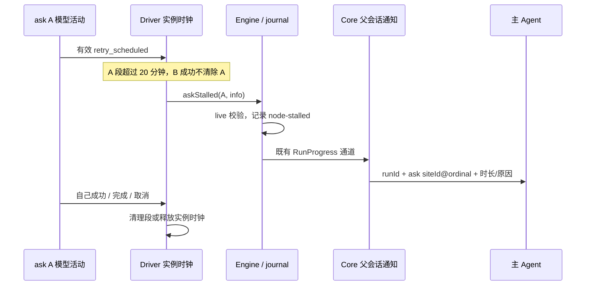

# Workflow 单 ask 模型重试停滞观察

状态：2026-10-21 设计已独立审查，实现及定向回归完成；最终静态验证由环境监理汇总。

## 目标与边界

一个 ask 持续模型重试时，即使同 run 的其他 actor 不断成功，主 Agent 仍能收到可定位到该 ask 的停滞通知。检测与通知属于同一个最小交付，只有内部计时器不构成完成。

当前 run 级时钟符合原合同：任何 actor 的模型成功都重置它。本次保留该语义，新增 ask 观察；不强制取消、自动重跑、切换模型或更改并发，不新增纯工具无响应、正常长推理或等待人工决定的超时。通知是调查依据，不代表已确认死锁或应重复执行副作用。

## 规则与所有者

- Driver 为每个在飞 `InstanceRef`（siteId × ordinal）拥有独立观察时钟，不能按共享 run 或可复用 actor session 直接归零。
- ask 段起点是该 ask 开始，之后该 ask 自己的成功模型请求更新起点。至少收到一次现有有效 `model_retry_scheduled` 后才上膛，阈值固定 20 分钟（1,200,000 ms）。沿用现有模型活动过滤，不把鉴权刷新、签名修复或纯工具活动当作新的停滞触发器。
- 同 ask 的 turn/tool-side 模型请求共用本 ask 时钟；另一 ask 成功不影响它。同 ask 任一模型成功清除当前段，之后新重试可重新上膛。没有重试不通知。
- 每段最多一条 ask 通知。成功接受/完成、失败结算、cancelAsk、run dispose 均释放时钟；同 actor 下一 ask 获得全新时钟。晚到状态和已取消的计时回调不能污染新实例。既有模型活动观察在换 ask 时保留尚在飞旧请求的 chainKey，迟到 retry/completed 不归属新 ask；旧链终态或会话退订时回收，原 run 节拍仍保留。
- Run 时钟继续独立运行。两种观察可能同时发生，各自每段一条，不用单 ask 事件冒充全 run 停滞。
- Engine 只记录观察事件，不改变 scheduler 状态；run 已结算或 ask 不 live 时忽略迟到事件。观察事件不计为进展，不写 run `stalledSince`。

## 最小事件与通知合同

新增 `AskStallInfo { sinceMs: number; reason?: string }`，定义于 dynamic-workflow 的 `src/engine/types.ts`，复用 `Pick<RunStallInfo, "sinceMs" | "reason">`，从 `engine/index.ts`、`src/index.ts` 公开导出。

`WorkflowReportSink.askStalled(instance: InstanceRef, info: AskStallInfo): void` 对应新增 `RunEvent` 成员 `{ type: "node-stalled"; instance: InstanceRef; sinceMs: number; reason?: string }`。不复用 `run-stalled`：既有 roster 通过它记录整个 run 的停滞，复用会产生错误事实。

复用既有 `DynamicWorkflowRunProgressPayload` 与 `recordDynamicWorkflowRunProgress`，无需新 RPC 或轮询 owner。Core 检查有限非负 sinceMs、非空 siteId、正整数 ordinal；非法载荷只记安全诊断并跳过，不让观察异常使任务失败。

本轮只发模型可读文本，沿用 `backgroundSource: "workflow"`、`title`、`workId`，不设置 `workflowNotification`。该通知的身份以 runId 加完整 ask siteId@ordinal 定位，可由现有 run 查询关联 actor。不得新增闭集 kind，也不得借用 `kind: "stall"` 冒充 run 级停滞；旧客户端以普通后台文本降级，避免拒绝协议整帧。此次无需修改 contracts/shared schema 或新增结构化元数据。通知格式器不再截断接收到的身份；常规编译生成的身份可完整定位。进度载荷遵守既有协议字符串 2,048 字符边界，不承诺任意超长自构身份无损传递；总 `truncated` 可能只来自 reason，不能因此丢弃正常可定位通知。

在 `core/src/runtime-task/notification.ts` 增加 `formatWorkflowAskStallNotification(input: { runLabel: string; runId: string; instance: { siteId: string; ordinal: number }; sinceMs: number; reason?: string }): string`。输出明确这只是指定 ask 的模型重试停滞，给出 runId、完整 siteId@ordinal、分钟数与原因，并说明 run 继续运行。复用已有 XML escaping。Core 入队沿用 runId 作为 taskId/workId，保留 branch fencing。GUI 使用普通后台文本，本轮不增加新 UI 交互或新通知 kind；模型文本必须完整可定位。

## 验收

1. A 重试，B 每分钟成功：19:59 无 ask 通知，20:00 A 恰好一条；run 级时钟继续被 B 重置。
2. A 自己成功清段；此后没有新重试不报警，新重试后重新达到阈值才能再发。
3. 取消、接受结果、失败、dispose、同 actor 下一 ask、迟到 completed/retry/timer 均无跨实例通知。
4. 没有模型重试的长工具调用、等待槽位或人工问题不新增告警。
5. Engine journal 的 node-stalled 经真实进度入口最终进入父会话通知队列；主 Agent 可读 runId 和 ask identity，旧 run-stalled 文本与元数据兼容。
6. 畸形载荷不抛错；ask 通知不含 workflowNotification，旧 run 通知仍使用原 stall 元数据。node-stalled 不清 wait、不更新进度、不写全 run stalledSince。

## 实施限制

仅改本功能文件；保留现有 confidential-controller、managed-skills、branding 及其他 dirty。不提交、不推送、不部署。独立子 Agent 审查代替流程性用户批准，主 Agent 决定技术取舍。测试只运行定向套件，另执行仓库要求的 typecheck、lint、architecture；不擅自跑全量测试。

## WF-4 对观察范围的更新

当前失败恢复合同见 [有限恢复spec](workflow-bounded-recovery.md)：请求层有限Workflow预算，Core每turn累计10次恢复，Driver不再额外重驱。ask观察只由有效网络retry事件上膛，终态释放时钟；Core恢复本身仍不新增观察入口，不用20分钟通知作为失败超时。

历史WF3曾补充外层重驱观察，相关33调用/30恢复等证据保留于会话调查记录；该无限重驱路径不再作为当前产品合同或验收要求。有限失败链和兄弟隔离须以WF4新测试验证，旧观察测试不能代替。