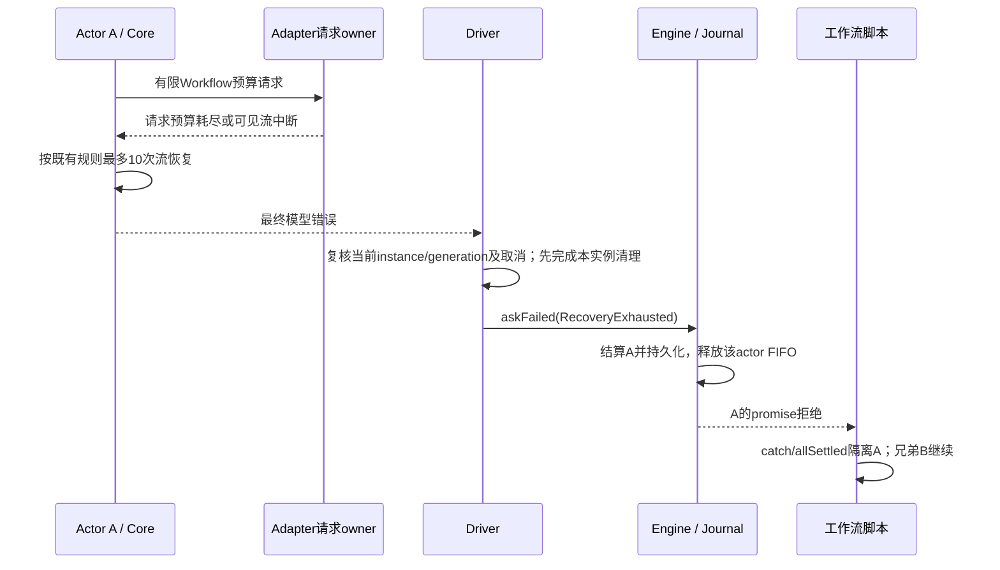
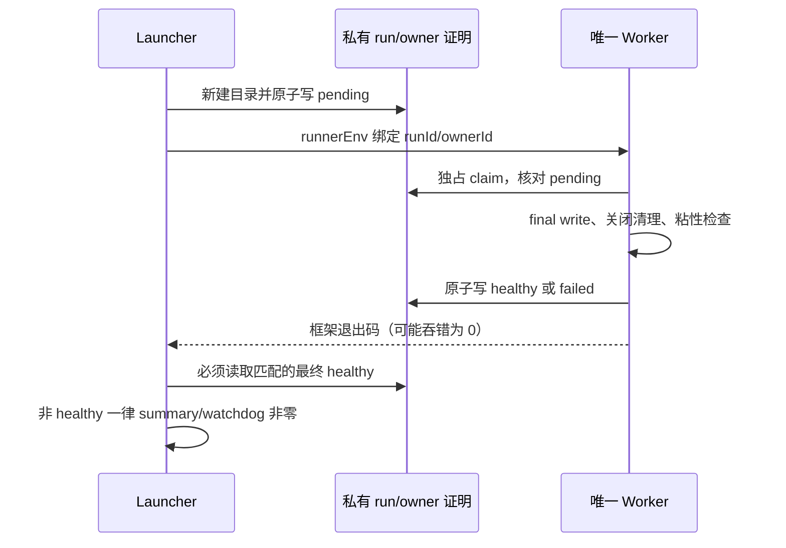

# WF-4：工作流模型失败链有限恢复

状态：已实现并集成，本地分层测试及静态检查通过；客户端 E2E 与 24 小时长时运行未验收。此项演进原unbounded合同，不将原行为定性实现bug。

## 目标与边界

持续瞬态模型失败必须有明确结局，不能由Driver无限创建新turn。保留底层已有恢复和取消能力；单个ask失败可由脚本捕获，使独立兄弟任务继续，已完成结果保留。此项不是全部ask时间/请求数上限，不处理永久无响应、工具自循环、进程接管或客户端E2E；WF5/WF6另列。

原真实Core/Driver基线：三个完整周期33次模型调用、30次Core恢复、2000/4000/8000ms退避，第三周期后仍安排重驱。证据在会话verification/wf4-baseline.log。

## 策略选择

1. 保留无限请求，仅限制Driver：漏掉无可见输出前的持续失败，不采用。
2. 请求改default并新增Driver任意次数：会改变workflow错误分类语义且新增重复预算，不采用。
3. 采用：workflow请求使用有限Workflow预算档，沿用现有retry选项（默认10次重试+首次，即maxAttempts=11，支持现有环境/构造配置），但仍读workflow错误策略表。Core每个turn既有10次流恢复保持。Driver收到最终瞬态错误以RecoveryExhausted拒绝当前ask，不再创建自动续跑turn。Driver额外预算为0，依据是底层预算已处理恢复且终态不能证明一般未知副作用可安全再执行，并非任意减少为2次。

保留Unbounded档供显式既有调用，生产workflow_child及嵌套工作流默认选择新Workflow有限档；普通会话Default、fallback SingleAttempt优先级保持。tool-side模型调用沿既有invocation context传播同档。错误分类仍保持stop→ProviderStop整run暂停、context_exceeded→ContextLimit单ask失败；取消优先短路。

## 所有者与重置

| 层 | 唯一所有者 | 有限范围/重置 |
| --- | --- | --- |
| adapter | 每个逻辑模型请求的attempt循环 | 现有maxAttempts配置；新逻辑请求归零；可见输出后不重放 |
| Core | 每个turn的stream recovery coordinator | 现有10次；每turn累计最多10次，成功不重置；新turn归零 |
| Driver | 当前ask的生命周期 | 不再建立第三层自动恢复循环；最终错误只结算匹配实例 |
| engine/scheduler | ask结果、actor FIFO、journal | askFailed只拒绝该ask；脚本未捕获错误仍按原合同fail run |

不能声称跨整个ask所有成功请求都有总数上限。off-peak合法排队、鉴权刷新/签名修复的既有额外尝试规则不改变，不将等待判失败，不承诺墙钟上限。

## 安全、恢复和兼容

- settle前清理只能针对捕获的当前实例；先清理再askFailed，后者可能同步释放FIFO派发下一ask，禁止在其后改写共享SessionState。
- 迟到resolve/reject须经过instance与turn generation核验，不能清后继升级项、结算后继或产生新turn；已取消/accepted/disposed优先。accepted只阻止再次结算/失败，已有用量记账与转录边界不得粗暴丢弃；settleExchange的await返回后必须复核generation再影响终态。
- 不恢复原ask自动重试，不添加新resume旁路。失败结果由既有journal记录；重复同run的恢复遵守现有失败缓存/恢复规则，不静默清除失败结果重跑。显式新工作需原已有入口和安全边界，未知副作用先核实。
- 不重放/回滚工具；Core during-stream只允许readOnly且sideEffectScope=none的现有准入保持。abandon账本不代表副作用已回滚，也不代表所有外部操作已结束。
- 不改controller绑定装配。已有恢复version/digest保持，正文只内存，无离线回退。
- Desktop continuous与Web replayable复用既有node-settled/错误journal和snapshot路径，不添加新通知事件种类；新稳定错误码需核对序列化/校验闭集。
- WF3重驱触发观察随重驱删除而不再适用；保留WF1有效请求重试观察，文档/测试同步去掉旧无限合同，不保留死回调。

## 验收

1. adapter有限Workflow沿现有配置在预算耗尽后退出；classifier与workflow策略分歧仍选workflow策略；Unbounded和Default及SingleAttempt回归保持。
2. Core真实流恢复达到既有上限后Driver只报告一次RecoveryExhausted，推进假时钟不再调用模型；正常兄弟B已完成结果保留。
3. 真实Engine/脚本catch或allSettled下A失败B继续；另记录未捕获拒绝仍fail run的既有合同，不声称任意脚本自动隔离。
4. 取消与最终失败竞态、已接受结果、迟到旧turn及后继ask，不复活/不误结算；长等待没有错误不触发失败。
5. 无工具重执行断言；真实未知副作用路径需可达证据，不以只读流工具测试冒充。
6. 针对性单测、CLI/root typecheck及lint、架构检查和独立代码审查；不运行全量测试，不把分层测试称客户端E2E。

## WF4 测试安全采集合同

WF4 配置 measurement owner 必须拥有完整 awaited measurement 的异常，包括 run 回调与 finally 中的 lifecycle recorder。run 原始异常在交给 measurement 记录前先置粘性失败并替换为固定错误；完整 measurement 的任何 rejection 再由同一 owner 置失败并固定抛出，不保留原始 cause 或自定义字段。recorder 暂时失败后恢复、后续 phase 成功不得清除失败；既有 afterSession/launcher 证明链须拒绝该 run。非 WF4 保持原异常与既有记录语义。本合同不覆盖其他 hook、模块加载、源日志或完整受保护 GUI。

仅精确的 `conversation-session/manual-review/pending/conversation-session-workflow-recovery-exhausted.test.ts` 单 spec、显式 `ZCODE_E2E_WF4_SAFE_CAPTURE=1`、replay 且无 toolsearch/coding-plan 代理可以启用测试安全采集；目标缺少 opt-in 或混跑必须拒绝，其他 case 未 opt-in 时行为不变。配置与 worker 各自核实际解析后的 spec，不以文件名后缀或未展开 glob 代替身份。

每个 replay owner 持有唯一的安全 writer 与不可清除的失败标记。请求只在内存用于匹配，持久化前新建白名单 DTO：固定 schema、HTTP ordinal/UUID、已知 fixture/actor、状态、合法 HTTP status/时间。pending 未匹配保持 unclassified；未知字段、正文、headers、URL、query、响应 chunks、原异常均不能进入最终文件或临时文件。HTTP ordinal 不是 adapter attempt，UUID 不是逻辑 requestId。

writer 或 replay 任一异常置粘性失败，后续成功不能恢复；unmatched、HTTP 错误、headersSent destroy、console 及启动/关闭异常仅固定 code。关闭先发起 listener close，再取消 gate、等待已接收 handler/写队列、final write，最后释放引用；不依赖 sleep 或 GC。初次写失败不得返回可用 server，最终 writer/stop 失败必须由实际 owner 导致非零退出和失败 summary，不能仅在另一个进程检查新建 healthy 实例。

测试采用完全合成 sentinel，覆盖 atomic tmp/rename、pending/unmatched/非法 JSON、响应/异常/并发/stop 与 stdout/stderr。关闭失败 collector 不等于源 runtime 日志安全。通用 reporter 较早事件顺序、源日志和正常固定版本授权没有真实接线的安全证据时，完整受保护 GUI 始终 NOT READY；局部 writer/reporter 消费者 UT 不得冒充全链通过。禁止先落盘再清洗、整页/数据库导出及用真实正文验证泄漏。

未来 GUI 直接证明 A HTTP 次数、journal 唯一结算、B 结果保留及明确观察区间内无增长；Core/Driver 内部预算与无重驱单独引用既有分层测试，不新增 Runtime 查询接口，不从内存 event store 缺失 SQL 事件推出零计数。安全基础设施实现不自动授权新增 GUI case 或真实模型请求。

WDIO 会吞掉 afterSession hook 的 rejection，并可能显式以 0 退出 worker，因此 worker 的 process.exitCode/throw 不是跨进程成功依据。每次私有 artifact run 由 launcher 创建全新专用 proof 目录、随机 owner 标识与原子 pending 状态；仅单个 worker 可独占认领。worker 在 replay final write、所有关闭清理和粘性检查完成后原子写入 healthy 或 failed 终态。证明只含固定 schema/code/state 与 runId/ownerId，不含请求数据。launcher 在 summary/watchdog 前必须读到与本 run/owner 匹配的最终 healthy，不能把 worker exit0 或“没有 failed 文件”当成功；缺失、pending、损坏、错配、重用目录、链接及任何 IO 失败一律失败。proof 保留在本次 artifact 中，不使用全局共享路径，不允许后继 worker 覆盖终态。

