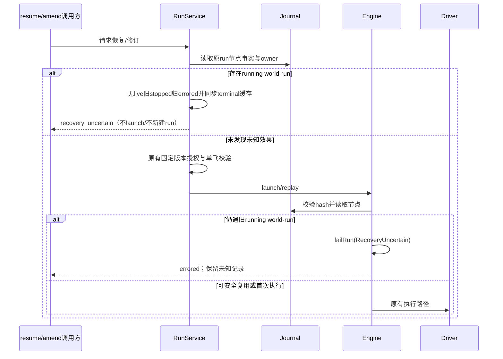
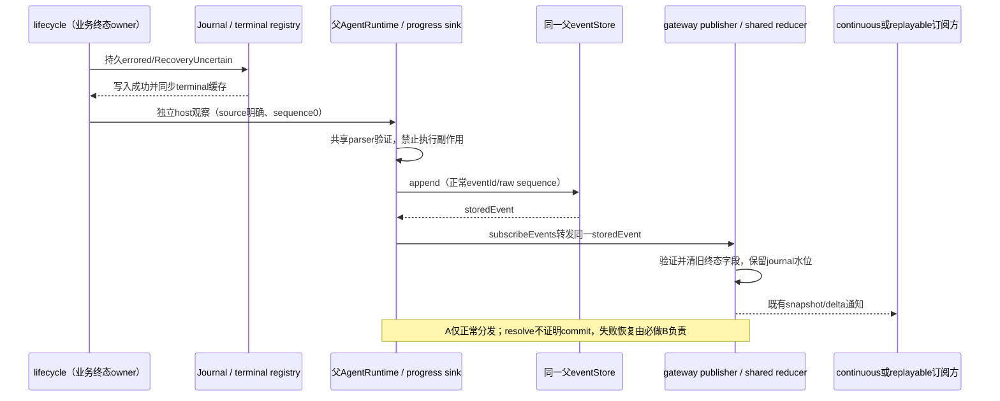

# WF5 未知外部效果的恢复保护

状态：Engine、宿主收敛、恢复入口、工具/协议提示及私有 SQLite 强杀回归已完成分层实现与验证；原库集成门禁另行记录。P2 联合复现确认暖重订阅可能保留旧 stopped/resumable/stopReason，而新 service/gateway 冷读正确。阶段 A 的正常观察分发已完成原库集成与独立验收。阶段 B 已获授权，Task1–Task5 已在隔离树实现并完成分层验证，Task6 精确原库集成和最终门禁待验收，不能据此关闭P2。完整客户端 E2E、跨 Host、掉电和 24 小时运行尚未验收，不代表整体无人值守交付。演进旧running节点可重放合同，不将旧行为定性实现违约。

## 依据与目标

一次性真实SQLite/Engine强杀探针已确认：world-run外部效果append+sync后、completed记录前强杀，恢复后效果计数从1变2；已completed兄弟节点命中缓存保持1。输入promote已提交但ACK丢失则真实Inbox可去重。证据在会话wf5-probe-report.md与verification/wf5-probe-2026-10-21T12-56-56.056Z.json。

目标：阻止已有运行中结果不确定的world-run在resume/amend中被静默重放，保留已完成结果和未知事实。此项不能提供全系统exactly-once，也不能识别独立新任务故意重新执行同一业务。

## 规则

- 旧journal节点status=running且kind=world-run表示结果不确定；不根据shell命令文本猜只读或猜成功。completed缓存、failed缓存、running纯world-read及首次新world-run保持原合同。
- 增加稳定错误码RecoveryUncertain，不新增数据库状态。Engine重放遇未知world-run，在hash核对后、写记录/调用driver前，以既有run errored终态失败，拒绝当前请求；保留未知节点running原记录，不伪造completed/failed。run级first-wins阻止脚本catch后继续新效果。
- 服务层resume在授权准备及launch前对同run已有节点做纯预检；对本parent所有、无live的旧stopped/孤儿run，发现未知world-run就沿既有宿主journal更新语义收敛为errored/RecoveryUncertain，不改节点、不伪造引擎事件。lifecycle所有者须同步已有terminal registry缓存/通知读面，避免旧stopped覆盖持久事实。返回专用recovery_uncertain，不启动sandbox。foreign owner先拒绝，不读取返回节点详情或改其状态。与Engine共享纯判定findUncertainWorldRun(nodes): InstanceRef | undefined，作为dynamic-workflow公开入口，不维护第二份状态。
- amend前驱含未知world-run时首版拒绝：无论原权限分类或确认结果如何，均不得成功创建替代run；首版没有force或重放批准入口，不增加force/idempotent旗标。保持既有权限谓词、用户停止/新provider确认及CTRL授权规则，不为必然被拒的请求新增审批或把未知状态复制到predecessor事实中。服务端先核对owner/已有节点，在异步授权完成后、停止前驱前再次扫描，最终扫描到abort之间禁止await，利用现有harness同步abort→engine.stop阻断新节点派发。提前权限快照不能替代此最终扫描，用户确认、取消或换runId都不能证明效果已核实。不能先停再普通拒绝、留下supersededBy悬空。发现未知时不创建替代run：live前驱保持live，completed前驱保持completed，只有本owner无live stopped/孤儿前驱按上述收敛。已有completed结果不删除。
- 同run再次resume、重复amend拒绝都不调driver或生成替代run。取消、owner/parent校验、脚本hash和controller固定version/digest原边界不移除。
- 仅返回可定位非敏感run/节点标识及稳定错误，不拼完整命令、工具输入或凭据。提示必须说明结果未知且需核实，不能自动推荐amend重跑。

## 所有者与顺序



resume/amend统一增加结构化分支：{ ok: false; reason: "recovery_uncertain"; uncertainty: { runId: string; instance: { siteId: string; ordinal: number } } }。重复拒绝保持专用原因，不退回建议amend重跑的普通提示。不得拿ProviderStop或ContextLimit冒名。预检与执行门共享判定但后者不可省略，防直接engine装配绕过。并发控制沿现有lease/preparingRuns与journal语义，不新增全局锁。

## 不在本轮新增的能力

可信外部receipt导入、绑定inputHash的显式重新执行授权、下游强幂等key协议均需独立设计，首版不提供绕过。通用world.run没有强幂等合同，不能把用户普通继续、runId变化或模型自行判断当作结果已核实。AI可继续只读调查其他独立任务；未知真实效果不能用自动重放来消除阻塞。

## 验收

### P2 阶段 A：宿主权威终态的会话观察

业务终态仍只有 lifecycle/journal 一个 owner。成功写 errored/RecoveryUncertain 并同步 terminal registry 后，才能发独立宿主观察；写失败、foreign/live/completed/superseded/未知节点不匹配均不发。观察不改节点、不调 driver、不写 dwf_event，不伪称 Engine 曾结算。

观察复用父会话 DynamicWorkflowRunProgress 的 `eventType: "run-settled"`，显式 `observationSource: "host-reconciliation"`，`sequence` 严格为数值 0，表示**无 journal cursor**；父会话仍正常分配 eventId/raw sequence。已有 run.lastEventSequence 不抬高/不回退，无 run 时初始 0，重复观察不抬 projection revision。两种序号不得混用。

共享校验唯一落点是既有 `packages/shared/src/zcode-protocol-v4/workflow-runs.ts`，经现有 `@zcode/shared/zcode-protocol-v4` 入口导出。拟定 `parseWorkflowRunProgressObservation(unknown)` 返回 legacy、合法 host 或 invalid：仅**没有自有 observationSource 键**才走原兼容路径；未知 source、显式 undefined/null 和非法 host 组合均拒绝，不能降级普通 run-settled。构造器、runtime 入口、product projection 边界与 shared reducer 调用同一纯解析器，不复制规则。

合法 host 集合：source 精确值、eventType=run-settled、sequence=0；runId 为 1–128 个 `[A-Za-z0-9-]` 安全字符，可选 toolCallId 为原关联键；payload 只含 status=errored 与 error，error 只含 code=RecoveryUncertain、有界非空 message（不超过 WORKFLOW_RUNS_LIMITS.maxErrorLength）。禁止 resumable、stopReason、supersededBy、actorSessionId、launchInputId 及其它执行/输入字段。producer 先按公共上界有界化安全消息，再用同一解析器验证；不截断身份，不复制工具输入。

shared reducer 在任何状态/水位变更前对 invalid 返回 null；runtime 在 append、提醒与 telemetry 前拒绝并记稳定 reasonCode。product projection 的既有 `event-normalizer.ts / normalizeConversationEvent` 入口复用同 parser，对非法历史在变更前抛出含稳定 reasonCode 的安全错误；不改超长 product-projection 文件，不把 throw 扩到 TUI 共用 reducer。gateway 将 apply 失败记入既有 commit 失败缓存并上抛，真实 runtime 订阅调用者沿既有 event-sink warn 记录，冷 hydration 沿订阅失败返回。generic apply 错误不保证调用 gateway.onError，不借 telemetry 旁路触发诊断。纯 shared 层不做 IO。日志只带安全 run/session、source 分类与 reasonCode，不输出原始 payload/错误正文/命令，不将非法观察当成功忽略。

正常链为 lifecycle 持久/缓存完成→独立 host 回调→既有 progress sink→真实父 AgentRuntime.recordDynamicWorkflowRunProgress→同一 eventStore.append→runtime.subscribeEvents→gateway publisher→shared reducer→原 continuous/replayable 帧。禁止直接写 UI store/注入期望 snapshot。构造期 orphan 早于 runtime 时由冷行权威初始化，不宣称未就绪回调已发布成功。safe amend 最后 scan→abort 同步片不得新增 await。



所有终态分支先移除旧 resumable/stopReason/supersededBy/error，再按本次合法终态载荷补回，不只 host 特判；保留 nodes、已有结果、usage、resumedFrom，未知节点不得伪成完成/失败。host 不携 launchInputId，telemetry 显式排除该 source，不重复 Engine 生命周期/记账；可闭合既有终态提醒，不新增模型唤醒或通知 kind。

新 CLI/shared publisher 产生的**既有 snapshot/delta**可供受支持旧远端消费者读取，须分别验证 continuous/replayable。直接消费原始 progress 的旧 reducer 可能保留旧可选字段，不承诺其已修复或所有旧客户端完全正确，不增加兼容绕过。

sequence0 不刷新依赖 lastEventSequence 的 workspace/journal 查询；本次不新增节点/产物/日志事实，保留水位是正确行为。run 终态头、Resume 与错误正文必须直接读更新 workflowRuns 投影；WorkspaceSidePane 状态头同样读 run 投影。实施时确认清单/正文无需重查；若真实终态信息依赖查询结果，按明确终态变化触发必要读取，禁止虚增 cursor。未发现需求前不扩 UI/hook 范围。

### 阶段 A 失败边界与必做阶段 B

阶段 A 修改的两个既有观察职责必须正式受管，不依赖上游原样接纳的持续有效性：

| 模块 / owner / 层 | 精确业务 root 与公开入口 | 依赖与契约制品 |
| --- | --- | --- |
| workflow-progress-payload / agent-runtime / app | 既有 bootstrap/src/app/dynamic-workflow-run-progress-payload.ts；现有三个序列化函数与同级 workflow-progress-payload/contract.ts | requires=[shared,zcode-cli]；五件聚合于同级 workflow-progress-payload 目录与 bootstrap/tests/workflow-progress-payload |
| workflow-telemetry-facts / conversation / app | 既有 bootstrap/src/zcode-protocol-v4/conversation-telemetry-workflow-facts.ts；现有 workflowLifecycleFactFromProgress 与同级 workflow-telemetry-facts/contract.ts | requires=[shared,zcode-cli]；五件聚合于同级 workflow-telemetry-facts 目录与 bootstrap/tests/workflow-telemetry-facts |

上表 bootstrap 路径均相对 apps/zcode-cli/packages。每模块 roots 只含既有职责文件、自身 src 契约目录和自身 tests 目录；module.ts、contract.ts、contract.example.ts、CONTRACT.md 放 src 契约目录，contract.test.ts 放 tests 目录并实际收集执行。contract 只引用真实签名，保留既有调用路径，不加运行时 wrapper、状态或业务行为，不纳管整个 app/协议目录。policy 只登记两个模块与真实依赖，不增加例外、不刷新 baseline 或 upstream snapshot。

A 只保证正常分发链下持续订阅、暖重订阅、冷读一致。sink 的 runtime unavailable/append rejected 必须有 run/session 可定位日志，单 event sink 失败沿既有记录。回调已调用或 record Promise fulfilled **不等于投影已提交**，因为 notifyEventSinks 吞单 sink 错误。持久成功但观察失败仍是未完成的可靠性要求；用户再点击/重启不能替代无人值守自动恢复，A 通过不能标 P2 整体完成。

sink 用同一 shared parser 区分日志合同：无 source 的旧 Engine 错误诊断保持；host/invalid 的同步 runtime unavailable 与异步 append rejected 只记录稳定 reasonCode、安全 run/session 和 source 分类，禁止直接写入任意 error.message/String(error)。

B 采用本文件下方已审合同：稳定host身份、store确认后/tail前同步局部hook、同record adapter实际admission证明和唯一strict candidate重建。不得等待整个appendEvent完成才交接；普通sink永久pending也必须启动观察job。仅借鉴commit/rebuild模式，不直接复用generic取消或permission allowlist。

A 必要验收：非法 source 组合全拒绝；字段/水位/重复幂等；真实 sink→runtime append→publisher 持续更新和暖/冷联合测试；写失败不发、父隔离、无重复通知/telemetry、两 delivery 的 snapshot/delta。冻结 RED 不得改为 stale 期望。B、真实 GUI、跨 Host和长期运行均继续待办。

订阅验收需区分逻辑投影与实际通知：现冻结 RED 使用的 `gateway.subscribe()` 内部已经执行 `dispatch.commit()`，不存在漏提交，暖重订阅快照证据仍成立；它不证明物理 transport 或持续在线通知。A 新 GREEN 应按真实 server 顺序使用 `subscribeReserved()`→接纳 `initialWires`→`dispatch.commit()`，再捕获真实 `context.notify` 的后续通知；若使用 `subscribe()` 包装，须证明等价订阅激活并分别接纳初始帧。`flushNow` 只作逻辑 publisher 探针，不能代替通知捕获。continuous/replayable 的实际 wire 通知分别验收，不能把此进程内联合测试写成 Desktop IPC/GUI 或跨 Host 证据。

### 已有执行保护验收

1. 新旧强杀探针对照：新策略world#2效果仍1、节点仍running、run errored/RecoveryUncertain，completed #1结果保留；不再调用driver执行#2。
2. completed/failed缓存与running纯read继续；hash漂移仍原错误；新world-run正常。脚本catch后再请求效果也被已终止run阻断。
3. 真实RunService resume未知run在runtime/sandbox启动前拒绝，amend拒绝且不创建新run；重复调用幂等，兄弟run不受影响。
4. 已有owner/parent/固定绑定/取消及resume并发断言保持；两种客户端通过既有错误/快照链读取同一事实，不新增通知kind。
5. 定向测试、独立代码审查、typecheck/lint/architecture；不把一次性Engine探针称RunService/桌面手机端到端。

## 实施前置

WF4/WF5执行保护与P2-A正常观察已完成独立分层验收。P2-B先按下方合同更新spec/计划并独立审查，再由主任务明确授权源码实施；设计批准不等于实施批准。总控装配保持既有固定版本授权，不覆盖他人改动，不扩业务执行授权。


## P2 阶段 B：宿主观察可靠性合同（隔离实现与分层验证完成，原库集成门禁待验收）

选定稳定host recorder与record订阅适配器；局部onStored交接不沿RunService/workflow port/tool上推，不提供“业务拒绝响应前投影已提交”的强合同。只catch/re-ingest不足以覆盖非throw失败、raw gap、notify前故障和seen去重。

### B.1 不变量与唯一所有者

| 事实/工作 | 唯一所有者 | 不允许的替代 |
| --- | --- | --- |
| run errored / RecoveryUncertain、拒绝原因 | 既有 journal/lifecycle | 投影失败后重做业务写、轮询 journal 来重跑拒绝 |
| 一次 host 观察的 id、payload、root trace、至多两次串行 append | core host recorder 的单次调用 | sink 重调旧 recorder 生成新 id；按 runId 找“最新一条” |
| 当前实例的权威 raw event | 该 direct parent record 的同一个 eventStore | gateway recent tail、child→parent fallback、journal 合成 id |
| 后台观察 job 与终结日志 | direct record 内的 host 适配器 | 全局 run→lastReceipt；无人 catch 的 Promise |
| projection、raw reorder、订阅恢复边界 | gateway / 既有 publisher | app 直接改 snapshot；重建第二个业务 owner |
| 线缆发送与客户端应用 | 既有 profile/resync/client reducer | 将 publisher commit 当作物理收到 |

host 输入必须先由 shared parser 分类为合法 `host-reconciliation`，并且 type、parent session、runId、`run-settled`、payload sequence 0、errored/RecoveryUncertain 均满足 A 的合同。未知/非法 source 不能退回 legacy Engine 分支。普通 Engine 事件、TUI 路径、permission allowlist、通用命令 barrier 均保留其合同。

record 适配器以对象引用及 gateway session generation 隔离运行实例；sessionId 相同不代表同一实例。不得给新 record 采用旧 record 的事件、load 结果或 candidate。

### B.2 最窄内部接口

以下为 B 当前实现的内部合同；不增加 JSON-RPC、公开工具 schema 或 workflow 业务 port 字段。

```ts
// core AgentRuntime：专用方法，legacy recorder 的签名保持不变。
recordWorkflowHostObservation(
  input: DynamicWorkflowRunProgressPayload,
  onStored: (storedEvent: SessionEvent) => void,
): Promise<void>; // 仅跟踪 recorder/tail；不作为接单或 commit barrier

// bootstrap ZCodeAppOptions：只在 protocol app 构造时注入。
// 同步接单；调用方不能从返回值推断 projection 或 wire commit。
onWorkflowHostObservationStored?: (storedEvent: SessionEvent) => void;

// bootstrap record-scoped adapter，普通订阅和上面 hook 共用。
acceptWorkflowHostObservation(
  event: SessionEvent,
  forward?: () => void,
): void;

// gateway 内部用途受限的入口；receipt 来源仍须 direct store 查证。
ensureWorkflowHostObservationCommit(
  sessionId: string,
  observation: { eventId: string; runId: string },
  owner: WorkflowObservationOwner,
): Promise<WorkflowHostObservationCommitResult>;

interface WorkflowHostObservationCommitResult {
  strictAttempted: boolean; // 同event/generation是否曾消耗唯一strict；本地诊断，不上推业务层
}
```

**最窄 core 拆点：**在 `runtime/methods/events.ts` 将现有 append 的私有阶段主体提取为共用 helper，公开 `AgentRuntime.appendEvent(event, traceContext)` 仍只接受原两参数。新增仅 core 内部可用的 `appendEventWithHostStoredHandoff(event, traceContext, onStored)` 包装，只接受经验证的 host progress；不从包公开导出，不给普通 sink 加标记。私有主体在原 `storedEvent = await this.eventStore.append(event)` 成功且返回身份核对通过后，立即执行一次安全、同步的 host callback，再进入原 durable/usage/notify 阶段。普通 append 包装不传 callback，原顺序、返回与异常合同保持。callback 不 await、不作为新 IO 阶段，也不得等普通 fanout。新 core 文件边界明确列入下方评审清单。

终结元数据必须读取gateway同event/generation的真实历史：从未消耗strict时返回 {strictAttempted:false}；一旦消耗唯一strict，该generation内即保持true，包括strict成功、job finally后重复hook走已commit正常快返，以及永久失败的重复结果，不能按本次执行分支硬编码false。失败抛内部安全 WorkflowHostObservationCommitError，携带phase、reasonCode、strictAttempted，固定安全message，不把原异常正文经generic出口泄漏。adapter不从耗时/是否调用force猜该标志，也不增加第二份业务owner。phase闭集为append/handoff/verify/forward/observe/old_flight/strict_load/candidate/adopt/postcondition/delivery/dispose；reasonCode闭集为invalid_observation/runtime_unavailable/append_rejected/identity_unverifiable/owner_unavailable/stale_owner/handoff_failed/apply_failed/strict_load_failed/target_not_applied/postcondition_failed/timeout/disposed/delivery_fault。只有取得gateway同event/generation权威事实时才报告boolean；adapter前置失败或违规端口未提供历史时，失败诊断为unknown，不能仅因本次尚未调用gateway就猜false。已有权威历史始终保留，不用当前phase覆盖。adapter不保存第二份attempt owner，对未知异常只使用其当前阶段安全原因，不解析异常文本。该小结果只在gateway→adapter本地流转，非公开workflow/tool receipt。

`WorkflowObservationOwner` 仅含本 job 的 signal、deadlineAt、now() 和 isCurrent()，deadlineAt/now 使用同一单调时钟（默认 performance.now）。它不持有业务真相、无公开序列化形式；gateway 以剩余预算保护每个 await 和最后同步 adopt。strict load 是用途受限的 V4GatewayHost.loadWorkflowHostObservationProjection(sessionId, target, owner) callback，在旧协议 bridge 捕获 direct record 并核 owner；不把整个 eventStore/repository 泄入 gateway，也不反向 import 旧协议目录。

strict loader 通过该用途受限闭包复用已有 cold materialization 算法，返回 loaded events、真实 raw cursor、全部 seeds 和目标 raw identity 的验证结果。普通 `loadPersistedEvents` 的降级合同不改成严格。优先将现有 bridge 加载主体提为私有 helper、参数区分 `normal` 与 `workflow-host-strict`；不复制第二套 cold merge。

publisher 仅增加内部 `prepareRehydration(...)` / `adoptPreparedRehydration(...)`。现有 `rehydrate` 继续作为同步 prepare+adopt 包装，保持普通 hydration 原来的 oversize 容忍和 delivery 合同。strict 用法把所有 await 放在 adoption 前，并在 candidate 上核实目标；不会把普通 hydration 全部改为严格。

### B.3 append、存储核查和 notify 缺口

1. app sink 保留现有 routing 闸门。构造时已注入 onWorkflowHostObservationStored 的 protocol-capable app，对合法 host 调用新 host recorder，**调用时就传入**同一同步 stored callback；新方法缺席或失败不能退回旧 recorder。明确未启用 protocol 的 TUI/普通 CLI app 无 hook，保留旧 recorder 与 A 合同，不承诺 B 投影可靠恢复。legacy 仍调用现有 recorder；invalid 无论 hook 是否存在均按 A 拒绝，零 append/hook/模型通知，不能被当成 legacy Engine。sink 不等待 recorder Promise 返回才装配 hook。
2. host recorder 使用捕获的同一 runtime、同一 eventStore 和 root trace 创建**一次**完整事件，冻结 id、session、payload 和 trace。不得把 eventId 塞入业务 payload；真正 raw sequence 仍由 eventStore 分配。
3. 第一次调用上述 host-only 内部 append 包装。真实 store append fulfill 后，立即校验返回事件与本次已准备 id/session/type/run/payload 一致、正 raw sequence；在**任何 durable/usage/fanout await 之前**，设置本操作已存储证据并同步调用一次安全 onStored。adapter 接单后独立异步从原 direct store 的 getEvents 精确核查，结果须恰好一条；不会只信 callback 对象。任何普通 sink 永久 pending 都不能阻挡这次接单或其 25s deadline。
4. callback 只同步接单，不等待 projection。core 隔离 callback throw，记录安全 handoff reason，不允许其异常阻止普通 durable/usage/fanout；不把 callback error 归为 append-before-store failure，不为此重 append。callback 本身由 app/protocol 提供同步实现，不接受后台 commit Promise 作为返回合同；它负责 catch 自己接管的 job。该操作的 handoffAttempted 在调用前置位；失败时也不反复调用 hook或重播全部 sinks，后到正常 subscription 仍可按同 event 接单/核现状。
5. 如果 store append 已 settle reject，且尚无已存储证据，才在捕获的同一 eventStore 执行 getEvents(sessionId) 精确查 id。查询成功并证明 absent，最多串行再 append 一次**同一个已准备事件**；不得并发、不得在原 append 未 settle 时重试。第二次若成功，仍在其 store 确认后立即交接。查询 reject、同 id 多条、身份冲突、runtime/app 已失效时，不重试，明确安全失败。
6. 如果 settled reject 后精确查询查明本事件已存在，就立即以该真实 storedEvent 执行同一次安全 handoff，零二次 append，不补播全部普通 sinks。若第一次已经确认存储并调用 hook，之后 durable/usage/notify/tail 再 reject，则仅报告对应 tail phase；不重 append、不重交接、不撤销 adapter job。普通 fanout 永久 pending 时 recorder/tail Promise 也可保持 pending，但已经接单的 adapter 会独立完成或按 deadline 终结。
7. 当前 host 事件的 durable persistence 没有专属写入分支；usage 对 DynamicWorkflowRunProgress 不匹配任何 ToolCall*/Permission* upsert 分支，**即使带合法 toolCallId 也不写 usage**。但有 toolCallId 时会先访问 registry 等依赖，仍可能 reject（见 E5），因此必须把 hook放在这些阶段之前，而不是依赖它们无失败。host 提醒状态在已确认存储后至多更新一次，不能让其异常阻断已接管 job；仍无模型可见通知。
8. hook 捕获创建它的 app/ownSessionRecord 和 owner，不在迟到 continuation 中重新 getRuntime。调用时 record 尚未就绪、已移除、已换代、app 关闭或缺 gateway，都输出明确同步失败；不得稍后按 sessionId 找新 record 重试。正常业务命令只在 record 就绪后可达。构造期无法交接只能报告失败、依靠既有冷恢复；不承诺跨进程 receipt 恢复。protocol factory 必须注入 hook；未启用 protocol 的 TUI 不被强加 gateway 能力。

**等待上限的准确范围：**25s 总 deadline 覆盖 adapter 接单后的 direct identity 查询、转发/commit/old flight/strict load/seeds/adopt/复核。真实 store 已 fulfill 后即接单，因此普通 sink pending 不属于允许漏掉的可靠性限制。另一方面，任意自定义 store 的 append Promise 未 settle、或 settled reject 后唯一必要的 identity lookup 未 settle 时，权威存储结果尚不可确认；本稿不承诺整个 recorder/store IO 可取消或有界，不允许用 Promise.race 超时后再 append。生产内存 append 当前同步编号/入数组后返回 Promise；必须将“store自身未 settle/identity未知”和“store已 settle、普通fanout未 settle”分别测试。

关闭/换代会先撤销原 adapter owner；其独立 job 结束并清理。任何在途 store/identity lookup 迟到后，安全 callback 再核原 app/record；任何普通 sink 迟到释放、推进到原 protocol subscription callback，也在其入口核原 owner。旧事件可以仍属于旧 store事实，但不得投递或 adopt 到替代实例。B 不声称取消了任意普通 sink 自有的 IO，也不为修此缺口改全部 sink 的串行合同。

### B.4 订阅入口、接单与 commit 后置条件

生产订阅 callback 必须先判定合法 host，然后将整个现有 `onSessionEvent(context, record, event)` 转发包进 `acceptWorkflowHostObservation(event, forward)`；不能仅包住 gateway.ingest，因为 persistence/debug 已在它之前。

接单器同步建立 job，再调用转发。转发抛错被本 job 捕获并分类；随后 job 在独立 microtask 中查 direct store、补发同一 storedEvent、核 commit。`onSessionEvent` 内的正常 ingest 不是递归调用接单器；hook 的补发只调用适配器/gateway 窄入口，不重入 runtime append。

同一 record 的 `Map<eventId, Job>` 仅保存进行中的 Promise 和 owner token，`finally` 删除并移除 timer/listener；不按 runId 关联。**strictAttempted/永久失败必须存于 gateway 的同 generation per-event 状态，独立于这个会清除的 job Map；candidate 替换 raw state 时也必须转移该标记。**标记在 strict reservation 之前原子设置，同事件重复只 join/读取既定结果，不能被 finally、后续 hook、普通 hydration 或 recent-tail 淘汰重置；随 session generation 销毁。完成后的重复交接重新核当前真实 commit，成功立即返回；永久失败拒绝再次 strict。状态依附现有 session/event生命周期，不建全局 run 历史。

每次正常 ingest 或补发之后都必须检查：

- 真实 storedEvent 仍来自原 direct record；parser 仍接受该观察。
- 目标 event 已真正经过 publisher admission/reducer，或 strict candidate 重放明确记录已应用；不能只看 seen、raw cursor 覆盖、loaded ids 或 `ingest` 不抛。
- 对应 run 的投影是该观察规定的 errored、RecoveryUncertain；旧 resumable、stopReason、旧终态残留按 shared reducer 清理；未知节点历史保留。
- 若目标之后已有更晚合法事件，需有目标确实应用的证据及后来事件顺序；不能把同 run 恰好 errored 当成功，也不能为了匹配旧观察回滚更晚事实。

**实际应用证据：**为合法 host identity 在 gateway per-event state 内记录“实际 publisher admission 成功”的窄证据；只在 `publisher.ingest` 成功或 strict candidate 的逐事件 admission 确认后写入。现有 generic `appliedEventIds` 会在 cursor<=source、loaded 全量初始化时填充，不能替代此证据。证据随现有 session/raw state 生命周期清理，strict 替换时转移；只跟踪本用途，不能给普通命令新增成功语义。

等待使用 host 专用 observer waiter：独立注册、可清理、deadline 只结束本 job，不调用 generic `rejectProjectionEventCommit` 来撤销 journal 事实。正常 apply failure 可复用既有 failure 原因；host job 的 timeout/cancel 不污染全部 generic waiters。generic TurnStarted 的取消、25s timeout 固化 failure 和迟到禁止行为必须原样回归。

### B.5 最多一次 strict recovery

job 总预算固定 WORKFLOW_HOST_OBSERVATION_TIMEOUT_MS=25000ms，正常 observer 阶段上限 WORKFLOW_HOST_OBSERVATION_INITIAL_WAIT_MS=1000ms，剩余预算用于唯一一次严格恢复；常量归 gateway/adapter 内部，非环境变量。转发已抛错、现有明确 apply failure 或未进入 gateway 时可立即恢复。**计时器只约束单个 operation，无定时轮询、无周期重试。** 1000ms 只分配单次 job 的等待预算，不是外部交付 SLA；可以被已知失败跳过，不能靠等够时间当成功证据。

严格流程：

1. 确认 owner/record/gateway generation 当前，真实 receipt 恰好一条、类型合法，且未记录本事件已尝试 strict。设置该事件 attempt 标志；同事件重复只 join。
2. 使用 gateway 的 session hydration 调度器等待当前旧 flight 结束。旧 flight 成功不是本次严格恢复；旧 flight 普通加载失败也不必提前把本 job 判死，仍可在剩余预算内执行唯一严格 load。stale/disposed/cancel 直接结束。
3. 不能“await oldFlight 后调用 force=true”留竞态。strict reservation 与普通 hydration 共用同一 session flight slot；在无 await 的临界段检查当前 slot、安装本 strict flight+buffer。其间若又出现普通 flight，继续 join 该当前 flight（同一 deadline），直到能原子取得 slot；不得取消其它消费者共用的 flight，不因复用普通 flight而记录 strict 成功。
4. strict loader 只使用捕获的 direct record。await 前后都检查 `context.sessions.get(sessionId) === record`、app/runtime/eventStore 引用、owner active 和 generation。加载 target raw identity 与 snapshot/cursor，加载全部当前 materialization 所需权威源/种子；来源缺失或任一必需读取 reject 都传播。禁止空 events fallback、禁止合成 journal event 冒充 target、禁止 child fallback、禁止仅靠当前内存做“完整 strict load”。
5. 复用既有 cold merge，但 strict 路径不吞 sessionEntries、workflow replay 等读取错误；文件摘要/usage/subagent seed 若沿用正常降级，必须明确该字段不被重新采用，否则 strict 应失败。最低可审实现是：本次将采用的所有字段，其读取失败均终止；可选能力从未存在与存在但读取失败不同，不能把后者当空值。strict helper 先完成所有异步读取和 config/usage/subagent/shared-context 种子，普通 loader 行为不变。
6. 构建不接订阅的 candidate；strict 路径优先使用逐事件 admission（不启用不能提供精确应用证据的 batch 快路径，普通 hydration 的 batch 行为不变）。strict 目标 host event 不允许 oversize 跳过或 reducer reject 后继续宣称 applied。保留普通恢复对其它 oversize 的既有策略时，必须记录实际 applied/skipped identity，不可把全部 loaded ids 直接列为 applied。目标被跳过就失败，不 adopt。
7. 在 candidate 的**整个 loaded replay 开始前**按现有 failed map 排除其它已 aborted/timed-out/失败的受保护 raw identity；过滤需进入实际 replay输入与应用证明，不能先 replay成功后只在最终复制 failed map。然后以 loaded source cursor 为界，合并现有 recent raw tail 与本 strict buffer，按 eventId 去重、raw sequence 排序并连续重放；tail drain 同样保留其它失败保护并消耗 raw cursor。**只允许恢复本次验证过的 host event**，不清空 session failed 表；strictAttempted 独立标记亦转移。目标之外的 failed 事实不得因 candidate 构建而被视作成功。若不能证明目标被真正 admission、缺 raw 连续边界或受保护事实不被复活，则失败，保留旧 publisher。
8. 所有 await 已结束后，在同步段重新检查 owner、deadline、record/generation、flight/buffer 归属及候选 freshness；补齐最后 live tail，验证目标应用与 run 后置条件。任何异步间隙都不得放在最后核验和 adopt 之间。
9. 同一 publisher、同一 logEpoch 执行同步 adopt，原 connection-owned subscriptions 保留，旧 in-flight reservation 失效，按既有 recovery boundary 标记 resync/发 state 或 snapshot；同步替换 raw sequence state 和本目标的成功/失败缓存。其它 generic failure 原样保留。无外部回调/网络 await 插入半提交临界段。
10. adopt 后才发帧/调度 index；投影成功和帧发送结果分开记录，再核同 event 实际 admission 及 run 后置条件。本次不再允许第二次 strict；失败明确终结。已成功 commit 之后的网络错误沿现有 resync 处理，不反向重新 append、重做业务或重建世界。

现有 `publisher.rehydrate` 已有同步 candidate/replay/adopt 基础；这里需要拆 prepare/adopt，是因为 gateway 还在其外侧异步补 usage，不能只给当前 force 参数换个名字。不能用“先对 live publisher rehydrate，后检查 signal”作为实现。

**strict 同 epoch 的独立恢复水位（联合旧 base 缺口修订，待实现验收）：**重建候选的同一数字 seq 不证明与原日志具有相同前缀。strict 不得沿用 candidate retained log 的恢复资格；即使无 runtimeInitialization，也须在候选内建立 `newSeq = max(candidate.seq, previous.seq + 1)`、`newRevision = max(candidate.revision, previous.revision + 1)`。参与计算的 previous/candidate seq、revision、previous+1 以及最终值必须都是非负安全整数；两个 previous+1 必须可表示且严格递增。任一条件不成立即安全失败，零 live adopt；不 clamp、不归零、不换 epoch，不全面修改已有 schema 或普通恢复规则。

唯一新增源文件白名单是既有 `apps/zcode-cli/packages/bootstrap/src/zcode-protocol-v4/product-projection.ts`：新增窄同步 `advanceRecoveryBoundary(minimumSeq, minimumRevision)`，数值验证先于边界写入，仅提升候选 seq/revision，保留全部业务字段和真实可选 runtimeInitialization。publisher 在 strict candidate 内完成水位提升后做最终 logical size 校验，全部成功才同步切换 live projection、清 log、设置 `floorSeq = newSeq`、清订阅 buffer 并使旧 reservation 失效。数值或最终大小失败可以使 prepared token 失效，但原 live snapshot/log/floor/subscriptions/reservations 必须不变。不得写 getSnapshot 返回引用、伪造业务事件或初始化事实，也不虚增 appliedEventIds。gateway 继续在 adopt 后读取最终 transport seq 更新 raw offset。

continuous/replayable 共用这条 authority 边界：所有旧合法 base（<= previous.seq）均小于新 floor，reconnect 和 same-sub resync 必须 snapshot 并实际应用新事实；新 snapshot base 等于 newSeq 可 resume，之后新事件正常形成连续 delta。revision 严格超过旧值使旧 baseRevision 命令按既有 CAS 规则 stale。验收覆盖无初始化时 candidate 水位小于/等于/大于 previous，两 profile 的旧/新 base、旧 reservation、CAS、非负安全整数与溢出失败、抬水位导致最终 size 超限的原子性。普通 rehydrate 的 batch/oversize/初始化同结构 patch、原 epoch 和业务字段保持。实现仅 Task3 三文件；原 V5 旧 base 断言不得改写或用 forceSnapshot 绕过，独立复跑前不宣称联合缺口关闭。

### 旧 flight、取消与替换实例

- 总 deadline 覆盖旧 flight 等待及所有 strict await，observer waiter、timer、listener 在 finally 清理。达到 deadline 后 owner 置 inactive；底层 IO 若不能取消，可以迟到 settle，但 continuation 只丢弃 candidate，不能 adopt/flush/写 hydrated 标志。
- 等待共享普通 flight 的取消只停止本 observer；不取消别人的 IO。预先存在普通 flight 的独立正常行为不被本 job deadline 撤销，但它仍受 session generation/disposal 约束。
- `unsubscribe`/record 关闭应先 deactivate 该 adapter owner，再取消其 job，再移除 subscription。旧 record callback 迟到必须失败，不查新 record 接续。
- gateway cleanup 已取消 hydrationBuffer，但普通 hydration 在后续 usage await 后尚有 session 标记更新。必要的**最窄共享安全补丁**是给 normal/strict flight 都增加 session generation/slot 归属检查，阻止旧实例迟到写标记/flush；不改变普通 load fallback、oversize 或 waiter 成功合同。strict 在旧 flight 仍活跃时绝不并行 adopt。
- request/tool 的 AbortSignal 不作为 journal host fact 的撤销信号；后台 job 属于 record，业务拒绝命令取消不会抹掉已提交观察。record 销毁/gateway dispose 才撤销本 job adoption。单个调用等待取消也不能污染其它 event waiters。

### B.6 事件与所有者顺序

```mermaid
sequenceDiagram
    participant L as journal/lifecycle owner
    participant S as app progress sink
    participant R as core host recorder
    participant ES as same parent eventStore
    participant A as record observation adapter
    participant G as gateway session scheduler
    participant P as existing publisher
    participant C as desktop/web client
    L->>L: settle errored / RecoveryUncertain; refuse once
    L->>S: legal host observation
    S->>R: recordWorkflowHostObservation
    R->>R: create event identity once
    R->>ES: append attempt 1
    opt settled error and authoritative exact lookup says absent
        R->>ES: append same event once
    end
    ES-->>R: confirmed stored event or settled-error exact lookup
    R->>S: synchronous onStored(same storedEvent), before tail awaits
    S->>A: injected stored hook; establish job and deadline now
    R->>R: durable/usage/ordinary fanout independently continues
    opt ordinary runtime notification eventually reaches subscription
        R->>A: same event callback; original owner guard + join
        A->>G: normal ingest if owner still current
    end
    A->>ES: verify direct record + exact raw identity
    A->>G: observe actual admission + run postcondition
    alt normal commit proved
        G-->>A: publisher commit
    else recoverable delivery/apply failure
        A->>G: unique strict attempt within deadline
        G->>G: join old flight; reserve strict flight + buffer
        G->>ES: strict load through captured bridge closure
        G->>G: candidate, seeds, raw tail, exact application proof
        G->>P: guarded synchronous adopt; preserve subscriptions
        G-->>A: same event commit + postcondition / explicit failure
    end
    A->>A: one final safe outcome; finally cleanup
    P->>C: existing profile frame/resync
    C->>C: protocol client applies terminal state
```

业务拒绝响应不画为等待 A 的箭头：它没有 projection receipt 强合同。A 的同步接单也不是 commit。

### B.7 分阶段失败和可观察永久失败

| 阶段 | 判断/处理 | 禁止行为 |
| --- | --- | --- |
| runtime 获取/身份验证失败 | 安全记录 runtime_unavailable/identity_invalid；无 append | 换父 record、legacy fallback |
| append settled reject，查明 absent | 同 id 一次串行重试 | 新 id 重调旧 recorder |
| append settled reject，查明 present | 立即以真实 storedEvent 同步交接，hook 定向验证/分发 | 再 append；等原 fanout；报告“从未存储” |
| store lookup reject/重复 id/冲突 | 明确 append_identity_unverifiable | 猜最新 run 事件 |
| 普通 sink pending、notify 丢失、订阅未安装、onSessionEvent 前置步骤抛错 | store 确认后的局部 hook 已接管同事件 job/启动 deadline | 等 recorder/fanout settle 才交接；把 fulfilled 当 commit |
| host stored hook throw | 安全隔离/分类，已存储不重 append；普通 fanout 继续，后到 callback 核同事件现状 | hook 异常阻断全部 sinks；未存储归因 |
| 无 direct record/gateway/实例替换 | 终结为 owner_unavailable/stale_owner | 对新实例强制重建 |
| raw gap/ingest 非 throw failure/目标后置条件不符 | 独立 observer 判失败，唯一 strict | 无限再 ingest、只等 onError |
| strict load/seeds reject、target 缺失/skip、候选不满足后置条件 | 保留原 publisher；同步失败终结 | 空回退 adopt、擦其它 failure |
| deadline/dispose/close | fence 本 candidate，清理等待资源 | Promise.race 后允许迟到 adopt |
| publisher 已 commit、frame 发送失败 | projection 成功与 delivery_fault 分开；既有 resync | 再做业务写/append |
| strict 已用仍失败 | 本事件永久失败；不自动再次 strict | 周期轮询、outbox、全局 run map |

每个 protocol job 必须有一次终结日志 `workflow.host_observation.sync.completed` 或 `workflow.host_observation.sync.failed`，带安全的 session/event/run 关联、phase、reasonCode、strictAttempted、elapsedMs；低频失败走 warn，成功走 info/debug 按现有日志政策定稿。`failure` 明确写“业务拒绝已生效，观察同步未完成”，不能记录为 run 自身再次失败。

诊断只允许验证过的有界关联 id 和闭集原因；不把任意异常 message、raw payload、工具输入、stack/cause 传入现有可能打印 raw message 的 onError/sink logger。adapter 自行 catch 终结，不再向 generic runtime sink 抛敏感错误。logger 若自身失败，仍必须 catch Promise/清理 owner，避免未处理 rejection；日志是观测，不是新业务状态。

“永久”指该 record/generation 的这条 event 不再主动恢复。进程重启后既有 journal 冷恢复可以重建终态，但不能伪称旧 eventId 跨进程 receipt 已提交。正常冷订阅或用户重连不是本 job 的无限重试机制。

### B.8 同事件幂等、不同事件和两 profile

- 同 eventId 在 subscription/hook 同时到达：join 同 job，仅一次 strict，存储一条、无新增 raw seq。job完成后重复event核已提交证据快返，并返回同event/generation历史strictAttempted；此前strict成功则重复快返仍true，未用strict才false。永久失败重复沿原安全结果/历史标志拒绝再次strict；B13必须断言这些终结元数据。
- 同 run 两个不同合法 eventId：各自保留身份，不用 runId 合并；串行 gateway flight、按真实 raw 顺序与后来事实决定 postcondition。较早 job 不得用较晚 event 的 errored 状态冒充自身应用成功。
- strict 后真实 raw callback 迟到：seen/applied/tombstone/cursor 保持一致，不重复 reducer或卡住后续 raw drain。必须测试 raw gap 被补齐后连续事件仍可推进。
- desktop-continuous：同订阅的 push、reservation、flush、断线/重连语义保留；验收包含现有订阅在失效后收到恢复帧并实际 apply，不能只重订阅拉快照。
- web-remote-replayable：验收 live push 与基于旧 base 的 resume/snapshot 边界，包含 ack/base、重复帧和断线后恢复；同 gateway topic authority，不为手机起新 runtime/Host。
- gateway 入口返回只代表 publisher projection。物理 stdio/relay/network 与客户端应用是单独验收层级；内存测试不能声称 GUI 或真实网络已通过。


### B.9 精确模块与范围

当前 architecture context：zcode-cli 为 legacy、managed=false、owner未分配；B 修改的既有11个生产文件均在 upstream snapshot historicalFiles、非introduced。它们没有被本次“整体纳管”。A 的 workflow-progress-payload（agent-runtime/app）与 workflow-telemetry-facts（conversation/app）保持原 roots、requires 和制品，不为 B 扩 roots。新增 record adapter 则必须先登记以下单一模块；现阶段只写计划，不改 policy。

```yaml
- id: workflow-host-observation
  roots:
    - apps/zcode-cli/packages/bootstrap/src/zcode-protocol/workflow-host-observation-adapter.ts
    - apps/zcode-cli/packages/bootstrap/src/zcode-protocol/workflow-host-observation
    - apps/zcode-cli/packages/bootstrap/tests/workflow-host-observation
  managed: true
  requires: [shared, zcode-cli]
  publicEntrypoints:
    - apps/zcode-cli/packages/bootstrap/src/zcode-protocol/workflow-host-observation-adapter.ts
    - apps/zcode-cli/packages/bootstrap/src/zcode-protocol/workflow-host-observation/contract.ts
  layers: {adapters: .}
  owner: conversation
```

adapters 层只承载 direct-store读适配、计时/取消和 record生命周期接单；业务 run所有者仍为 lifecycle/journal。requires.shared 对应公开 shared parser；requires.zcode-cli 对应已有 contracts事件类型和 bootstrap gateway窄接口。五件路径：同级 workflow-host-observation/module.ts、contract.ts、contract.example.ts、CONTRACT.md，以及 bootstrap/tests/workflow-host-observation/contract.test.ts。contract 公开 createWorkflowHostObservationAdapter(deps) 的 accept/dispose 意图与依赖端口类型，不加透传wrapper或第二份校验；正常 subscription与host hook只能调用同一实例。禁止纳管整个 app、core、protocol目录，不增加例外，不刷新baseline/upstream snapshot。

future源码和测试的完整精确白名单、接口类型、命令及评审门见既有[实施计划](../superpowers/plans/2026-10-21-workflow-uncertain-recovery.md#p2-b-观察可靠性实施计划待授权)。新方法还必须通过 core/runtime/methods/index.ts 显式绑定，不能只声明class方法。公开 appendEvent 的两参数与 legacy recorder签名不变；不改 SessionEventSink、eventStore业务port、workflow公开port、工具schema或权限allowlist。

### B.10 验收和剩余交付边界

B01–B23 的 setup/action/assertion 已逐项录入[case catalog](../conversation-session-case-catalog.md#e2e1-p2-b-宿主观察故障恢复acceptedplanned)，[coverage matrix](../testing/conversation-session-e2e-coverage-matrix.md#e2e1-p2-b-宿主观察故障恢复planned)仅记录planned，不写成已执行。B21必须使用真实内存eventStore和普通前置sink的deferred Promise，释放前证明hook接单、投影核实/恢复已进行；不能把“store已成功但fanout pending”并入允许未知的store IO限制。B22验证关闭/换代后释放旧sink不污染新实例；B23为三独立注入组，不把hook接单前throw写成必定已接单。

普通路径回归必须包括legacy Engine/TUI、generic TurnStarted commit的pre-abort/注册后abort/timeout保护、permission专用入口、正常cold hydration/oversize/batch/subscription reservation、source0水位、未知节点/已完成结果、safe amend scan→abort原时序。所有新增诊断只用安全闭集原因，不泄漏原异常正文。

本阶段是spec/plan，不是B实现。B协议内存测试必须用真实编码wire和客户端apply，分别覆盖持续订阅与old base/resync；P1合成renderer fixture只证明展示，不能因B protocol通过而改称真实IPC/GUI/relay/网络/跨Host/24h通过。现有workflow-recovery-renderer.test.mjs保持P1职责，真实GUI/完整侧板导航需另按e2e-case-lifecycle准入与授权，不在本次B代码白名单中偷偷扩展。

### B 取消元数据补充合同（Task2 独立裁决）

Gateway 的成功结果与安全错误仍只提供权威 strictAttempted:boolean，读取同 event/generation 的真实历史。仅 adapter 的 failed Outcome 允许 strictAttempted:boolean | "unknown"；completed 必须 boolean。unknown 表示未取得权威元数据，不等于 false，不进入业务端口、wire、run 状态，也不改变一次 strict 的限制。invalid 可以交旧 recorder 执行 A 校验；旧方法名不等于将 invalid 分类成 legacy Engine，仍须零 append/hook/模型通知。

ensureWorkflowHostObservationCommit 必须同步注册 owner.signal 的 abort listener（含已 aborted 情况）；abort 同步撤销本 operation/candidate，并在 abort 返回前以安全 phase/reasonCode 和真实 strictAttempted 拒绝直接返回给 adapter 的 Promise，不等待 loader/旧 flight。Task4 的 ensureCommit 注入闭包直接返回该 Promise，不额外 async/then 包装。generation 销毁先取得真实历史并拒绝在途 operation，再清状态；不调用 generic command waiter 的 reject。

adapter 取得 ensure Promise 时直接挂 settlement handler。timeout/dispose 先撤销 owner，再 controller.abort；只在 abort 返回后排一次 microtask 兜底。合规 gateway 已排入的 settlement 优先提供真实元数据；若无权威 settlement，兜底 failure/unknown 并清理 timer/listener/job。不用 Promise.race 的本地 false 抢先终结，不设固定毫秒宽限、轮询、getter 或第二 attempt cache。Promise 已 settle 但 handler 未运行时，取消终结仍保留可得真实元数据，不能报 completed；迟到 settle 必须被接住且无第二终结/adopt。

B13/B22 追加验收：合规 abort 同步拒绝 true/false 分别保真；重复事件处于 verify 阶段或未知错误时无权威信息只能 unknown；不响应 abort 的永久 pending port 也按一次 microtask 有界清理；malformed 元数据不猜测。覆盖已settled未消费、不同listener注册顺序与report抛错；未知失败敏感正文不泄漏。Task4 必须用真实 gateway→无包装闭包→adapter 验证 strict 前/后取消、历史true、dispose清表次序和迟到loader零adopt，Task2假port不能替代这些证明。
