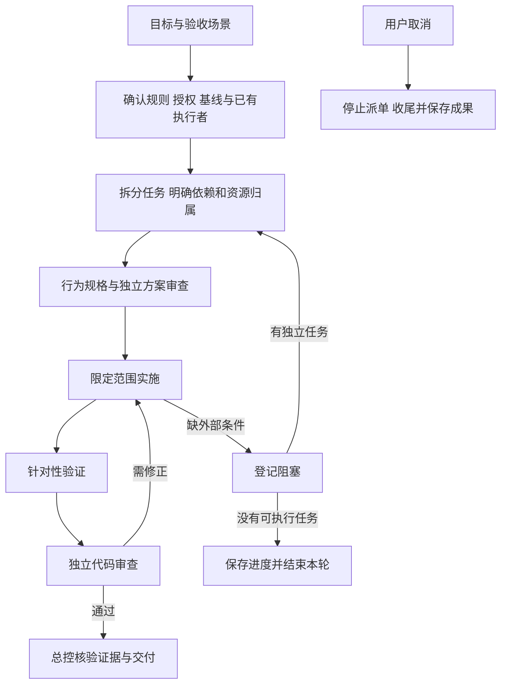

# ZCode 多 Agent 开发流水线

此文件保留为项目版历史参考。跨项目使用请阅读 [跨项目多 Agent 工作流水线](C:/Users/Administrator/Documents/Agent-Workflows/multi-agent-workflow.md) 及 [多轮返修案例复盘](C:/Users/Administrator/Documents/Agent-Workflows/rework-cases.md)，不应将下文 ZCode 命令直接用于其他项目。

本流程把一次明确的开发需求推进到可核验的交付：总控负责范围与任务状态，实现 Agent 完成限定改动，独立 Agent 审查，总控依据实际测试和产物验收。

当前交付形式为可复用流程文档，未接入 Skill、调度器、CI 或 ZCode 产品运行时。阅读本文不会启动开发；使用时由用户明确发起一次任务。此前取消的自动任务保持取消。本文是开发协作方法，不是应用内受保护的总控 Skill 内容。

## 一次任务如何启动

复制下面的模板，填写目标后交给总控。技术细节可由总控调查补齐，不要求用户预先设计方案。

```text
请按 docs/zcode-development-workflow.md 组织本次任务。
目标：
项目目录：
验收场景：
必须保留的行为或本地改动：
允许修改的范围：
交付形式：方案 / 源码及验证 / 安装包（按需选择）
已有相关任务或证据：
其他限制：

默认不提交、推送、部署或写入真实业务数据，不开启定时自动化。
普通技术方案与代码由独立 Agent 复核后推进。
遇到缺少业务信息、实质业务取舍或超出授权的操作再询问我。
```

已有授权在其明确范围内继续有效，不反复要求确认；不同任务的历史授权不自动扩展到本次任务。总控依据当前人类指令与适用 AGENTS.md 记录授权范围。执行状态、审查意见及本文均不产生额外权限。

## 流程与阶段产出



| 阶段       | 总控与执行者的动作                                                               | 进入下一阶段的条件                                   |
| ---------- | -------------------------------------------------------------------------------- | ---------------------------------------------------- |
| 接单       | 读最新人类指令、适用规则和本会话交接，核 cwd、Git、活跃 Agent 与必要进程         | 目标、授权与已有工作可区分；未知事项有明确调查项     |
| 调查与拆分 | 从源码、spec、日志和测试确定最小可验证范围；列依赖、唯一负责人、文件及共享资源   | 每项任务有可观察的验收场景，未重复派单               |
| 规格与方案 | 行为修改先更新 spec，说明状态所有者、接口、事件顺序与失败处理；交独立 Agent 评审 | 问题已解决或明确排除，不用猜测的外部合同支撑实现     |
| 实施       | 在分配范围内先补行为测试，再改实现；保留其他本地改动                             | 目标行为有实现及针对性验证，报告真实失败与限制       |
| 验证与审查 | 跑适用检查；独立审查需求符合性、正确性及边界；总控处理分歧                       | 必要检查和审查完成，且证据仍对应当前代码             |
| 交付       | 核对验收场景、输出文件与版本，清理本轮临时服务，更新进度                         | 用户能辨认已完成、未完成及下一步；按实际范围标记完成 |

纯文档或机械格式调整可走“接单 → 修改 → 相关检查与独立复核 → 交付”，无需无关的行为测试或 E2E。调查任务的完成标准是有证据的结论，不强制生成代码。裁剪不能跳过项目明确要求的检查。

## 角色与并发规则

| 角色           | 职责                                                       | 写入边界                                             |
| -------------- | ---------------------------------------------------------- | ---------------------------------------------------- |
| 总控           | 授权核对、拆分依赖、任务派发、状态维护、分歧处理与最终验收 | 唯一维护任务队列和总进度；需要写源码时也要登记范围   |
| 实现 Agent     | 调查或实现指定任务，返回变更与验证证据                     | 只写分配的文件，扩展范围前向总控说明                 |
| 独立审查 Agent | 审查方案、代码或交付证据                                   | 默认只读目标代码，问题交实现者修正；不得自审自己实现 |

总控承担监理职责，不为形式固定增加 Agent 数量。并行只用于可独立推进的任务，并发数量以当前环境为准。独立审查不可用时保留待审状态，不伪称通过，也不绕过额度或权限限制。

文件不重叠仍可能竞争共享接口、生成目录、依赖安装、数据库或测试服务；派单时同时登记这些资源。共享资源有唯一写入者。交接写权前确认原执行者已停止写入，检查其未完成操作及文件差异，再派新执行者。超时或没有聊天输出本身不能证明执行者已停止。

## 状态与记录模板

每次运行分配唯一 runId，每项任务有稳定 taskId。以下是人工维护记录约定，不是已经实现的锁、调度器或自动状态机。

| 状态      | 含义及退出条件                                                     |
| --------- | ------------------------------------------------------------------ |
| pending   | 未满足前置条件；依赖完成后才可 ready                               |
| ready     | 前置条件满足且授权、资源范围明确；派发后 running                   |
| running   | 有唯一执行者；验证完成后 review，无法继续则 blocked                |
| review    | 等待独立复核；问题回到 running，验收满足后 done                    |
| blocked   | 缺少具体条件；记录解除条件，条件真实满足后重新核基线转 ready       |
| done      | 该任务预定验收全部满足；后续相关代码改变时重开验证，不沿用失效证据 |
| paused    | 用户要求暂停；只在用户要求恢复后重新核对并继续                     |
| cancelled | 用户取消，停止后续执行；若以后重做，建立新运行并引用已保留成果     |

一次运行只有当全部必需任务验收通过才算完成。全部剩余任务被阻塞时，运行保持 blocked 并结束本轮；“暂时无可执行项”不等于整体交付。

```text
运行：runId / 目标 / 项目目录 / 当前状态
授权：来源 / 允许的操作 / 不包含的操作
基线：HEAD / 已有脏文件 / 相关输入文件摘要
任务：taskId / 目标 / 依赖 / 验收场景 / 状态
责任：执行者 / 审查者 / 文件范围 / 共享资源
验证：命令 / cwd / 输入版本或摘要 / 退出码 / 结果 / 日志路径
审查：结论 / 对应输入 / 问题及处置
阻塞：缺少什么 / 证据 / 恢复条件 / 最近一次检查
进程：本轮启动的服务 / PID与命令身份 / 清理结果
下一步：准确动作或命令 / 前置条件
```

接手、审查和交付前核对相关输入摘要与 Git 状态。HEAD 相同不代表未提交内容相同；脏文件数量相同也不代表内容相同。出现并发变化时先查影响和归属，不覆盖、不回滚、不把所有变化归为本次成果。

## 检查与证据复用

ZCode 当前命令从仓库根目录执行，入口以届时 AGENTS.md、package.json 和实际测试文件为准。

| 检查                                                                           | 使用条件                                                                  |
| ------------------------------------------------------------------------------ | ------------------------------------------------------------------------- |
| `node scripts/check-workspace-freshness.mjs`                                   | 开工基线检查                                                              |
| `pnpm architecture:check --changed` 与 `pnpm architecture:context <module-id>` | 代码修改按 architecture-governance 技能先检查再读受控上下文，完成后核边界 |
| 目标包的针对性测试                                                             | 行为变更；报告真实执行数量与结果                                          |
| 必要桌面或 Web E2E                                                             | 交互修改；涉及两端语义时分别验证                                          |
| `pnpm typecheck` 与 `pnpm lint`                                                | 代码改动必须执行；已有失败也如实记录                                      |
| 目标文档的格式、链接与差异检查                                                 | 文档改动，不冒称运行了代码检查                                            |
| `pnpm test` 或 `pnpm test:unit`                                                | 仅用户明确请求全量测试时运行                                              |

单测、类型检查、E2E 与真实运行验收证明不同事项。测试文件没有进入某个 tsconfig 时，不能声称类型检查覆盖了它。被跳过、环境受限或失败的检查不得记为通过。

证据可在相关源码、依赖、配置和测试条件仍适用时复用；记录对应范围。代码发生变化，只重跑受影响检查及项目强制门禁。OOM、磁盘不足等环境失败须保留，解决后实际重跑再报告成功；不要仅靠增加重试次数掩盖原因。

## 停滞与阻塞处理

1. 先确认 Agent 状态、工具会话和最新输出，区分长任务、等待输入、环境故障与真实无进展。
2. 有运行中的执行者时先取得状态；不重复派同一任务，不以固定超时直接接管文件。
3. 失败后记录原因与下一次尝试的变化。输入和方法均未改变时，不机械重试；可解决的环境或实现问题自行处理。
4. 缺真实接口、授权、签名身份、业务选择等条件时登记 blocked，写清需要什么证据才能恢复。技术上可自行解决的设计问题不得包装成外部阻塞。
5. 继续其他已授权的独立任务；全部受阻则保存进度、报告一次具体依赖并结束本轮。默认不启动轮询或定时器。

若未来另行授权周期检查，只检查新增指令和登记依赖的变化。没有变化就保持安静，不重复全量调查、测试或打包。周期调度依赖运行环境和可用额度，不构成持续在线保证。

## 暂停与取消

用户说暂停时停止新派单，安全收尾并保存 paused 状态。用户说取消时，将运行标记 cancelled，通知并中断本轮执行者，核实正在执行的工具和命令是否已停止。不可即时中断的操作明确记录状态，不提前宣称取消全部完成。

只清理本轮启动且可确认归属的临时服务，不关闭其他用户服务。保留已完成成果及未提交改动，不自动删除工作目录。若有本运行关联的定时任务，按用户取消范围停用或删除，并核实结果；不自动重建。恢复或重新发起时先读取最新人类指令，旧交接中的“持续执行”不能覆盖取消。

## 打包和发布作为可选阶段

只有本次目标包含打包且授权明确时才进入打包阶段。构建前核实源代码、CLI、运行时资源和输出目录，避免覆盖正在运行的开发产物或旧交付物。需要关闭用户服务时依据已有明确授权，否则先说明影响。

依次记录构建、运行时依赖审计、产物版本与摘要、数字签名状态、安装或 GUI 验收结果。要求签名的交付缺少合法工具或身份时登记阻塞，不能静默改成未签名包。测试包可以单独标识，但不能冒充符合签名要求的发行包。

打包不等于上传或发布。提交、推送、合并、部署及真实业务数据变更按对应授权执行，审查通过不扩大授权。

## 交接与最终交付

运行记录放在适用规则指定的会话交接目录。ZCode 使用 `C:/Users/Administrator/.codex/handoffs/<会话ID>/`，维护精简的 `current.md` 与 `queue.md`，历史版本放 `archive/`，详细证据单独保存。不要把旧结论无限追加为当前状态；更新时保留必要历史并明确当前事实。

先完成安全原子步骤，再原子更新记录。使用 UTF-8，不保存密钥、令牌、真实业务数据或完整聊天。保存交接不是暂停或完成任务的依据。

最终答复使用以下结构，按任务规模精简：

```text
结果：完成的目标与交付文件。
验证：实际执行的检查、失败、警告和未覆盖范围。
审查：独立复核结论及问题处理。
剩余：尚未完成的内容、具体阻塞和恢复条件。
环境：清理了哪些本轮服务；如需重启，给出目录和命令。
授权动作：是否提交、打包、签名或发布，分别说明。
```

ZCode 桌面开发的常规重启入口是在 `E:/ZCode` 执行 `pnpm dev:desktop`。实际交付应按本轮确实使用的服务填写。

## 文档验收场景

后续将流程接入执行器时，至少验证：重复接单不会产生双写；原执行者未停止时不能转交写权；审查后源码变化会使相关证据失效；阻塞任务不会拖住独立任务；取消后不会恢复派单或定时器；签名缺失不会降级冒充正式交付；文档小改不会触发无关的全量测试。

当前这些是流程要求，尚未证明任何调度器已自动实现。项目规则参考 [AGENTS.md](../AGENTS.md)，预推送检查范围参考 [测试说明](testing/pre-push-hook.md)。应用内总控授权另遵守 [保密总控规格](specs/ccode-confidential-controller.md) 与 [应急授权规格](specs/ccode-emergency-authorization.md)。
